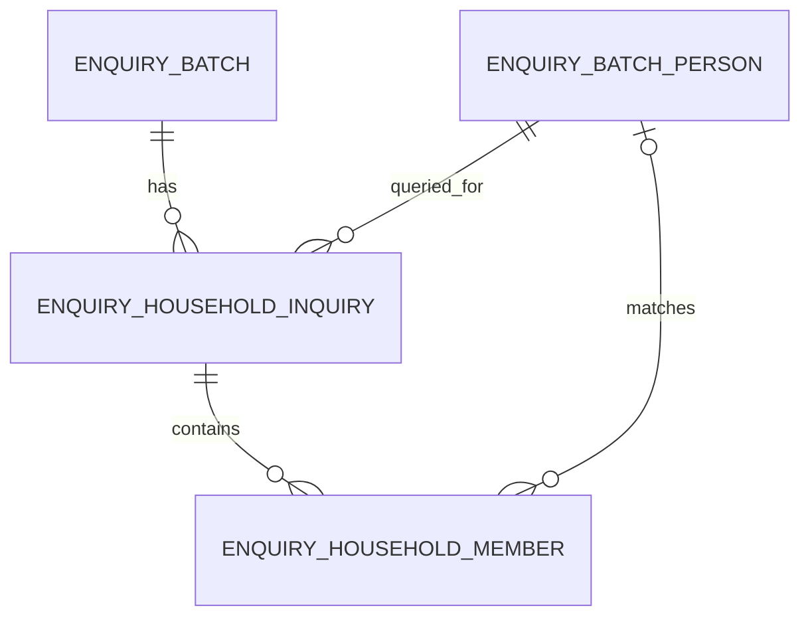

# 戶役政查調資料表規劃

版本 v1.1｜日期 2026-11-08｜資料庫 PostgreSQL

依據：`API客製化_資料項目表_HURC修_1151014.docx`（CP03／P301）及 `backend/enquiry-household-detail.html` 的家庭成員／共居者區塊。

## 1. 資料表範圍與關聯

本模組只使用兩張結果表：`enquiry_household_inquiry`（一次查調結果）及 `enquiry_household_member`（回傳人員明細）。既有案件、批次、人員、逐項授權、社福及閱覽稽核表沿用，不另建。

申請人、配偶、親屬與寄居者共用成員表，不再另建本人表。監護／輔助資料保存為成員的結構化陣列，顯示於個人詳細記事，不另建表。未成年子女查詢不在本次範圍，不規劃相關延伸表。原住民身分沿用社福資格模型保存及顯示，不在這兩張表重複建立欄位。

一次 P301 呼叫包含申請人戶與配偶戶時，只建立一筆查調結果，不因回傳兩戶資料而拆成兩次查詢。重新查調新增結果，不覆寫舊結果。本文為戶政結果的精簡版規格；其他跨機關規格若仍列舊版戶政拆表方式，戶政部分以本文為準。

## 2. `enquiry_household_inquiry`：戶政查調結果

一筆對應一次來源查調，保存回應及兩戶的摘要。既有同名表若已建置，以 migration 調整，不重複建表。

| 欄位 | 型別 | 必填 | 預設值 | 關聯／說明 |
|---|---|---|---|---|
| `id` | `uuid` | 是 | `gen_random_uuid()` | PK |
| `batch_id` | `uuid` | 是 | 無 | FK → `enquiry_batch.id` |
| `subject_person_id` | `uuid` | 是 | 無 | FK → `enquiry_batch_person.id`；本次查詢對象 |
| `api_form_code` | `varchar(10)` | 是 | `'P301'` | 本次來源作業代號 |
| `case_number_snapshot` | `varchar(20)` | 是 | 無 | 案件編號快照 |
| `reference_date` | `date` | 是 | 無 | 本次查調基準日 |
| `status` | `varchar(30)` | 是 | `'PENDING'` | `PENDING`、`COMPLETED`、`FAILED`、`DATA_INCOMPLETE` |
| `response_code` | `varchar(1)` | 否 | NULL | 來源訊息代碼；尚未收到回應時 NULL |
| `response_message` | `varchar(10)` | 否 | NULL | 來源訊息 |
| `error_message` | `varchar(100)` | 否 | NULL | 來源異常訊息 |
| `applicant_household_number` | `varchar(8)` | 否 | NULL | 申請人戶號 |
| `applicant_county_code` | `varchar(5)` | 否 | NULL | 申請人戶籍縣市代碼 |
| `applicant_county_name` | `varchar(20)` | 否 | NULL | 申請人戶籍縣市名稱 |
| `applicant_district_name` | `varchar(30)` | 否 | NULL | 申請人戶籍鄉鎮市區 |
| `spouse_same_household` | `boolean` | 否 | NULL | true 同戶、false 不同戶；無法確認或不適用時 NULL |
| `spouse_household_number` | `varchar(8)` | 否 | NULL | 配偶不同戶時的戶號 |
| `spouse_county_code` | `varchar(5)` | 否 | NULL | 配偶戶籍縣市代碼 |
| `spouse_county_name` | `varchar(20)` | 否 | NULL | 配偶戶籍縣市名稱 |
| `spouse_district_name` | `varchar(30)` | 否 | NULL | 僅其他確認來源有提供時保存；P301 申請文件未列此欄 |
| `completed_at` | `timestamptz` | 否 | NULL | 查調處理結束時間 |
| `response_payload_ref` | `varchar(500)` | 否 | NULL | 加密原始回應的物件位置，不是公開網址 |
| `response_payload_hash` | `char(64)` | 否 | NULL | 原始回應完整性雜湊 |
| `created_at` | `timestamptz` | 是 | `now()` | 建立時間 |

`response_code` 允許 NULL 或 `0`（成功）、`1`（存在收養關係）、`2`（配偶死亡）、`3`（配偶無統號）、`9`（異常）。`status` 與來源代碼分開保存；代碼 `1`、`2`、`3` 保留來源資料及訊息，不一律當成系統失敗。代碼 `9` 不得標為 `COMPLETED`。

索引：`INDEX (batch_id, reference_date)`、`INDEX (subject_person_id, created_at DESC)`。服務層驗證查詢對象屬於同一批次，案件編號與基準日均與批次一致。

## 3. `enquiry_household_member`：戶籍成員明細

申請人本人、配偶本人、兩戶親屬及寄居者均放在本表。`household_scope` 決定列在哪一戶，`person_role` 決定身分標籤；不能用戶籍稱謂代替與申請人／配偶的關係。

| 欄位 | 型別 | 必填 | 預設值 | 關聯／說明 |
|---|---|---|---|---|
| `id` | `uuid` | 是 | `gen_random_uuid()` | PK |
| `household_inquiry_id` | `uuid` | 是 | 無 | FK → `enquiry_household_inquiry.id` |
| `person_id` | `uuid` | 否 | NULL | FK → `enquiry_batch_person.id`；比對成功後填入 |
| `household_scope` | `varchar(30)` | 是 | 無 | `APPLICANT_HOUSEHOLD`、`SPOUSE_HOUSEHOLD` |
| `person_role` | `varchar(20)` | 是 | 無 | `APPLICANT`、`SPOUSE`、`RELATIVE`、`LODGER` |
| `member_order` | `smallint` | 是 | 無 | 同戶顯示順序，從 1 起算 |
| `source_code` | `varchar(30)` | 是 | 無 | 實際資料來源代號；用來區分 P301 與其他既有戶籍來源 |
| `national_id_hash` | `char(64)` | 否 | NULL | 統號 HMAC-SHA256；來源明確無統號時允許 NULL |
| `national_id_encrypted` | `bytea` | 否 | NULL | 統號應用程式加密密文 |
| `id_key_version` | `smallint` | 否 | NULL | 統號加密／HMAC 金鑰版本 |
| `national_id_masked` | `varchar(20)` | 否 | NULL | 遮罩顯示值 |
| `name_snapshot` | `varchar(200)` | 是 | 無 | 本次姓名快照 |
| `birth_date` | `date` | 否 | NULL | 出生日期 |
| `relation_to_applicant` | `varchar(30)` | 否 | NULL | 與申請人關係；本人、配偶、父、女、寄居等 |
| `relation_to_spouse` | `varchar(30)` | 否 | NULL | 與配偶關係；本人、子、母、寄居等 |
| `is_case_member` | `boolean` | 是 | `false` | 本批次原案件名單比對結果；不代表已取得財稅授權 |
| `moved_in_date` | `date` | 否 | NULL | 申請人遷入日期，其他人僅來源有提供時保存 |
| `marital_status_code` | `varchar(1)` | 否 | NULL | 申請人婚姻狀況代碼 |
| `marriage_date` | `date` | 否 | NULL | 結婚日期；只能保存來源值，不能套用網頁範例日期 |
| `spouse_person_id` | `uuid` | 否 | NULL | FK → `enquiry_batch_person.id`；已比對配偶時填入 |
| `spouse_national_id_encrypted` | `bytea` | 否 | NULL | 來源配偶統號密文；未能對應 `spouse_person_id` 時仍可保存 |
| `spouse_id_key_version` | `smallint` | 否 | NULL | 配偶統號加密金鑰版本 |
| `spouse_name_snapshot` | `varchar(200)` | 否 | NULL | 來源配偶姓名；同戶或未回傳配偶本人組時仍保留 |
| `spouse_special_note_code` | `varchar(1)` | 否 | NULL | 空字串現住人口；`3` 喪失國籍、`4` 遷出國外、`5` 喪失身分 |
| `guardian_assistance` | `jsonb` | 否 | NULL | 監護／輔助結構化陣列；NULL 未取得、`[]` 明確無資料 |
| `notes` | `text` | 否 | NULL | 該人個人詳細記事；不取代結構化監護／輔助資料 |
| `created_at` | `timestamptz` | 是 | `now()` | 建立時間 |

限制：`member_order > 0`；`UNIQUE (household_inquiry_id, household_scope, member_order)`；有統號時加部分唯一索引 `UNIQUE (household_inquiry_id, household_scope, national_id_hash) WHERE national_id_hash IS NOT NULL`。同一人出現在兩戶回傳組時，可保留各戶來源列，但以同一 `person_id` 對應，不重複建立批次人員。

索引：`INDEX (household_inquiry_id, household_scope, member_order)`、`INDEX (person_id)`。統號密文與雜湊須成對有效，來源無統號時不得拿姓名當去重鍵。

### 3.1 監護／輔助陣列

陣列每筆保存以下欄位，不另建監護／輔助表；姓名及統號以密文保存，不將敏感明文寫入 JSONB。

| 欄位 | 型別 | 必填 | 預設值 | 關聯／說明 |
|---|---|---|---|---|
| `category` | `string` | 是 | 無 | 受監護宣告、受輔助宣告 |
| `guardian_id_encrypted` | `string` | 否 | NULL | 監護／輔助人統號密文，Base64 編碼 |
| `guardian_name_encrypted` | `string` | 是 | 無 | 監護／輔助人姓名密文，Base64 編碼 |
| `key_version` | `integer` | 是 | 無 | 陣列該筆敏感欄位的加密金鑰版本 |

以 `CHECK (guardian_assistance IS NULL OR jsonb_typeof(guardian_assistance) = 'array')` 限制欄位格式，服務層逐筆驗證欄位與類別。資料放在被監護／輔助人的成員列；P301 此組資料對象是申請人，不可從其他人的記事反推申請人的監護狀態。

## 4. 畫面對應

| 畫面內容 | 資料來源 | 顯示規則 |
|---|---|---|
| 申請人戶標題 | 主表 `applicant_*`、申請人成員的 `moved_in_date` | 戶號、戶籍：縣市．鄉鎮市區、遷入日期 |
| 婚姻與配偶摘要 | 申請人成員的婚姻、結婚日期及 `spouse_*` | 有偶代碼 `2`、`6` 顯示結婚日期；其他狀態若有歷史結婚日期仍可顯示 |
| 申請人戶人員表 | `household_scope = APPLICANT_HOUSEHOLD` | 申請人、親屬、寄居者逐列顯示，關係欄使用 `relation_to_applicant` |
| 配偶戶標題 | 主表 `spouse_*` | 配偶同戶時顯示「與申請人同戶」，不虛構另一戶資料 |
| 配偶戶人員表 | `household_scope = SPOUSE_HOUSEHOLD` | 配偶、親屬、寄居者逐列顯示，關係欄使用 `relation_to_spouse` |
| 個人詳細記事 | 成員 `notes` ＋ 解密後的 `guardian_assistance` | 組成同一欄文字，支援多位監護／輔助人，不另設區塊 |
| 原住民身分 | 沿用 `enquiry_welfare` 對應資格 | 只顯示於社福資格；來源代碼 `0` 不建立符合資格紀錄，缺值不推定為 `0` |

人員表欄位順序為「身分、姓名、與申請人／配偶關係、案件成員、統號、出生日期、個人詳細記事」。畫面空值顯示「無」，是／否欄位顯示「否」；這只是顯示規則，資料庫仍保留 NULL、空陣列、false 及失敗狀態的差異。

## 5. 寫入與必要檢核

收到查調時建立主表；回應後更新狀態及戶籍摘要，並寫入成員明細。只有申請人本人資料包含的配偶統號／姓名時，保存在申請人成員的 `spouse_*`，不補造未回傳的配偶本人生日等欄位。

配偶同戶時，不因配偶戶三組資料未回傳就判定異常；也不得僅憑三組資料缺漏就推定同戶，須由明確來源資訊確認。婚姻查詢失敗或缺值時，婚姻代碼保持 NULL，不得當成未婚。

寄居者保留在名單中，角色為 `LODGER`，關係顯示「寄居」。P301 申請文件不保證提供寄居者名單，若資料來自其他既有戶籍來源，須記錄實際 `source_code`，不可由三親等結果推造寄居者。

`is_case_member` 由本批次原案件名單比對；未列入案件或顯示為寄居者，不等於已授權或未授權。財稅查調仍依既有逐人逐項授權表判斷，不在戶政表複製授權狀態。

婚姻代碼沿用文件 `1` 至 `9`；配偶特殊記事的 NULL 與空字串分開保存。原住民來源代碼轉寫既有社福模型時，保留代碼對應及戶政來源識別，避免與其他機關資格混淆。

## 6. 保存與整合

統號用 HMAC 比對、加密密文保存，金鑰不放資料庫。姓名、生日、戶籍、記事與監護／輔助資料受既有角色權限及批次保存期限控管；原始回應只留加密物件位置與雜湊，不存整包明文 JSONB。

主表及成員表須納入 `enquiry_batch` 的內容到期清除；加密回應物件與監護／輔助陣列亦同。閱覽沿用 `enquiry_view_log`，不另外建戶政專用稽核表。

若舊版表已建置，先將本人資料併入成員列、監護／輔助明細轉為對應人的陣列，驗證筆數與欄位後再移除舊表；尚未建置則直接按本版建立兩表。與既有欄位名稱不同的關聯需於同一 migration 調整，不平行維護兩套戶政結果。
