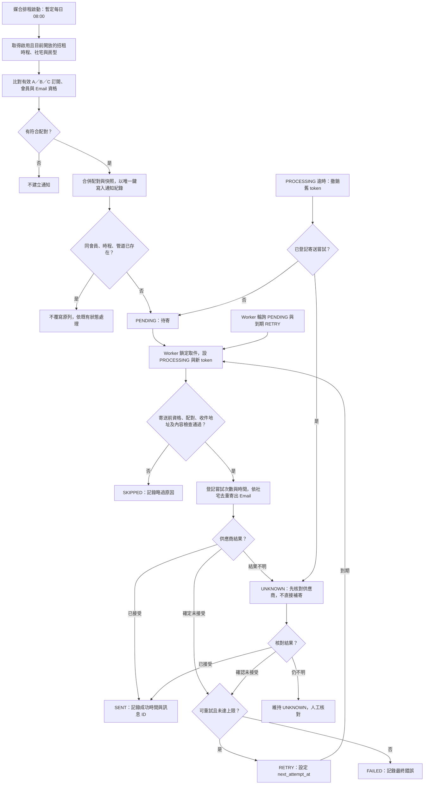

# A6.3 招租通知

v1.11｜2026-11-16｜PostgreSQL｜時間採 `timestamptz`，顯示時區採 `Asia/Taipei`。依[訂閱管理規格](訂閱管理_規格.md)中 `member_subscription.status = 'ACTIVE'` 的有效訂閱，與既有招租時程媒合後寄送 Email。

## 一、通知表 `subscription_notification_log`

一列為「會員 × 招租時程 × EMAIL」通知兼待寄作業；重試更新原列。

| 欄位 | 型態 | 規則 |
|---|---|---|
| id | uuid | PK；DEFAULT gen_random_uuid() |
| member_id | uuid | 必填；FK → member_profile.id |
| schedule_id | uuid | 必填；FK → rental_schedule.id |
| channel | varchar(20) | 必填；DEFAULT 'EMAIL'，本期限 EMAIL |
| recipient_email | varchar(254) | 必填；收件地址快照 |
| match_snapshot | jsonb | 必填；配對陣列，結構如下 |
| content_snapshot | jsonb | 必填；信件內容快照，結構見下表 |
| status | varchar(20) | 必填；DEFAULT 'PENDING'；狀態見第三章 |
| attempt_count | integer | 必填；DEFAULT 0；非負，呼叫前登記次數 |
| last_attempt_at | timestamptz | 最近登記寄送時間 |
| next_attempt_at | timestamptz | 僅 RETRY 必填，其餘 NULL |
| processing_started_at | timestamptz | 僅 PROCESSING 必填，其餘 NULL |
| processing_token | uuid | 僅 PROCESSING 必填，每次取件產生新值，其餘 NULL |
| provider_message_id | varchar(200) | 供應商訊息 ID |
| last_error_code | varchar(50) | 最近失敗／不明／略過原因代碼 |
| last_error_detail | text | 最近錯誤說明，去除敏感資料、限 1,000 字 |
| created_at | timestamptz | 必填；DEFAULT now() |
| updated_at | timestamptz | 必填；DEFAULT now()；異動時更新 |
| sent_at | timestamptz | 僅 SENT 必填，其餘 NULL |

`match_snapshot` 每項：

| 欄位 | JSON 型態 | 規則 |
|---|---|---|
| subscription_id | string | 訂閱 UUID，須屬於收件會員 |
| subscription_type | string | A／B／C |
| housing_id | string | 社宅 UUID，須屬於該招租時程 |
| survey_id | string 或 null | A 使用的問卷 UUID；B／C 為 null |
| criteria_effective_at | string | 生效時間，ISO 8601 含時區 |
| matched_room_type_ids | array of string | A／B 為符合房型及預算的本次開放房型 UUID；C 為該社宅本次所有開放房型 UUID |

上述 JSON 屬性均須提供。每組 `(subscription_id, housing_id)` 唯一，信件按 housing_id 去重。JSON 配對由服務驗證；新建 PENDING 至少一組，複核後 SKIPPED 可為空。

`content_snapshot` 欄位：

| 欄位 | JSON 型態 | 規則 |
|---|---|---|
| template_version | string | 信件模板版本 |
| apply_start_at | string | 招租申請開始時間，ISO 8601 含時區 |
| apply_end_at | string | 招租申請結束時間，ISO 8601 含時區 |
| housings | array of object | 信件列出的社宅，依 housing_id 去重 |
| housings[].housing_id | string | 社宅 UUID |
| housings[].name | string | 社宅名稱 |
| housings[].county_name | string | 縣市名稱 |
| housings[].district_name | string 或 null | 行政區名稱；來源無行政區為 null |

## 二、索引與限制

| 表 | 索引 |
|---|---|
| subscription_notification_log | UNIQUE `(member_id, schedule_id, channel)` |
| subscription_notification_log | INDEX `(status, next_attempt_at, created_at)` WHERE status IN ('PENDING', 'RETRY') |
| subscription_notification_log | INDEX `(processing_started_at)` WHERE status = 'PROCESSING' |
| subscription_notification_log | INDEX `(member_id, created_at DESC)` |

CHECK 通知狀態及其必要欄位、match_snapshot 為陣列。FK 不採 ON DELETE CASCADE；取消、停用不刪通知歷史。

## 三、通知流程

### 排程流程圖

### 媒合

取啟用且 `apply_start_at <= now() <= apply_end_at` 的 rental_schedule；透過 rental_schedule_housing_room_type 取得啟用社宅及本次開放房型。訂閱 status 為 ACTIVE、會員啟用且 Email 已驗證才建單。暫採 `criteria_effective_at <= apply_start_at`，是否補寄已開始招租待確認。

A 須由會員在完成登記後自行確認訂閱。只有 SUBMITTED 問卷、尚無 A 訂閱列的會員，其問卷供登記與即時推薦使用。A 首次訂閱的 criteria_effective_at 取確認訂閱當下時間。

| 項目 | 規則 |
|---|---|
| A／B／C | A 讀目前關聯問卷的區位、房型、預算、公設，B 讀保存的相同四類條件，C 比對 housing_id。依訂閱管理標註圖，本版暫不納入生活機能及社宅名稱關鍵字。 |
| 區位 | 先套縣市／生活圈，再套行政區；全部未選為不限。由 housing 接 county／district／living_area_county。A「全區」沿用問卷展開行政區規則 |
| 房型與租金 | 同一社宅的同一本次開放房型，接 housing_room_type；租金區間與預算有交集即符合。訂閱 NULL 端點不限；有預算限制但房型租金不完整則不符合 |
| 公設 | 公設取 housing_facility，指定條件缺資料時不視為符合。 |
| 條件組合 | 各筆訂閱獨立判斷，任一筆符合即納入該會員通知（訂閱間 OR）。單筆訂閱內各條件類別 AND，區位、房型的多選內 OR，公設多選規則須與找社宅一致。 |

### 建單與寄送

| 步驟 | 處理 |
|---|---|
| 排程 | 暫定每日 08:00，可設定；短期招租需縮短間隔或於開放時觸發。訂閱 API 不同步寄信 |
| 建單 | 分批媒合，按會員＋時程合併，以唯一鍵及 ON CONFLICT DO NOTHING 寫入 PENDING 與快照，衝突不覆寫 |
| 取件 | 短交易以 FOR UPDATE SKIP LOCKED 取 PENDING／到期 RETRY，改 PROCESSING 並填時間、新 token；提交後才呼叫郵件服務 |
| 複核 | 重查訂閱 status = 'ACTIVE'、啟用會員、已驗證 Email、開放時程及媒合條件。首次登記寄送前，以目前資料重算全部配對（可增可減），並將 recipient_email 更新為會員目前已驗證 Email；無配對則 SKIPPED |
| 寄送 | 確認 token 後登記 attempt_count、last_attempt_at；供應商支援時以 `rental-notice:{id}` 為固定冪等鍵。結果更新須符合 id、PROCESSING 與本次 token |
| 中斷 | 逾時 PROCESSING 撤銷 token；未登記嘗試可回 PENDING，否則轉 UNKNOWN 核對供應商，不直接重寄 |

已登記寄送嘗試後，收件地址、配對與內容凍結。重試前複核若任一配對失效、會員目前 Email 已不同於收件地址，或內容須變更，該筆 SKIPPED，不向舊地址寄送，也不縮減內容後沿用原冪等鍵。每會員每時程最多一封通知；通知建立後新增的訂閱，只在首次登記寄送前納入。

### 狀態處理

| 狀態 | 定義／後續 |
|---|---|
| PENDING | 待取件 |
| PROCESSING | 處理中；離開時清空工作時間與 token |
| RETRY | 確定未接受且可重試；到 next_attempt_at 後取件 |
| UNKNOWN | 結果不明；確認接受轉 SENT、未接受才可重試或 FAILED；無法確認則維持並人工核對 |
| SENT | 供應商已接受，填 sent_at；不重寄、不改快照 |
| FAILED | 永久失敗或達上限，結案 |
| SKIPPED | 無有效配對、資格失效或地址／內容變更，記原因並結案 |

暫定最多 3 次嘗試（含首次），重試間隔 30、60 分鐘且須在招租截止前。SENT／FAILED／SKIPPED 不自動重開；同時程改期、增加社宅或重新訂閱不追加通知。

