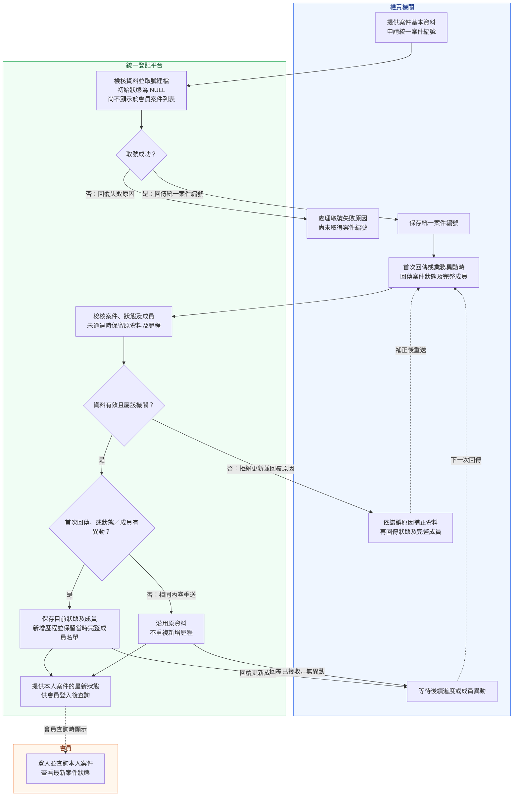
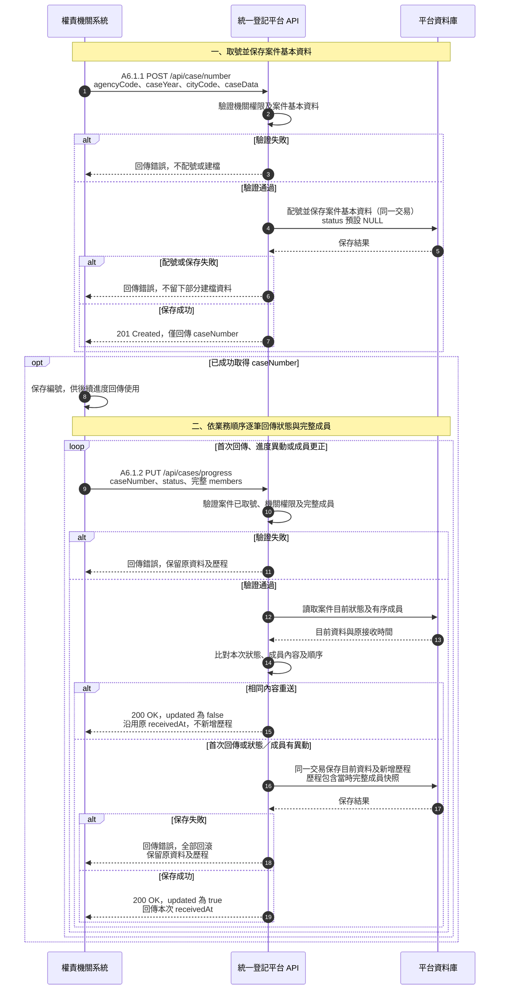

# 申請案件查詢功能規格

## 一、基本資訊

| 項目 | 說明 |
|---|---|
| 功能名稱 | 申請案件查詢 |
| 所屬模組 | 前臺會員功能 |
| 畫面連結 | [開啟申請案件查詢](../progress.html) |
| 文件日期 | 2026/11/16 |
| 使用對象 | 已登入會員 |
| 主要功能 | 查看個人社會住宅申請案件、案件狀態與權責機關，確認後前往權責機關網站 |
| 目前狀態 | 靜態前端展示版，固定顯示 5 筆範例；尚未串接會員案件查詢、登入驗證或跨機關狀態同步服務 |
| 規格依據 | 現行 progress.html、assets/css/pages/progress.css，以及本次確認的編碼與外連需求 |

本文件區分「已確認需求／目前畫面」、「正式串接待確認事項」、第十節「API 設計草案」、第十一節「案件基本資料表」及第十二節「取號至狀態更新流程與循序圖」。範例案件編碼、房型、申請時間及案件狀態均為展示資料，不代表真實申請或實際招租進度。

## 二、頁面入口與查詢範圍

- 會員主導覽點選「進度查詢」，開啟 progress.html。
- 頁面主標題為「申請案件查詢」。
- 說明文字為「以下為您的社會住宅申請案件紀錄。」。
- 標題區顯示「共 N 筆」；目前範例為「共 5 筆」。正式串接時須依回傳的會員案件總筆數顯示。
- 正式功能僅可查閱登入會員本人的申請案件；後端身分驗證及資料授權尚未實作。
- 目前沒有關鍵字搜尋、條件篩選、手動排序、分頁或匯出功能。
- 範例依申請時間由新至舊排列，但目前是固定 HTML 順序，並非動態排序。
- 共用頁首、會員選單、通知中心、頁尾及客服沿用會員版型，其完整規則不屬於本頁專屬功能。

## 三、案件列表

### 3.1 欄位順序及呈現

| 順序 | 欄位 | 顯示規則 | 範例 |
|---|---|---|---|
| 1 | 申請社宅 | 第一行顯示社宅名稱，第二行顯示「縣市／行政區」 | 江翠玫瑰社會住宅；新北市／板橋區 |
| 2 | 房型 | 顯示該筆申請房型 | 一房型、二房型、三房型 |
| 3 | 統一案件編碼 | 顯示完整 14 字元編碼，不加連字號或空白，字級至少 16px | CH115A00000842 |
| 4 | 申請時間 | 民國日期與 24 小時制時間分兩行顯示 | 115/11/02；13:17 |
| 5 | 案件狀態 | 僅顯示「已受理」「已入住」「已退租」其中之一 | 已受理 |
| 6 | 權責機關 | 顯示負責該案件的機關名稱，固定放在案件狀態右側 | 國家住宅及都市更新中心 |
| 7 | 操作 | 顯示「前往查看」，點選後先開啟外部網站確認視窗 | 前往查看 |

本頁不顯示「補件期限」「身分別」「中籤結果」，亦不提供補件、修改申請或取消申請操作。需至權責機關平台查看後續內容。

### 3.2 案件狀態

| 顯示值 | 業務含義 | 目前呈現 |
|---|---|---|
| 已受理 | 案件已由權責機關受理 | 藍色標籤 |
| 已入住 | 案件已進入入住階段 | 綠色標籤 |
| 已退租 | 案件已完成退租 | 灰色標籤 |

- 本頁僅呈現案件狀態，不允許會員修改。
- 不使用「須補件」「審查中」「合格」「已抽籤」「已簽約」作為本頁列表狀態。
- 各來源系統如何對應至上述三種狀態，須於介接時另行確認；不能將未知狀態自行當成「已受理」。
- 三種狀態的範例案件皆提供「前往查看」。

## 四、統一案件編碼

### 4.1 組成格式

```text
機關代碼 agencyCode（2 碼）＋案件年度 caseYear（民國 YYY，3 碼）＋縣市代碼 cityCode（1 碼）＋流水號（8 碼）

CH115A00000842
CH       ：機關代碼（第 1–2 碼）
115      ：民國案件年度（第 3–5 碼）
A        ：縣市代碼（第 6 碼）
00000842 ：8 碼流水號（第 7–14 碼）
```

| 區段 | 字元位置 | 格式與規則 |
|---|---|---|
| 機關代碼 | 第 1–2 碼 | 2 個大寫英文字母，須存在於來源機關代碼表 |
| 案件年度 | 第 3–5 碼 | 3 碼民國年度，例如 115、116 |
| 縣市代碼 | 第 6 碼 | 1 個大寫英文字母，須存在於平台縣市代碼對照資料 |
| 流水號 | 第 7–14 碼 | 8 位數字，未滿 8 位時左側補 0，例如 842 → 00000842 |

- 編碼總長度固定為 14 字元。
- 格式檢核可使用 `^[A-Z]{2}[0-9]{3}[A-Z][0-9]{8}$`，另須檢核機關代碼與縣市代碼是否有效。
- 編碼應以字串儲存及傳遞，保留流水號前導零。
- 畫面直接顯示正式取得的統一案件編碼，不在前端以列序或當年度自行生成。
- 目前範例的案件年度與申請日期年度一致；跨年度案件的年度認定仍須由後端業務規則定義。流水號配號範圍依 A6.1.1。

### 4.2 來源機關代碼 AgencyCode

依使用者提供之 P1「來源機關代碼 AgencyCode」對照表整理：

| 機關代碼 | 機關名稱 | 備註 |
|---|---|---|
| CH | 國家住宅及都市更新中心 | 國家住都中心 |
| LF | 新北市住宅及都市更新中心 | 新北市政府 |
| LA | 臺北市住宅及都市更新中心 | 臺北市政府 |
| LH | 桃園市住宅及都市更新中心 | 桃園市政府 |
| LB | 臺中市住宅發展工程處 | 臺中市政府 |
| LD | 臺南市政府都市發展局 | 臺南市政府 |
| LE | 高雄市住宅及都市更新中心 | 高雄市政府 |

機關代碼依案件來源機關判定，不能僅由社宅所在地縣市推定。例如位於新北市、但由國家住都中心負責的案例仍使用 CH。

## 五、前往查看與外部網站確認

### 5.1 操作流程

1. 會員點選任一案件的「前往查看」。
2. 阻止直接跳轉，記錄該筆案件的外連網址，開啟模態確認視窗。
3. 目前國家住都中心案例顯示下列訊息：

   > 您即將前往 國家住宅及都市更新中心 網站

4. 視窗提供「確定」「取消」兩個按鈕，畫面順序為確定在前、取消在後。
5. 選擇「確定」後，於新分頁開啟該筆連結，關閉確認視窗，保留原案件列表頁。
6. 選擇「取消」或按 Escape，關閉確認視窗，不開啟外部網站。
7. 視窗關閉後，鍵盤焦點回到原本點選的「前往查看」。

### 5.2 外連設定

| 項目 | 規則 |
|---|---|
| 目前權責機關 | 國家住宅及都市更新中心 |
| 目前目的網站 | 安居好室入口網 |
| 目前網址 | https://www.socialhousing.tw/ |
| 開啟方式 | 新分頁，使用 noopener、noreferrer |
| 確認視窗初始焦點 | 取消 |
| 確認訊息字級 | 18px |
| 確定／取消字級 | 16px |
| 確定／取消最小高度 | 44px |

- 目前 5 筆範例皆連到入口網首頁，並未帶入案件編碼或導向特定案件明細。
- 本頁未實作跨站單一登入；外部網站是否要求登入，由該網站處理。
- 正式支援多機關時，訊息須依該筆案件顯示「您即將前往 {權責機關名稱} 網站」，目的網址亦須使用對應機關平台；目前程式訊息固定為國家住都中心。

## 六、響應式與可及性

| 視窗寬度 | 列表呈現 |
|---|---|
| 大於 1024px | 桌機表格，依七個欄位水平排列 |
| 681–1024px | 每筆案件改為兩欄排列；社宅名稱與操作區各占整列，欄位附顯示標籤 |
| 680px 以下 | 每筆案件改為單欄排列，操作按鈕占滿可用寬度 |

- 手機版欄位順序與桌機版一致，不遺漏「權責機關」。
- 統一案件編碼於桌機及手機版皆至少 16px；窄螢幕允許換行以避免溢出。
- 確認視窗採原生 dialog 模態顯示，具備可辨識的訊息標籤、鍵盤操作與焦點提示。
- 外連控制項提供可辨識的輔助名稱，說明前往平台及另開分頁。
- 狀態以文字搭配顏色呈現，不單靠顏色辨識。

## 七、目前展示資料

以下資料為目前靜態畫面的既有展示資料，不代表真實申請結果。表內案件編碼仍為舊版 13 字元格式；正式介接及新版驗收須改用第四節含 cityCode 的 14 字元格式，本次僅更新規格，未調整靜態頁面。

| 社宅名稱 | 所在地區 | 房型 | 統一案件編碼 | 申請時間 | 案件狀態 | 權責機關 |
|---|---|---|---|---|---|---|
| 江翠玫瑰社會住宅 | 新北市／板橋區 | 三房型 | CH11600000123 | 116/03/18 10:32 | 已受理 | 國家住宅及都市更新中心 |
| 鶯陶安居社會住宅 | 新北市／鶯歌區 | 二房型 | CH11600000118 | 116/03/15 14:08 | 已受理 | 國家住宅及都市更新中心 |
| 公誠安居社會住宅 | 南投縣／埔里鎮 | 一房型 | CH11600000096 | 116/03/10 09:21 | 已受理 | 國家住宅及都市更新中心 |
| 開南安居社會住宅 | 臺南市／南區 | 二房型 | CH11600000075 | 116/02/26 16:42 | 已入住 | 國家住宅及都市更新中心 |
| 仁武安居社會住宅 | 高雄市／仁武區 | 二房型 | CH11500000842 | 115/11/02 13:17 | 已退租 | 國家住宅及都市更新中心 |

## 八、正式串接待確認事項

以下尚未於目前原型實作，應於正式開發前確認，不視為已有功能：

| 項目 | 待確認內容 |
|---|---|
| 會員身分與權限 | 登入驗證、未登入導向、Session 失效處理，以及後端僅回傳本人案件的授權規則 |
| 案件資料介接 | 第十節已提出 API 路徑與欄位草案；正式部署、主檔與同步時機待確認 |
| 統一編碼配號 | 第十節提出平台按機關／年度／縣市配號、編碼唯一性及每次呼叫配發新號；案件年度認定待確認 |
| 狀態對應 | 各來源狀態到三種顯示狀態的映射及無法映射時的處理 |
| 權責機關與網址 | 多機關顯示名稱、有效網址設定、目的網址檢核及是否提供案件深層連結 |
| 顯示筆數與排序 | 正式排序規則、大量資料是否分頁、總筆數計算方式 |
| 載入與異常情境 | 載入中、無案件、查詢失敗、資料缺漏及重試的畫面與文案 |
| 外連失敗 | 網址缺漏、網站停用及新分頁遭瀏覽器阻擋時的提示 |
| 名稱一致性 | 目前主標題為「申請案件查詢」，瀏覽器標題仍為「申請進度查詢」、主導覽仍為「進度查詢」；是否一併更名待確認 |

## 九、驗收項目

| 編號 | 檢查項目 | 預期結果 |
|---|---|---|
| AC-01 | 開啟頁面 | 顯示「申請案件查詢」、說明文字及共 5 筆範例 |
| AC-02 | 欄位順序 | 七欄依序為申請社宅、房型、統一案件編碼、申請時間、案件狀態、權責機關、操作 |
| AC-03 | 已移除欄位 | 不顯示補件期限、身分別、中籤結果 |
| AC-04 | 編碼結構 | 新版案件編碼為 2 碼機關代碼＋3 碼民國年度＋1 碼縣市代碼＋8 碼流水號，總長 14 字元，無分隔符號；靜態頁面舊範例待同步 |
| AC-05 | 前導零 | 00000842 等流水號完整保留，不省略前導零 |
| AC-06 | 編碼字級 | 桌機與手機版皆至少 16px |
| AC-07 | 案件狀態 | 僅出現已受理、已入住、已退租 |
| AC-08 | 權責機關 | 國家住都中心案例顯示完整機關名稱，位於案件狀態右側 |
| AC-09 | 點選前往查看 | 先顯示指定確認訊息，不立即跳轉 |
| AC-10 | 確定外連 | 點選確定後，另開安居好室入口網，原頁保留 |
| AC-11 | 取消與 Escape | 關閉確認視窗且不開新分頁，焦點回原控制項 |
| AC-12 | 重複操作 | 取消後再點其他案件，確認視窗正常開啟，使用本次選取的連結 |
| AC-13 | 響應式呈現 | 桌機七欄、平板兩欄、手機單欄，標籤對應正確且內容可讀 |
| AC-14 | 正式介接驗收 | 待第八節事項定案後，補驗登入授權、本人資料隔離、動態筆數、資料異常與多機關外連 |

## 十、API 設計（草案）

本節為簡易介接設計，供確認及開發使用；目前靜態頁面尚未實作以下 API。呼叫方向均為「權責機關系統 → 統一登記平台」。本版將兩支 API 的責任區分如下：

| API | 接收資料 | 寫入範圍 | 回傳 |
|---|---|---|---|
| A6.1.1 統一案件編碼取號API | 來源權責機關代碼、民國案件年度、社宅所在地縣市代碼、案件基本資料（申請日期、申請社宅代碼、申請房型代碼） | 配號並建立案件基本資料 | 統一案件編號 |
| A6.1.2 案件進度回傳API | 統一案件編號、狀態、完整成員清單 | 更新既有案件的進度及成員，狀態或成員異動時新增含完整成員快照的歷程 | 接收結果 |

### 共通規則

- 使用 HTTPS，請求與回應採 JSON、UTF-8；`Content-Type: application/json`。
- 使用機關服務憑證：`Authorization: Bearer {access_token}`；憑證須綁定可操作的 agencyCode，不使用民眾登入憑證呼叫。
- 案件編號、機關代碼、民國年度、縣市代碼、社宅代碼及房型代碼皆使用字串；代碼不以顯示名稱替代。
- 申請日期沿用 `appliedAt` 傳遞申請日期與時間，採含時區的 ISO 8601，例如 `2026-11-05T10:32:00+08:00`，供現行列表顯示申請時間；生日採西元日期 `YYYY-MM-DD`。
- 每次請求須全筆驗證成功後才在同一資料庫交易中寫入；失敗不部分配號、建立或更新資料。
- 請求欄位以各 API 欄位表為準；未定義的欄位回應 422，不默默忽略或改寫其他資料。
- 下列社宅代碼與人員資料均為文件示意。範例身分證字號為刻意不可驗證的占位值，不可直接作為正式 API 測試資料。

### A6.1.1 統一案件編碼取號API

#### 1. 用途與路徑

權責機關建立申請案件時，提供取號所需代碼及案件基本資料。平台驗證後配發一組統一案件編號，並同步建立第十一節的 `application_case` 案件基本資料。取號時不收案件狀態或成員，亦不預設為「已受理」；狀態及成員由 A6.1.2 回傳。

```http
POST /api/case/number
Authorization: Bearer {access_token}
Content-Type: application/json
```

#### 2. 請求欄位

| 欄位 | 型別 | 必填 | 說明 |
|---|---|---|---|
| agencyCode | string(2) | 是 | 來源權責機關代碼，例如 CH；須符合第四節機關代碼及憑證授權 |
| caseYear | string(3) | 是 | 民國案件年度，例如 115；由機關依案件年度送入，不取系統當年度覆寫 |
| cityCode | string(1) | 是 | 社宅所在地縣市代碼，須為平台對照資料中的 1 個大寫英文字母；寫入案件編號第 6 碼 |
| caseData | object | 是 | 案件基本資料 |
| caseData.appliedAt | string(datetime) | 是 | 原始申請日期與時間；非本次取號時間 |
| caseData.housingCode | string(1–50) | 是 | 申請社宅代碼，須能依來源機關及社宅代碼對應唯一社宅主檔；不傳社宅名稱 |
| caseData.roomTypeCode | string(1–30) | 是 | 申請房型代碼，例如 2R；對應 `housing_class` 的 ROOM_TYPE 群組，不傳「二房型」等顯示文字 |

```json
{
  "agencyCode": "CH",
  "caseYear": "115",
  "cityCode": "A",
  "caseData": {
    "appliedAt": "2026-11-05T10:32:00+08:00",
    "housingCode": "DEMO-HOUSING-001",
    "roomTypeCode": "2R"
  }
}
```

#### 3. 取號及建檔規則

1. 先驗證憑證、agencyCode、3 碼民國年度、cityCode 及全部案件基本資料，再進行配號。必填資料缺漏、日期格式無效、代碼無效或所在地不一致時回應 422，不配號或建立案件。
2. housingCode 須透過來源機關與社宅代碼的對應規則解析為 `housing.id`；既有 `housing` 使用 `(agency_id, no_build)` 識別社宅，不假設有名為 housing_code 的唯一欄位。cityCode 須經字母代碼與 `county` 的對照驗證為該社宅所在縣市；roomTypeCode 須為 ROOM_TYPE 有效代碼且屬於該社宅的房型。
3. 以「agencyCode＋caseYear＋cityCode」為配號範圍，各組流水號由 00000001 起算。統一案件編號＝2 碼機關代碼＋3 碼民國年度＋1 碼縣市代碼＋8 碼流水號，例如 `CH115A00000842`，總長 14 字元。
4. 在同一交易中原子更新配號計數並新增案件基本資料，對案件編號及配號組合設定唯一限制，避免併發重號。案件建立失敗時整筆回滾，不回傳成功編號。
5. 每次成功呼叫均配發一組新編號並建立一筆案件基本資料；不判斷是否同一申請或重複取號，不要求來源案件識別碼或冪等鍵。逾時後重新呼叫可能取得另一組編號，由機關自行選定一組使用。
6. 未使用的編號及其案件基本資料保留，狀態為 NULL 且沒有成員，不列入會員案件列表。同一申請若有多組編號皆成功回傳進度與成員，將視為多筆案件，平台不自動合併。
7. 已配發編號不回收、不重用，不保證流水號連續無缺號；達 99999999 後回應 409，不擴充碼長或從頭重用。
8. 編號、機關、年度、縣市及案件基本資料不由 A6.1.2 修改；基本資料更正方式另行確認。

#### 4. 成功回應

回應 `201 Created`，回傳本次新配發的統一案件編號。

```json
{
  "caseNumber": "CH115A00000842"
}
```

### A6.1.2 案件進度回傳API

#### 1. 用途與路徑

權責機關以已取得的統一案件編號，回傳案件狀態及完整成員清單。此 API 更新進度與成員，在首次回傳或狀態、成員任一異動時新增含完整成員快照的案件歷程。取號時的案件基本資料沿用原值。歷程由平台自動建立。

```http
PUT /api/cases/progress
Authorization: Bearer {access_token}
Content-Type: application/json
```

`caseNumber` 須對應 A6.1.1 已建立的案件，且歸屬呼叫憑證授權機關；未取號案件不得自動新增。來源機關代碼由案件主檔及憑證判斷，不在本 API 重複傳入。

#### 2. 請求欄位

| 欄位 | 型別 | 必填 | 說明／畫面對應 |
|---|---|---|---|
| caseNumber | string(14) | 是 | 統一案件編號，須為 A6.1.1 已配發的有效編號 |
| status | string(enum) | 是 | ACCEPTED（已受理）／MOVED_IN（已入住）／MOVED_OUT（已退租） |
| members | array<object> | 是 | 完整成員清單，至少一人；第一個成員 `members[0]` 一律為申請人本人，其餘為其他成員 |
| members[].nationalId | string(10) | 是 | 身分證字號，正式資料須通過格式及檢查碼驗證，同一案件不得重複 |
| members[].name | string(1–200) | 是 | 姓名，不可為空白 |
| members[].birthDate | string(date) | 是 | 生日，西元 `YYYY-MM-DD`；須為有效日期且不得晚於臺灣當日日期 |
| members[].gender | string(1–20) | 是 | 性別文字，例如「男」「女」；不可為空白，不由身分證字號自動推定；其他值的對照另待確認 |
| members[].title | string(1–50) | 是 | 稱謂文字，例如「本人」「配偶」「子女」；不使用代碼，不可為空白；申請人身分一律依陣列第一筆判定，不依稱謂猜測 |

| status 值 | 前臺顯示 |
|---|---|
| ACCEPTED | 已受理 |
| MOVED_IN | 已入住 |
| MOVED_OUT | 已退租 |

#### 3. 請求範例

```json
{
  "caseNumber": "CH115A00000842",
  "status": "ACCEPTED",
  "members": [
    {
      "nationalId": "A000000000",
      "name": "測試申請人",
      "birthDate": "1990-05-20",
      "gender": "男",
      "title": "本人"
    },
    {
      "nationalId": "B000000000",
      "name": "測試案件成員",
      "birthDate": "1992-08-15",
      "gender": "女",
      "title": "配偶"
    }
  ]
}
```

#### 4. 接收、更新與顯示規則

1. 以 caseNumber 查找案件基本資料；格式無效回應 422，未配發回應 404，非憑證授權機關的案件回應 403。均不新增案件或更新資料。
2. 僅接受上述三種狀態，不將未知值當成「已受理」。接受任一有效狀態以支援補登及更正；正式狀態轉換限制另依來源業務規則確認。
3. 每次須傳入完整 members，至少一人且每人五個欄位皆必填。缺漏、空陣列、空白文字、無效生日或身分證字號重複等情形回應 422，狀態與成員均不更新。
4. 保留成員傳入順序，將 `members[0]` 存為 `member_order = 1`，代表申請人本人；不得先依姓名、生日或稱謂重新排序。其餘成員依序由 2 起算。
5. 在同一交易內鎖定案件、讀取目前狀態與有序成員，更新案件與必要的完整成員清單，並於首次回傳或狀態、成員任一異動時新增一筆 `application_case_status_history`。每筆保存更新後完整成員加密快照，依異動範圍填入 change_type。首次進度記錄 `NULL → 本次狀態`；僅成員異動時前後狀態相同；更正亦追加歷程。任一步驟失敗全數回滾。僅送申請人一筆代表目前成員改為一人，送 [] 為驗證失敗。
6. 本版請求不含 revision、來源異動時間或狀態生效時間。平台以同一案件取得資料列鎖並成功提交的順序保存最新內容；機關須依業務發生順序逐筆呼叫，前筆完成後再送下一筆，避免舊資料晚到覆蓋。平台無法由本介面判斷來源資料的新舊，不以接收時間推定來源狀態生效時間。
7. 相同狀態及相同有序成員清單重送時，回應成功，updated 為 false，回傳原接收時間並保留歷程筆數。僅成員異動時，更新成員及進度接收時間，updated 為 true，新增 MEMBERS_CHANGED 歷程與完整成員快照。比對採正規化業務內容。若其間已有其他內容更新，舊內容重送仍可能覆蓋，須依前項順序處理。
8. 會員列表資料取自 A6.1.1 已儲存的案件基本資料，依社宅主檔顯示社宅名稱與所在地，依房型代碼顯示房型名稱，依機關代碼顯示權責機關及外連設定。A6.1.2 不接收 agencyCode、cityCode、housingCode、roomType、roomTypeCode、appliedAt 或行政區郵遞區號；傳入時回應 422。
9. 僅已成功回傳狀態及成員的案件可列入會員案件列表；只取號的案件不顯示。會員以已驗證身分比對第一個成員的身分證字號，不以姓名比對；其他成員的查閱權限尚待確認。
10. 成員資料僅供後端案件歸屬及介接使用，不增加至前臺七欄列表，不在列表回應、成功回應或一般紀錄中下發完整身分證字號、姓名、生日、性別及稱謂。

#### 5. 成功回應

成功接收或相同內容重送均回應 `200 OK`。`receivedAt` 為平台接收並寫入該份進度的時間，不代表來源的狀態生效時間。

```json
{
  "caseNumber": "CH115A00000842",
  "status": "ACCEPTED",
  "updated": true,
  "receivedAt": "2026-11-05T10:35:01+08:00"
}
```

### 共通錯誤回應

| HTTP 狀態 | 錯誤碼範例 | 說明 |
|---|---|---|
| 400 | INVALID_REQUEST | JSON 無法解析或基本請求格式不正確 |
| 401 | UNAUTHORIZED | 未提供有效機關憑證或憑證已失效 |
| 403 | AGENCY_FORBIDDEN | 嘗試取用或回傳非授權機關的案件 |
| 404 | CASE_NUMBER_NOT_FOUND | 指定的統一案件編號尚未配發 |
| 409 | SERIAL_EXHAUSTED | 該機關／年度／縣市的 8 碼流水號已用盡 |
| 422 | INVALID_FIELD | 必填欄位缺漏、無效格式／代碼／日期／狀態、所在地或房型不一致、成員重複，或傳入未定義欄位 |
| 500 | INTERNAL_ERROR | 平台處理異常；取號重試可能取得新號，進度重送須注意同一案件的呼叫順序 |

```json
{
  "error": {
    "code": "INVALID_FIELD",
    "message": "申請房型代碼無效或不屬於指定社宅。",
    "field": "caseData.roomTypeCode"
  },
  "requestId": "req-demo-0001"
}
```

錯誤回應及介接紀錄不得輸出完整成員資料或憑證；以 requestId、機關代碼、案件編號、處理時間及結果追查。

### API 驗收補充

| 編號 | 情境 | 預期結果 |
|---|---|---|
| API-01 | 同機關同年度同縣市併發取號 | 每次成功呼叫取得不同 14 字元編號，並各建立一筆完整案件基本資料 |
| API-02 | 相同取號請求再次呼叫 | 配發新編號並建立新案件，回應 201，不檢核重複申請 |
| API-03 | 取號成功但尚未回傳進度 | 基本資料已保存，status 為 NULL、成員及狀態歷程均為零筆，不列入會員列表 |
| API-04 | 完成取號後首次回傳狀態及成員 | 更新同一案件並新增第一筆 NULL → 本次狀態的歷程；列表結合取號基本資料與最新進度顯示七欄 |
| API-05 | 相同進度與相同有序成員清單重送 | 回應 200，updated 為 false，回傳原接收時間，不重複新增資料或狀態歷程 |
| API-06 | 進度夾帶基本資料、機關代碼或舊版 revision 等未定義欄位 | 回應 422，基本資料、狀態與成員均不改變 |
| API-07 | 非授權機關或未配發編號 | 分別回應 403／404，不新增或覆寫案件 |
| API-08 | 取號缺少基本資料、日期無效、代碼無效、縣市不符或房型不屬該社宅 | 回應 422，不配號或建立案件 |
| API-09 | members 缺漏、為 []，或任一成員五個欄位有缺漏／無效值 | 回應 422，狀態與成員均不更新 |
| API-10 | members 僅一筆 | 第一筆為申請人，接受完整快照並清除舊的其他成員 |
| API-11 | 前臺資料隔離 | 保留 members 傳入順序，以第一筆識別申請人；會員只能查詢本人申請案件，列表不下發成員個資 |
| API-12 | 成員身分證字號重複或傳入未知狀態 | 回應 422，整筆不寫入 |
| API-13 | 同機關同年度、不同縣市取號 | 各縣市獨立配號，編號第 6 碼與 cityCode 一致 |
| API-14 | 配號後案件建檔失敗，或進度更新中成員／狀態歷程寫入失敗 | 同一交易回滾，不留下部分建立或更新的主檔、成員或歷程 |
| API-15 | 成員順序與稱謂文字不同，或調整成員順序 | 申請人永遠依第一筆判定；保存原始稱謂文字，不以稱謂改排順序 |
| API-16 | 已受理 → 已入住 → 已退租 | 依序保留三筆狀態歷程，前後狀態相接，主檔狀態為已退租 |
| API-17 | 狀態相同但成員有異動 | updated 為 true，更新成員及接收時間，新增 MEMBERS_CHANGED 歷程，前後狀態相同並保存新名單快照。 |
| API-18 | 已入住更正回已受理，再回傳已入住 | 每次狀態異動各新增一筆歷程，不覆寫或刪除既有歷程，不以案件＋狀態去重 |
| API-19 | 同案併發回傳不同狀態 | 以案件資料列鎖依序處理；歷程序號唯一遞增，前一筆後狀態等於下一筆前狀態，最新歷程後狀態與主檔一致 |

### 本版仍待確認的介接事項

- 完整縣市字母代碼表，以及與既有 `county.county_code` 五碼代碼的對照與版本管理方式。
- 來源 agencyCode 與 `housing.agency_id`、housingCode 與 `housing.no_build` 的對應規則及主檔同步機制；房型沿用 ROOM_TYPE 代碼群組。
- 機關憑證申請、核發與失效機制；API 正式網域及部署路徑。
- 案件年度認定、來源系統既有狀態映射、基本資料更正方式、申請人更正及其他成員查閱權限。
- 性別文字的完整允許值及來源代碼轉換；稱謂維持文字傳入，不設稱謂代碼表。
- 是否另支援居留證等證件；本版依需求僅列身分證字號。
- 會員端案件列表查詢 API 為另一介面，本次僅設計機關取號與進度回傳 API。

## 十一、案件基本資料表

本節為 PostgreSQL 資料表設計，完整欄位、用途及資料規則見[申請案件資料表規劃](申請案件資料表規劃.md)，DBML 定義收錄於 [db.txt](db.txt)。本次為資料模型規劃。

### 11.1 資料表職責與關聯

| 資料表 | 用途 | 寫入時機 |
|---|---|---|
| application_case | 案件基本資料主檔；一個統一案件編號一筆，保存目前狀態供列表查詢 | A6.1.1 建立基本資料，A6.1.2 僅更新狀態與進度接收時間 |
| application_case_member | 案件目前完整成員清單，保留來源順序 | A6.1.2 與案件狀態在同一交易內更新 |
| application_case_number_counter | 各機關／年度／縣市的最後配發流水號 | A6.1.1 與案件建檔在同一交易內原子更新 |
| application_case_status_history | 案件狀態與成員異動歷程，每筆保存完整成員快照 | A6.1.2 首次回傳或狀態、成員任一異動時，與主檔及成員共用同一交易新增 |

一筆 `application_case` 對應零至多筆 `application_case_member`：只取號時零筆，成功回傳進度後至少一筆。既有跨機關查調規劃的 `enquiry_case` 屬查調讀取模型，未來以 case_number 對應此共用案件主檔；查調批次狀態與本表的申請案件狀態分開保存，不互相覆寫。

一筆 `application_case` 另對應零至多筆 `application_case_status_history`：只取號時零筆，首次回傳進度後至少一筆。案件列表讀取主檔目前狀態，狀態歷程依案件內序號查詢；本版補充後端保存規則，歷程查詢介面及畫面另行規劃。此表與跨機關查調的 `enquiry_status_history` 用途不同，不共用。

### 11.2 application_case：案件基本資料

| 欄位名稱 | 中文名稱 | PostgreSQL 型別 | 必填／預設 | 說明／來源 |
|---|---|---|---|---|
| id | 案件識別碼 | uuid | 是／gen_random_uuid() | 主鍵 |
| case_number | 統一案件編號 | varchar(14) | 是／無 | 唯一統一案件編號，固定 14 字元 |
| agency_code | 來源權責機關代碼 | varchar(2) | 是／無 | A6.1.1 agencyCode，建立後不由進度 API 變更 |
| case_year | 民國案件年度 | varchar(3) | 是／無 | A6.1.1 caseYear，民國年度 |
| city_code | 社宅所在地縣市代碼 | varchar(1) | 是／無 | A6.1.1 cityCode，字母縣市代碼，不直接當作 county 的五碼代碼 |
| serial_number | 案件流水號 | integer | 是／無 | 1–99999999；組碼時補足 8 碼，不另由機關傳入 |
| applied_at | 申請日期與時間 | timestamptz | 是／無 | caseData.appliedAt，原始申請日期與時間 |
| housing_code | 申請社宅代碼 | varchar(50) | 是／無 | caseData.housingCode，保留來源社宅代碼 |
| housing_id | 社宅主檔識別碼 | uuid | 是／無 | FK → housing.id，取號驗證時依來源代碼解析 |
| room_type_code | 申請房型代碼 | varchar(30) | 是／無 | caseData.roomTypeCode，限 ROOM_TYPE 群組且須為該社宅房型，由服務驗證 |
| status | 目前案件狀態 | varchar(20) | 否／NULL | 僅 ACCEPTED、MOVED_IN、MOVED_OUT 或 NULL；NULL 表示尚未收到進度，不是已受理；非 NULL 時須等於最新狀態歷程的 to_status |
| progress_received_at | 最新進度接收時間 | timestamptz | 否／NULL | 最近一次內容有異動的進度接收時間；相同內容重送不改變 |
| created_at | 建立時間 | timestamptz | 是／now() | 取號及基本資料建立時間 |
| updated_at | 最後異動時間 | timestamptz | 是／now() | 最近一次實際資料異動時間 |

限制與索引：

- `UNIQUE (case_number)`、`UNIQUE (agency_code, case_year, city_code, serial_number)`。
- 檢核 `case_number` 符合第四節格式且與機關、年度、縣市及補零流水號組成的字串完全一致；流水號介於 1–99999999。
- `status` 為 NULL 時 `progress_received_at` 亦為 NULL，且沒有狀態歷程；非 NULL 時必須有接收時間、至少一位成員及至少一筆歷程，並與最新歷程的 to_status 一致，完整性由同一交易的服務驗證維持。
- `INDEX (agency_code, status, applied_at DESC)`、`INDEX (housing_id)`。
- 主檔名稱與地區由 housing、county、district 取得，房型名稱依 ROOM_TYPE 取得；不要求進度 API 重送名稱及行政區代碼。

### 11.3 application_case_member：案件成員

| 欄位名稱 | 中文名稱 | PostgreSQL 型別 | 必填／預設 | 說明／來源 |
|---|---|---|---|---|
| id | 成員識別碼 | uuid | 是／gen_random_uuid() | 主鍵 |
| case_id | 案件識別碼 | uuid | 是／無 | FK → application_case.id |
| member_order | 成員順序 | integer | 是／無 | 原始清單順序，從 1 連續起算；1 為申請人本人 |
| national_id_encrypted | 身分證字號密文 | bytea | 是／無 | members[].nationalId 的應用程式加密密文，不存明文身分證字號 |
| national_id_hash | 身分證字號比對雜湊 | char(64) | 是／無 | 正規化身分證字號的 HMAC-SHA256，供成員去重與會員歸屬比對 |
| id_key_version | 證號金鑰版本 | smallint | 是／無 | 加密／HMAC 金鑰版本；同一案件的去重及會員比對須使用一致有效版本 |
| name | 姓名 | varchar(200) | 是／無 | members[].name |
| birth_date | 出生日期 | date | 是／無 | members[].birthDate |
| gender | 性別 | varchar(20) | 是／無 | members[].gender，性別文字 |
| title | 稱謂 | varchar(50) | 是／無 | members[].title，稱謂原文；不作申請人判定依據 |
| created_at | 建立時間 | timestamptz | 是／now() | 本份成員資料建立時間 |

限制與索引：`UNIQUE (case_id, member_order)`、`UNIQUE (case_id, national_id_hash)`、`INDEX (national_id_hash, member_order, case_id)`；`member_order >= 1`，文字欄位不可為空白。服務須保證順序從 1 連續且與 members 陣列一致，並在換版金鑰時一併維護去重與會員比對資料。會員查詢只以 `member_order = 1` 的成員比對；不得僅因是其他成員就授予案件存取權。

### 11.4 application_case_number_counter：取號計數

| 欄位名稱 | 中文名稱 | PostgreSQL 型別 | 必填／預設 | 說明 |
|---|---|---|---|---|
| agency_code | 來源權責機關代碼 | varchar(2) | 是／無 | 來源權責機關代碼，複合主鍵之一 |
| case_year | 民國案件年度 | varchar(3) | 是／無 | 民國案件年度，複合主鍵之一 |
| city_code | 社宅所在地縣市代碼 | varchar(1) | 是／無 | 社宅所在地字母縣市代碼，複合主鍵之一 |
| last_serial_number | 最後配發流水號 | integer | 是／0 | 最後配發流水號，0–99999999；首次成功取號更新為 1 |
| updated_at | 最近配號時間 | timestamptz | 是／now() | 最近配號時間 |

`PRIMARY KEY (agency_code, case_year, city_code)`。以資料列鎖或原子 UPSERT 取得下一號並檢查上限，與 application_case 新增共用同一交易；首次建立計數列的併發情境亦須避免重號，不使用「先查最大值再加一」。

### 11.5 application_case_status_history：案件狀態歷程

每筆記錄一次平台成功保存的狀態或成員異動，保存當時完整有序成員的加密快照。首次回傳、更正狀態或成員異動均追加歷程，保留原始順序。相同狀態與有序成員內容完全相同的重送沿用原資料。

| 欄位名稱 | 中文名稱 | PostgreSQL 型別 | 必填／預設 | 說明／來源 |
|---|---|---|---|---|
| id | 歷程識別碼 | uuid | 是／gen_random_uuid() | 主鍵 |
| case_id | 案件識別碼 | uuid | 是／無 | FK → application_case.id |
| sequence_no | 歷程序號 | integer | 是／無 | 案件內歷程序號，首次為 1，每次狀態或成員異動遞增 1，由平台在案件鎖內配發。 |
| change_type | 異動類型 | varchar(30) | 是／無 | INITIAL、STATUS_CHANGED、MEMBERS_CHANGED、STATUS_AND_MEMBERS_CHANGED，由平台比對填入。 |
| from_status | 異動前案件狀態 | varchar(20) | 否／NULL | 本次更新前的主檔狀態；僅第一筆允許 NULL，代表首次回傳進度 |
| to_status | 異動後案件狀態 | varchar(20) | 是／無 | 本次狀態，限 ACCEPTED、MOVED_IN、MOVED_OUT。僅成員異動時前後狀態相同。 |
| members_snapshot_encrypted | 完整成員快照密文 | bytea | 是／無 | 更新後完整有序成員 JSON 的應用程式加密密文，快照欄位見申請案件資料表規劃。 |
| members_snapshot_key_version | 成員快照金鑰版本 | smallint | 是／無 | 快照加密金鑰版本，須為正整數，供歷史解密。 |
| recorded_at | 歷程記錄時間 | timestamptz | 是／無 | 平台在案件鎖內確認異動並記錄的時間，與本次主檔 progress_received_at 及回應 receivedAt 使用相同值；不代表來源業務生效時間 |
| source_agency_code | 回傳機關代碼 | varchar(2) | 是／無 | 實際呼叫憑證授權的來源機關代碼，須與案件 agency_code 一致，由平台填入 |
| request_id | 請求追蹤識別碼 | varchar(100) | 是／無 | 平台產生的本次請求追蹤識別，供比對介接紀錄；不含憑證或成員個資，不作為機關冪等鍵 |

限制、索引與寫入規則：

- `UNIQUE (case_id, sequence_no)`，亦支援依案件及序號正序／倒序讀取歷程；`INDEX (request_id)` 供請求追查。
- `sequence_no >= 1`。INITIAL 僅用於第一筆且 from_status 為 NULL。其餘 from_status、to_status 限三種有效狀態。STATUS_CHANGED 與 STATUS_AND_MEMBERS_CHANGED 前後狀態不同，MEMBERS_CHANGED 前後狀態相同。加密快照必填且金鑰版本為正整數。
- 鎖定 application_case 後，比對目前狀態與有序成員。首次或任一異動時分配下一序號，新增含完整成員快照的歷程並更新目前資料。完全相同時沿用原資料與接收時間。
- 第一筆序號為 1，後續序號為最後一筆加 1；除第一筆外，每筆 from_status 必須等於前一筆 to_status，最後一筆 to_status 必須等於主檔目前 status。由同一案件鎖及交易維持，不單靠時間戳排序。
- 歷程、主檔及成員寫入全數成功才提交；任一驗證或寫入失敗均不留下歷程。歷程唯讀權限及禁止修改／刪除由正式資料庫權限或 trigger 落實，不對案件外鍵設定連鎖刪除。
- 更正或回退仍追加歷程；不重寫原紀錄。A6.1.1 取號時 status 維持 NULL，不建立一筆 NULL → NULL 的歷程。
- 本 API 未提供來源狀態生效時間，故只能追溯平台記錄的狀態順序及時間，無法據此認定實際入住日或退租日；若需保存來源業務生效時間，須另行擴充 API 欄位。本次不以申請日期或平台接收時間代填。

## 十二、取號至狀態更新流程與循序圖

兩張圖依閱讀對象呈現不同重點，詳細規則沿用第十、十一節。

| 圖示 | 閱讀對象 | 確認重點 |
|---|---|---|
| 12.1 業務泳道流程圖 | 業務承辦人、需求確認與驗收人員 | 各角色負責的步驟、何時取號與更新、哪些異動留歷程，以及民眾何時看得到案件 |
| 12.2 API 介接循序圖 | 機關介接工程師、平台開發人員 | 呼叫順序、傳入與回傳資料、相同內容重送及失敗時的資料處理 |

### 12.1 業務泳道流程圖

流程由上往下排列，依「權責機關」「統一登記平台」「會員」分成三個泳道，用於確認各角色的責任及資料交接。會員查詢與機關後續更新各自進行，機關不必等待會員查閱才回傳下一次異動。



圖中的受理、入住及退租為回傳時機示意，平台依機關提供的有效狀態更新。首次回傳及後續狀態、成員任一異動均留歷程；成員更正也包含名單順序變更。

### 12.2 API 介接循序圖

用於確認兩支 API 的呼叫順序與成功、重送、失敗結果。資料庫僅呈現讀取與保存的責任。



機關每次回傳完整成員，第一筆為申請人，基本資料沿用取號時內容。前一次回傳完成後再送下一次；進度更新失敗不撤銷已取得的案件編號。取號逾時後重新呼叫可能取得新編號，處理規則見 A6.1.1。

API 欄位、錯誤碼及重送規則見第十節；交易鎖定、歷程序號、異動類型、加密與資料表限制見第十一節及 [申請案件資料表規劃](申請案件資料表規劃.md)。
