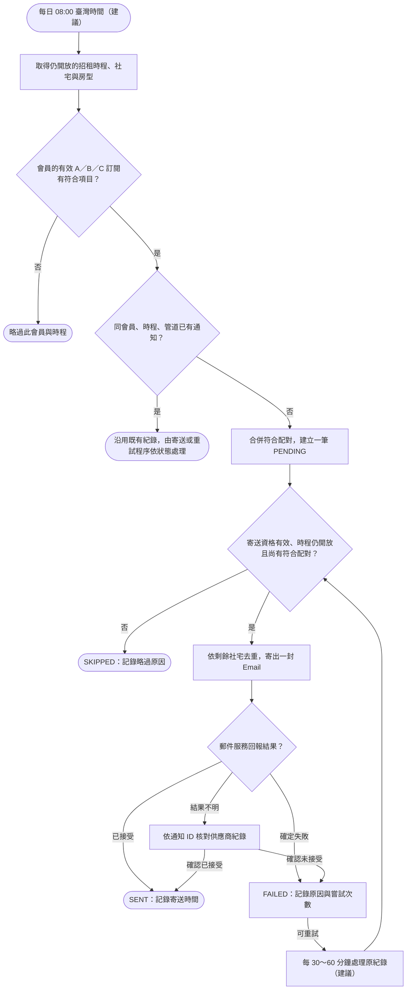

# A6.3 訂閱管理與招租通知－資料表與處理流程規格

> 專案：全國社會住宅統一申請登記平臺  
> 資料庫：PostgreSQL  
> 文件性質：系統分析／資料庫設計草案  
> 版次：v1.3｜2026-11-08  
> 依據：A6.3 訂閱功能畫面、既有 DBML 規劃及目前討論確認的訂閱條件。[建議驗收情境與待確認事項](訂閱管理_招租通知_驗收與待確認事項.md) 另冊整理。

---

## 一、設計範圍與原則

### 1.1 訂閱類型

| 類型 | 名稱 | 建立來源 | 可建立筆數 | 是否可取消 | 條件維護方式 |
|---|---|---|---|---|---|
| A | 居住需求訂閱 | 完成居住需求問卷 | 每位會員固定一筆 | 依目前畫面：不可從訂閱頁取消 | 指向最新一份已送出的問卷；重新提交問卷後更新關聯 |
| B | 搜尋條件訂閱 | 找社宅搜尋結果／搜尋條件 | 可多筆 | 可 | 訂閱時儲存當下搜尋條件，不因日後再搜尋而變更 |
| C | 指定社宅訂閱 | 找社宅－社宅詳情 | 每間社宅可訂閱一筆有效紀錄 | 可 | 指向既有社宅 ID，社宅資料不重複儲存 |

> 「A 類不可取消」是**訂閱頁操作規則**，不代表可以忽略會員撤回通知同意、停用會員或依法停止寄送的情形。寄信前仍須進行資格檢查。

### 1.2 各類訂閱採用的條件

| 訂閱條件 | A 居住需求 | B 搜尋條件 | C 指定社宅 |
|---|:---:|:---:|:---:|
| 縣市／生活圈／行政區 | ✓（讀取問卷） | ✓（保存訂閱條件） | — |
| 房型（多選） | ✓（讀取問卷） | ✓（text[]） | — |
| 租金範圍 | ✓（讀取問卷） | ✓（主檔） | — |
| 公設服務（多選） | ✓（讀取問卷） | ✓（text[]） | — |
| 生活機能（多選） | — | ✓（text[]） | — |
| 社宅名稱關鍵字 | — | ✓（主檔） | — |
| 指定社宅 ID | — | — | ✓ |

**B 類包含六項完整的訂閱條件**：①區位、②房型、③租金、④公設服務、⑤生活機能、⑥社宅名稱關鍵字。關鍵字為模糊搜尋，不等於 C 類指定某一筆社宅。

`housing_search_log` 原有的 `housing_status_codes` 是找社宅畫面的搜尋條件之一，但**本版未納入訂閱條件**：招租狀態具有時效性，且通知本身即以招租事件為觸發。若業務要求 B 類「逐欄完整複製找社宅」而包含狀態，應再確認後擴充，不應默默忽略。

### 1.3 沿用既有資料表

| 既有資料表 | 在訂閱功能的用途 |
|---|---|
| `member_profile` | 會員主檔、Email、會員啟用與驗證狀態 |
| `member_consent` | 會員登記同意與切結紀錄。招租通知的同意項目及撤回資料來源待確認 |
| `housing_demand_survey` | A 類最新已送出問卷；區位、房型、租金、公設條件 |
| `housing_search_log` | B 類按「訂閱此搜尋條件」時可選擇記錄原始搜尋來源，不以日誌作為訂閱條件 |
| `housing` | C 類指定社宅，以及各類媒合的社宅名稱、縣市、行政區 |
| `housing_room_type` | 社宅既有房型、租金資訊 |
| `housing_facility` | 社宅公設服務資訊 |
| `housing_class` | `ROOM_TYPE`、`FACILITY_ITEM`、`LIFE_FUNCTION` 等代碼分類 |
| `county`、`district`、`living_area`、`living_area_county` | 區位資料與地區比對 |
| `rental_schedule`、`rental_schedule_housing_room_type` | 招租開始時間、招租社宅與本次開放房型 |
| `announcement` | 公告資訊；目前不含社宅／縣市明確關聯，**不可直接代替招租時程媒合來源** |

資料庫依據 [db.txt](db.txt) 的 PostgreSQL DBML。下列兩張表為本功能擬新增的結構。時間欄位採 `timestamptz`，畫面以 `Asia/Taipei` 顯示。

---

### 1.4 會員專區「訂閱管理」畫面

已登入會員由右上會員選單進入「訂閱管理」。頁首說明為「管理您關注的區位與社宅招租通知。」兩區各自統計本人的有效訂閱，每筆訂閱顯示一列。多個行政區或房型不增加筆數。無有效資料時該區顯示 0 筆。

| 區塊 | 畫面欄位（由左至右） | 排列與顯示 |
|---|---|---|
| 已訂閱條件（A＋B） | 訂閱地區、房型、預算範圍、公設服務、訂閱日期、媒合推薦、操作 | 有 A 時固定第一列，在地區上方標示「居住需求問卷」。其後列出每筆 B，依訂閱日期由新到舊。 |
| 已訂閱社宅（C） | 社宅名稱、所在地區、訂閱日期、媒合推薦、操作 | 依訂閱日期由新到舊，每列顯示指定社宅的名稱、縣市及已知行政區。 |

地區依縣市分行，各市內並列行政區，例如「臺北市 萬華區、文山區」與「新北市 板橋區、中和區」屬同一筆條件。房型、公設顯示選項名稱，未限定的條件顯示「不限」。每月預算呈現如「NT$ 5,000–15,000／月」。訂閱日期取 `subscribed_at`，格式為 YYYY/MM/DD。

| 操作 | 互動與結果 |
|---|---|
| A「更新條件」 | 開啟「更新訂閱條件」，說明此筆訂閱來自居住需求問卷，請前往問卷變更需求條件。「留在本頁」關閉視窗。「前往居住需求問卷」導至「會員專區 ＞ 編輯居住需求」。正式送出後更新原訂閱，暫存草稿不生效。 |
| A／B「媒合推薦」放大鏡 | 導至「找社宅」，帶入 A 的最新已送出問卷條件或 B 的已存搜尋條件，立即顯示查詢結果。B 即使列表只顯示部分欄位，仍帶入生活機能與社宅名稱關鍵字。 |
| C「媒合推薦」放大鏡 | 導至「找社宅」，搜尋欄帶入社宅名稱，並以指定的 `housing_id` 限定結果，只顯示該社宅，避免同名誤列。 |
| B／C「取消訂閱」 | 開啟「招租通知設定」，詢問「確定取消這筆訂閱？」。B 顯示該列地區、房型、預算、公設摘要；C 顯示社宅名稱及所在地區。說明取消後將不再收到這筆招租通知，其他訂閱與申請不受影響。 |
| 「保留訂閱」／「確認取消訂閱」 | 保留會關閉視窗。確認時，服務端核對登入會員與訂閱歸屬，只接受 B／C。取消成功後移除該列並更新所屬區塊筆數；重複確認同一筆不重複扣數。 |

## 二、訂閱資料表 `member_subscription`

### 2.1 用途

每列代表一位會員的一筆訂閱。會員專區依此表列出有效訂閱、計算筆數及處理取消。「媒合推薦」與招租通知排程依同一筆訂閱讀取問卷條件（A）、搜尋條件快照（B）或指定社宅（C）。

### 2.2 欄位

| 欄位 | PostgreSQL 型態 | 用途與限制 |
|---|---|---|
| id | uuid | 主鍵，預設 gen_random_uuid() |
| member_id | uuid | 必填，FK 至 member_profile.id |
| subscription_type | char(1) | 必填，限 A、B、C |
| survey_id | uuid | FK 至 housing_demand_survey.id；僅 A 必填 |
| housing_id | uuid | FK 至 housing.id；僅 C 必填 |
| housing_name | varchar(100) | B 的名稱關鍵字，未填存 NULL |
| county_code、living_area_id | varchar(5)、uuid | B 的區位範圍，分別參照 county.county_code、living_area.id，最多填一項 |
| district_codes | text[] | B 的行政區代碼，對應 district.district_code，可跨縣市 |
| room_type_codes、facility_codes、life_function_codes | text[] | B 的房型、公設、生活機能代碼，依序對應 housing_class 的 ROOM_TYPE、FACILITY_ITEM、LIFE_FUNCTION 群組 |
| rent_min、rent_max | integer | B 的每月預算，以元計；有值時為非負數，下限不得高於上限 |
| subscribed_at | timestamptz | 必填，預設 now()，作為列表訂閱日期 |
| criteria_effective_at | timestamptz | 必填，預設 now()；A 提交新版問卷時改為該版本的 submitted_at |
| cancelled_at | timestamptz | NULL 代表有效；僅 B、C 確認取消時寫入 |

### 2.3 資料規則

| 類型 | 建立與更新 | 欄位與唯一性 |
|---|---|---|
| A 居住需求問卷 | 會員正式送出問卷時，在同一交易新增或更新訂閱。再次送出時保留原 `subscribed_at`，更新 `survey_id` 與 `criteria_effective_at`。暫存草稿不觸發更新。 | 每位會員最多一列。問卷須為本人最新的 SUBMITTED 版本。`housing_id`、B 專用欄位及 `cancelled_at` 均為 NULL。 |
| B 搜尋條件 | 每次訂閱搜尋條件時新增一列，保存當次條件。日後重新搜尋或清理搜尋日誌不影響快照。 | 同一會員可有多列。`survey_id`、`housing_id` 均為 NULL。四個多選陣列沿用 `housing_search_log` 的代碼格式，未選該項時存空陣列。 |
| C 指定社宅 | 訂閱時寫入單一 `housing_id`；取消後重新訂閱則建立新列。顯示名稱及所在地區由社宅主檔取得。 | 同一會員對同一社宅最多一列有效訂閱。`survey_id` 與 B 專用欄位均為 NULL。 |

**有效與取消**　列表、筆數及排程均以 `cancelled_at IS NULL` 選取有效訂閱。取消時依登入會員、訂閱 ID、B／C 類型及有效狀態更新該列的 `cancelled_at`。保留歷史列，重複取消不覆寫首次取消時間。

**欄位檢核**　以 PostgreSQL CHECK 約束類型、欄位組合與預算。寫入 B 時由服務逐項驗證陣列代碼存在、群組及區位相符，並去除重複代碼。PostgreSQL 外鍵無法直接約束陣列內每個元素。

區位先依縣市或生活圈限定範圍，再套用已選行政區。例如只選臺北市時可保存縣市代碼與空陣列；跨臺北市、新北市選四區時，可將兩個範圍欄位留空，保存四個行政區代碼。列表以 district.county_code 分組。A 直接讀問卷，沿用問卷將「全區」展開為行政區代碼的規則。

```sql
CREATE UNIQUE INDEX uq_member_subscription_a
ON member_subscription (member_id) WHERE subscription_type = 'A';

CREATE UNIQUE INDEX uq_member_subscription_c_active
ON member_subscription (member_id, housing_id)
WHERE subscription_type = 'C' AND cancelled_at IS NULL;
```

## 三、招租通知紀錄表 `subscription_notification_log`

### 3.1 用途

每列代表一位會員針對一個招租時程、透過一個管道發送的通知作業。排程以此表取得待寄項目、避免重複建單、重試失敗郵件，並查詢該次通知涵蓋哪些訂閱與社宅。

### 3.2 欄位

| 欄位 | PostgreSQL 型態 | 用途與限制 |
|---|---|---|
| id | bigint GENERATED ALWAYS AS IDENTITY | 主鍵 |
| member_id、schedule_id | uuid | 均必填，分別參照 member_profile.id、rental_schedule.id |
| channel、recipient_email | varchar(20)、varchar(254) | 必填，管道預設 EMAIL，記錄本次收件地址 |
| match_snapshot | jsonb | 必填，陣列內每項含 subscription_id、housing_id；A 另記當次 survey_id。ID 採 UUID 字串 |
| status | varchar(20) | 必填，預設 PENDING；其他狀態為 SENT、FAILED、SKIPPED |
| created_at、last_attempt_at、sent_at | timestamptz | 建立時間必填、預設 now()；後兩項分別在嘗試、成功時寫入 |
| attempt_count、error_detail | integer、text | 嘗試次數必填、預設 0；錯誤原因可空 |

### 3.3 資料規則

- **建立與去重**　至少有一組有效媒合配對才建立 PENDING 列，初始 `attempt_count = 0`。資料庫以 `UNIQUE (member_id, schedule_id, channel)` 確保同時執行或補跑排程時，同一通知只建立一列。
- **媒合快照**　服務逐項檢查訂閱屬於收件會員、社宅屬於該招租時程，且每組 `(subscription_id, housing_id)` 只出現一次。若 A、B 都符合甲社宅，B 另符合乙社宅，快照保存三組配對，信中只列甲、乙各一次。
- **寄送前複核**　依第四章重查收件資格及配對。部分配對失效時只保留仍符合的配對；全部失效或收件資格失效則記為 SKIPPED，於 `error_detail` 記錄原因。僅略過寄送不增加嘗試次數。
- **狀態與時間**　每次實際嘗試寄送才增加 `attempt_count` 並更新 `last_attempt_at`。郵件服務確認接受後記為 SENT，填入 `sent_at` 並保留收件地址與當次快照。確定失敗時記為 FAILED，記錄錯誤原因；可重試者更新原列。只有 SENT 可填 `sent_at`，排程重跑時略過已寄送列。

## 四、招租通知每日排程

會員點選「媒合推薦」時即時開啟找社宅查詢。背景排程則以招租時程為觸發依據，會員無須開啟訂閱頁即可收到通知。

**招租通知排程流程圖**



### 4.1 執行時間與順序

| 作業 | 建議執行時間（Asia/Taipei） | 處理內容 |
|---|---|---|
| 招租媒合 | 每日 08:00 | 掃描有效招租時程、比對 A／B／C 訂閱，將符合結果寫入待寄佇列。 |
| Email 寄送 | 媒合完成後立即執行 | 從通知紀錄取得 PENDING 列，確認資格後寄送。 |
| 失敗重試 | 每 30～60 分鐘 | 處理可重試的 FAILED 列，並接手上次中斷後遺留的 PENDING 列。 |
| 執行監控 | 每次作業結束或異常中止時 | 由既有排程日誌記錄起迄時間、候選時程數、新增通知數、成功／失敗／略過筆數及錯誤原因。 |

每日媒合時間與重試間隔為建議值，可由部署設定調整。

### 4.2 招租候選查詢與補跑

```sql
SELECT rs.id, rs.apply_start_at, rs.apply_end_at
FROM rental_schedule AS rs
WHERE rs.is_enabled
  AND now() BETWEEN rs.apply_start_at AND rs.apply_end_at;
```

起訖時間均包含在招租期間內。每次執行掃描所有仍開放的時程，因此前次作業中斷或 API 晚到時，可在招租截止前補跑。尚未介接時程的社宅可先接受訂閱，待有符合的招租時程再產生通知。

### 4.3 A、B、C 媒合規則

只取 `cancelled_at IS NULL` 的訂閱。依目前建議，另須滿足 `criteria_effective_at <= apply_start_at`；是否通知訂閱前已開始的招租，詳見[待確認事項第 6 項](訂閱管理_招租通知_驗收與待確認事項.md#二尚待業務技術確認)。

| 類型 | 資料來源 | 比對方式 |
|---|---|---|
| A 居住需求 | 訂閱關聯的本人最新已送出問卷 | 比對區位、房型、租金、公設。快照記下當次問卷 ID。 |
| B 搜尋條件 | 訂閱時保存的搜尋條件 | 比對區位、房型、租金、公設、生活機能及名稱關鍵字，未限制的項目直接通過。 |
| C 指定社宅 | 訂閱指定的 housing_id | 在本次時程的社宅清單找到相同 ID 即符合。 |

依 `rental_schedule_housing_room_type` 取得本次開放的社宅與房型。A、B 的各類條件須由同一間社宅滿足，房型及預算須由同一本次開放房型滿足，以 `housing_room_type` 的租金區間與訂閱預算是否有交集判斷。公設比對 `housing_facility`，名稱依字面子字串比對。生活機能沿用找社宅的判斷來源，會員有指定條件且資料不足時，該社宅不列入結果。

### 4.4 合併、寄送與重試

1. 每位會員在同一時程有任一符合配對時，彙整後寫入一列 `subscription_notification_log`，初始狀態為 PENDING，所有配對存入 `match_snapshot`。以會員、時程、管道唯一鍵處理排程重跑或同時執行；已 SENT 的列直接略過。
2. 寄送程序獨占處理該列，寄送前重查時程仍開放、會員啟用、Email 已驗證、通知同意及訂閱仍有效。部分配對失效時更新快照，依剩餘社宅 ID 去重後寄一封信。已無配對或資格時記為 SKIPPED。
3. 每次實際嘗試寄信更新 `attempt_count` 與 `last_attempt_at`。郵件服務接受後記錄 SENT 與 `sent_at`；確定失敗時記錄 FAILED 與 `error_detail`，下次於同一列重試。若供應商回應不明，使用通知 ID 作為供應商支援的冪等鍵，或先核對其寄送紀錄再補寄。
