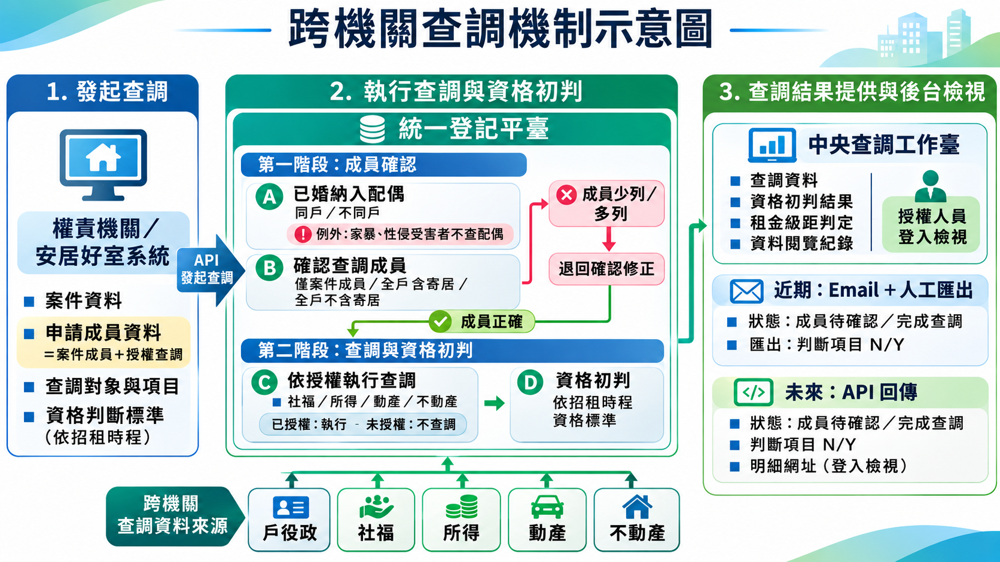
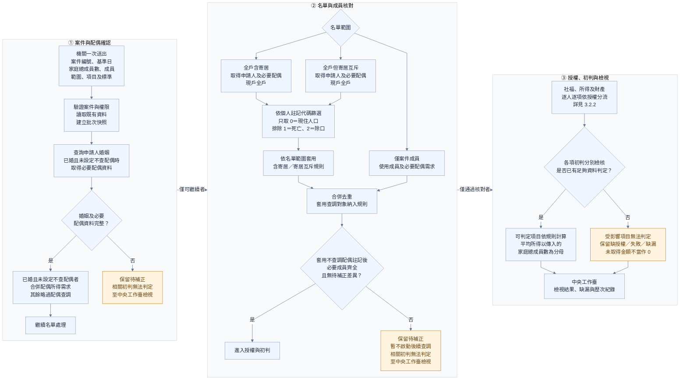
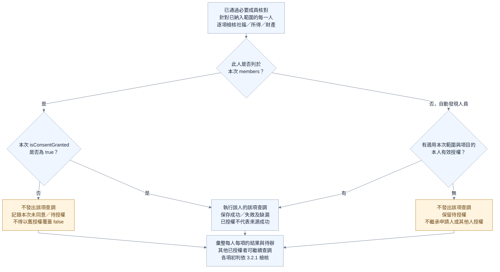

# 全國社會住宅統一申請登記平臺｜查調機制與 API 介接說明（會議討論版 v3.0）



**適用對象：國家住都中心、安居好室開發團隊、統一登記平臺團隊**

**更新日期：2026-11-24**

## 一、整體查調規則

查調對外僅保留一支 **案件查調 API：`POST /api/v1/inquiries`**。權責機關提供統一案件編號、查調基準日、家庭總成員數、案件成員、名單範圍、查調項目及資格標準；平台依案件編號讀取既有案件基本資料，並查詢申請人婚姻、依不查調配偶註記及名單範圍取得必要資料、檢核授權、執行查調及資格初判。

統一案件取號及案件進度 API 沿用 [申請案件查詢功能規格](申請案件查詢功能規格.md)，不計入本文件的一支查調 API。查調請求不重複傳入機關、案件年度、縣市、社宅、房型或申請日期，亦不更新案件基本資料、案件進度或案件成員主檔。

原先由機關分別呼叫的「個人戶籍基本資料」與「全戶籍」服務，改為平台內部來源介接步驟，不再提供獨立對外查調端點。機關無須先取得配偶或全戶查詢識別碼，也不需傳入戶籍結果引用清單。

共同原則：

- `members[0]` 固定為申請人本人，至少一人，保留傳入順序。本次成員及授權屬查調批次快照，不因主檔已有成員就省略。
- 平台每次查調均自動確認申請人是否有配偶，不依「配偶是否已列案件成員」或「是否展開全戶」決定要不要查婚姻。
- `query.skipSpouseInquiry` 為不查調配偶註記，預設 false。false 時，已婚配偶無論是否同戶、是否列原案件成員，均保留配偶所得查調需求；未取得授權時待授權。true 時不對配偶發出查調需求。
- 戶役政查詢依核准用途執行。社福資格、所得、動產及不動產均須有受查人本人的有效授權；申請人的授權不能套用至配偶或全戶其他人。
- 全戶戶籍來源一律使用「現戶全戶」，依來源資料表欄位「個人註記代碼」篩選，只取 `0＝現住人口`；`1＝死亡`、`2＝除口` 不納入現戶名單。先篩選現住人口，再依名單範圍處理寄居者。
- 自動取得的人員與原案件成員依身分證字號去重，保留案件成員、配偶及各戶來源標記。戶籍名單不直接等於財稅查調名單或家庭計算人口。
- 先核對案件成員，必要成員未齊時保留待補正，暫不啟動社福、所得及財產查調；已回傳的戶政資料仍可供核對。
- 查調需求方自行算好包含胎兒的家庭總成員數，於請求傳入 `familyTotalMemberCount`；平台直接採用此值作為平均所得分母，不另行計算或回傳家庭總成員數。
- 各來源資料對齊同一查調基準日；來源無法提供該日資料時須保存實際資料期間與差異，不以當日現況冒充基準日結果。
- 婚姻、配偶、授權或必要資料缺漏時，保留待辦或無法判定，不推定未婚、零所得或資格符合。
- 同一案件可有多次查調，每次保存獨立批次、標準快照及初判結果；查調批次狀態與「已受理／已入住／已退租」案件狀態分開保存。

## 二、開始查調時，要提供什麼？

| 資料類別 | 輸入內容 |
|---|---|
| **案件識別** | 統一案件編號；案件基本資料由平台依編號讀取，不重複傳入 |
| **查調基準日** | 西元日期 `YYYY-MM-DD` |
| **家庭總成員數** | `familyTotalMemberCount`，由需求方自行算好、已包含胎兒的總人數，作為每人每月平均所得分母 |
| **案件成員** | 第一筆固定為申請人；每人提供姓名、身分證字號、是否同意授權查調、懷孕胎兒數 |
| **不查調配偶註記** | `query.skipSpouseInquiry`，true＝不查調配偶；false＝照常，未傳預設 false |
| **名單範圍（三選一）** | ① 僅案件成員　② 全戶含寄居　③ 全戶但寄居互斥 |
| **查調資料** | ① 戶役政（基本）　② 社福資格（基本，須授權）　③ 所得（基本，須授權）　④ 動產（依需求，須授權）　⑤ 不動產（依需求，須授權） |
| **資格標準** | 年所得標準、每人每月平均所得標準、不動產價值標準、動產價值標準、動產換算利率、自有住宅公告範圍縣市、所得級距 |
| **所得級距** | 級距名稱與判斷條件；可單獨使用「住宅法第 4 條弱勢身分」或「每人每月平均所得起訖範圍」，同一級亦可將兩者以 AND／OR 組合 |

戶役政、社福資格及所得為本次基本查調項目，`query.items` 必須包含三者；動產、不動產依需求加入。基本項目不代表免授權，未授權的社福及所得仍不得執行。

`familyTotalMemberCount` 為請求頂層必填欄位，定義見 4.2；由需求方負責將胎兒計入後提供，平台不依案件成員筆數、戶籍人數或逐人胎兒數重算此值。

## 三、平台自動查調流程

### 3.1 處理順序

1. **驗證與讀取案件**：驗證機關憑證及統一案件編號，確認案件已由取號 API 建立且屬授權機關；讀取 `application_case` 及必要主檔，建立本次基本資料快照。未取號時拒絕，不由查調 API 自行建立申請案件。
2. **建立查調批次與成員快照**：保存基準日、傳入的 familyTotalMemberCount、名單範圍、項目、資格標準及完整 members。第一筆為申請人；若案件成員主檔已有申請人，須比對其身分證字號，不一致時拒絕並要求先更正，不能藉查調變更申請人。若尚未回傳進度而沒有成員主檔，採本次第一筆作查調申請人，不回寫主檔。
3. **自動查婚姻及配偶**：以第一筆申請人及基準日向戶政來源查詢。有偶時先檢查不查調配偶註記；`query.skipSpouseInquiry=true` 時不延伸配偶查調，其餘情況取得配偶姓名，以姓名比對本次案件成員；未比對到時依本案流程標記配偶分戶，另取得必要配偶戶籍。後續以來源身分證字號確認同一人並去重，合併批次人員及建立配偶所得需求；來源失敗、婚姻不明或配偶身分不足時保留待補正，不當作未婚。
4. **依名單範圍取得現戶全戶**：僅案件成員時不展開全戶；其餘範圍取得申請人的「現戶全戶」，已婚且未設定不查調配偶時另取得配偶的「現戶全戶」。每戶均先依資料表欄位「個人註記代碼」只取 `0＝現住人口`，排除 `1＝死亡`、`2＝除口`，再依「全戶含寄居／全戶但寄居互斥」的來源規則處理名單。由平台依來源協定完成一次或多次內部查詢，機關無須分次呼叫。已明確同戶時可共用來源結果；不能因配偶戶未回傳就自行推定同戶。
5. **合併名單並決定實際查調對象**：以篩選後的現住人口依身分證字號去重、保留原案件成員及配偶標記，再套用業務納入規則。不在申請人戶、也不在配偶戶的原案件成員另列「其他案件成員」，不得因兩戶都未出現就刪除；若來源明確回傳原案件成員為死亡或除口，僅保留原案件成員快照與差異，不將其重新納入現戶名單，必要成員有此差異時待補正。套用 `query.skipSpouseInquiry` 排除本次不查調的配偶後，必要案件成員未齊或現住人口資料有待補正差異時，暫不啟動後續社福、所得及財產查調。未授權不影響名單納入判斷；配偶戶其他成員的財稅納入規則未定時，標記待確認，不自動查調。
6. **取得基本戶役政並逐人檢核授權**：戶役政依核准用途取得，不以 `isConsentGranted` 作為是否執行的開關；CASE_MEMBERS 只是不展開全戶，仍執行基本戶役政及申請人婚姻確認，同批次已取得的來源結果直接沿用。社福、所得及財產則先確認該人與該項目已納入本次業務範圍，再檢核授權：已列 `members` 者使用本次 `isConsentGranted`，true 才可查，false 不查且不得改用舊授權；未列 `members` 的自動發現人員，只能使用明確適用於本次範圍的本人有效授權，缺少時待授權，不繼承他人授權。
7. **分流執行查調，再分別進行初判**：必要案件成員核對通過後，逐人逐項執行已取得本人授權的社福、所得及財產查調。缺授權者不發出該項查調，其餘已授權者可繼續；逐項保存待授權、來源成功、失敗或資料缺漏，不能把「已授權」當成「查調已完成」。彙整後，各項初判分別檢核是否已有足夠資料；足以判定者依規則計算，受缺授權、失敗或必要資料缺漏影響者保留無法判定。平均所得仍以傳入的 familyTotalMemberCount 為分母，不刪除未授權者後重算，也不將未取得的金額當作 0；級距 AND／OR 仍依 4.3.1 的三值規則判定。
8. **結果檢視與稽核**：授權承辦人登入中央查調工作臺檢視當次資料、配偶及全戶自動查詢結果、初判、待辦及歷次批次；留存資料閱覽紀錄。

### 3.2 流程圖

#### 3.2.1 整體流程

區塊間僅承接通過檢核的流程；必要成員待補正者保存已取得資料，供工作臺檢視，暫不進入後續社福、所得及財產查調。授權通過、來源查調成功與資格可判定分別記錄。



#### 3.2.2 社福、所得及財產：授權與查調分流

本圖逐一套用至「每一位受查人 × 本次要求的每一項社福、所得或財產項目」。進入前須已通過必要成員核對，且該人、該項目已確認納入業務範圍；不查配偶、未要求或未納入的項目不進入授權分流，納入規則未定者保留待確認。戶役政依核准用途及前述現戶規則執行，沿用同批次已取得資料。



本節為新版流程依據；舊版 `跨機關查調機制流程圖.png` 未同步，不再作為本版流程規格。

### 3.3 名單範圍

以下配偶查調規則適用於 `query.skipSpouseInquiry=false`（預設）。設為 true 時，不查配偶個人戶役政、配偶全戶、社福、所得、動產及不動產；即使配偶已列 members 或已有授權也不執行，原案件成員快照仍保留。申請人本人的婚姻及戶籍查調照常，配偶若隨申請人全戶回傳，僅保留該戶來源資料，不另對配偶發出查調需求。

**戶籍來源只取「現戶全戶」；現戶名單只納入「個人註記代碼＝0」的現住人口。** 此規則同時適用申請人戶與必要配偶戶，並先於寄居者篩選及名單合併執行。

| 個人註記代碼 | 意義 | 現戶名單處理 |
|---|---|---|
| `0` | 現住人口 | 納入現住人口名單，再依名單範圍處理寄居者 |
| `1` | 死亡 | 排除，不列為現住人口或由戶籍自動延伸後續查調 |
| `2` | 除口 | 排除，不列為現住人口或由戶籍自動延伸後續查調 |

來源欄位對應 `enquiry_household_member.personal_note_code`，保留來源原值；不得以「配偶特殊記事代碼」、婚姻狀態、是否寄居或是否已授權替代「個人註記代碼」。個人註記代碼缺漏或不在上述代碼內時，保留資料不完整／待確認，不預設為 `0`，也不將該筆納入現住人口名單。原始來源回應可供稽核，不等於全部人員都可納入現戶名單。

`query.skipSpouseInquiry` 優先於配偶自動納入、名單範圍及配偶授權；被排除的配偶不列本批次所得、財產及自有住宅判斷的受查範圍，記錄為「不查調配偶」，不列待授權或當作零所得。`familyTotalMemberCount` 仍直接採需求方傳入值，不因略過配偶而自動增減。

| query.scope | 名稱 | 處理方式 |
|---|---|---|
| CASE_MEMBERS | 僅案件成員 | 不展開全戶，仍自動查婚姻並保留已婚配偶所得需求 |
| WHOLE_HOUSEHOLD_INCLUDE_LODGERS | 全戶含寄居 | 取得申請人及必要配偶的「現戶全戶」，只納入個人註記代碼為 `0` 的現住人口，包含來源確認的現住寄居者 |
| WHOLE_HOUSEHOLD_EXCLUDE_LODGERS | 全戶但寄居互斥 | 同樣先取「現戶全戶」且篩選個人註記代碼為 `0` 的現住人口，再依戶政來源的寄居互斥規則產生展開名單 |

「全戶但寄居互斥」依戶政來源的寄居互斥規則處理自動展開的戶籍名單，不刪除機關已送入的案件成員，也不省略必要配偶所得需求。來源無法提供對應名單或辨識寄居者身分時，標記範圍資料不完整，不能將部分親屬名單冒充完整全戶結果。

原案件成員不在兩戶現住人口名單中時，仍保留其案件成員快照及「其他案件成員」身分；若來源明確回傳該必要成員為 `1＝死亡` 或 `2＝除口`，須保留差異待補正，暫不啟動後續查調，不因原已列 `members` 而視為現住人口。現住人口篩選不重算或調整需求方傳入的 `familyTotalMemberCount`。

### 3.4 授權、人口與胎兒數

- `isConsentGranted` 為每人必填布林值；true 表示機關確認此人已同意本次要求的社福、所得、動產及不動產查調，false 表示未同意。不另傳逐項授權陣列，後端仍逐人逐項保存授權及執行結果。
- 案件成員明確傳入 false 時，不以舊授權紀錄覆蓋本次未同意。自動取得的非案件成員缺授權時，標記 `PENDING`／`BLOCKED_CONSENT`，不得預設 true。
- 授權只允許執行已納入範圍的項目；有授權不代表自動成為家庭計算人口或財稅受查人。
- 必要案件成員未齊時，整批暫不啟動後續社福、所得及財產查調；核對通過後，授權依人、依項目分流，缺授權只阻擋該人的該項查調，其他已授權者可繼續，未授權者仍保留於應查名單及缺漏檢核中。
- 自動查到的配偶若原已列 members，使用同一人的授權及胎兒數，不重複建立人員；未列 members 時，不變更原案件成員身分，胎兒數未知保留 NULL，不代填 0。
- members 的 `fetusCount` 必填非負整數，無胎兒填 0，保留為成員資料；平台不使用此欄位重算平均所得分母。
- `familyTotalMemberCount` 由查調需求方自行計算，必須包含胎兒，並以正整數傳入；平台直接使用傳入值。**每人每月平均所得＝家庭年所得合計 ÷ 12 ÷ familyTotalMemberCount**，不再加一次胎兒數。
- 不得先刪除未授權者，再將剩餘人員視為完整家庭計算平均所得。
- 自動取得的非案件成員之授權來源、補授權與胎兒數補正作業另行確認；未補齊前保留待辦，不為傳入授權而將非案件成員偽列原案件成員。補正後仍透過同一案件查調 API 發起新批次，不新增配偶／戶籍對外 API，亦不覆寫既有批次。

授權與實際執行依以下順序判斷；`isConsentGranted` 仍是每人一個布林值，適用於該人本次要求且已納入的社福、所得及財產項目，不新增逐項授權輸入欄位。

| 情境 | 是否發出該人該項查調 | 保存及初判處理 |
|---|---|---|
| 未要求、未納入，或已設定不查調配偶 | 否 | 記錄未要求／未納入／不查配偶，不列待授權 |
| 該人或該項目的業務納入規則未定 | 否 | 保留待確認，不因已有授權而自行納入；涉及初判必要範圍時不得視為資料已齊 |
| 戶役政及申請人婚姻確認 | 依核准用途執行，已取得者沿用 | 依前述來源與現住人口規則保存；不以社福、所得及財產的授權布林值決定是否取得 |
| 已列 members，且本次 isConsentGranted=true | 是，限已要求且納入的項目 | 保存逐項來源結果；仍須確認成功及必要資料是否足夠 |
| 已列 members，且本次 isConsentGranted=false | 否 | 記錄本次未同意及待授權原因；即使有舊授權也不查，相關缺漏不當作 0 |
| 自動發現且未列 members，有適用本次範圍的本人有效授權 | 是，限該有效授權涵蓋的要求項目 | 保存授權依據及逐項來源結果，不變更原案件成員身分 |
| 自動發現且未列 members，沒有適用的本人有效授權 | 否 | 保留待授權，不套用他人授權，相關缺漏不當作 0 |
| 已授權，但來源逾時、失敗或必要資料缺漏 | 已嘗試，該項尚無足夠可用資料 | 保存來源狀態與原因，受影響初判無法判定；不將已授權或已呼叫標成查調成功 |

各項初判依自身所需資料判斷，部分項目可判定時仍可保存其結果；不得據此將其他缺授權或未完成項目標為完成，亦不得直接宣告整案資格符合。級距有 OR 條件時仍適用 4.3.1 的三值判定規則。

## 四、案件查調 API

### 4.1 用途與介接原則

```http
POST /api/v1/inquiries
Authorization: Bearer {agency_access_token}
Content-Type: application/json
Idempotency-Key: {request_key}
```

- HTTPS、JSON、UTF-8，機關服務憑證須綁定可查案件的 agencyCode；不使用民眾登入憑證。
- `Idempotency-Key` 為必填非空字串標頭，最長 100 字元。同機關同鍵同內容為重送，沿用原批次與基本資料快照，不新增批次；同鍵不同內容回應 409。主動重查、改基準日、改標準、補授權或補正須使用新鍵建立新批次。
- 查調請求以頂層 `caseNumber` 識別案件；不再使用含基本資料的 `case` 物件。
- `familyTotalMemberCount` 為請求頂層必填的家庭總成員數，不放在 `standards` 內；`standards.selfOwnedHousing` 僅接收公告範圍設定物件，不接收住宅判定碼。
- 本版不接收 `subject`、`includeLodgers`、`householdInquiryIds`、`subjectNationalIds`、`subjectConsents` 或預查配偶結果；範圍由 `query.scope` 決定，其餘由平台內部處理。
- 全筆輸入驗證成功後才建立批次並啟動內部查調；任何輸入錯誤均不得留下部分批次或啟動來源查調。
- 呼叫成功代表送出查調，查調完成與資格符合須分開判斷。既有主檔狀態為 NULL 亦可送查調，不將「已受理／已入住／已退租」當作查調批次狀態。

### 4.2 請求欄位

| 序號 | 中文名稱 | 欄位 | 型別／必填 | 說明 |
|---|---|---|---|---|
| 1 | 統一案件編號 | caseNumber | string(14)／是 | 已取號的統一案件編號，格式沿用申請案件規格，如 CH115A00000842；須歸屬憑證授權機關 |
| 2 | 查調基準日 | referenceDate | string(date)／是 | 查調基準日，西元 YYYY-MM-DD |
| 3 | 家庭總成員數（含胎兒） | familyTotalMemberCount | integer／是 | 家庭總成員數，由查調需求方自行算好提供，已包含胎兒，須 ≥ 1；平台直接作為每人每月平均所得分母，不重算、不再加胎兒數 |
| 4 | 案件成員 | members | array／是 | 完整案件成員快照，至少一人，第一筆為申請人；同一身分證字號不可重複 |
| 4.1 | 成員姓名 | members[].name | string(1–100)／是 | 姓名，不可為空白 |
| 4.2 | 成員身分證字號 | members[].nationalId | string(10)／是 | 身分證字號，須通過格式及檢查碼驗證 |
| 4.3 | 是否同意授權查調 | members[].isConsentGranted | boolean／是 | 本人是否同意授權查調，不接受字串或 NULL |
| 4.4 | 懷孕胎兒數 | members[].fetusCount | integer／是 | 懷孕胎兒數，須 ≥ 0，無則填 0 |
| 5 | 查調設定 | query | object／是 | 查調名單範圍、配偶查調註記及查調項目 |
| 5.1 | 名單範圍 | query.scope | enum／是 | CASE_MEMBERS、WHOLE_HOUSEHOLD_INCLUDE_LODGERS、WHOLE_HOUSEHOLD_EXCLUDE_LODGERS，三選一；全戶一律取「現戶全戶」，並由平台依個人註記代碼只取 `0＝現住人口`，不由機關另傳篩選代碼 |
| 5.2 | 不查調配偶註記 | query.skipSpouseInquiry | boolean／否 | 不查調配偶註記，預設 false；true 時不查配偶本人及配偶戶，不執行配偶社福、所得、動產及不動產查調，規則見 3.3；不得傳字串或 null |
| 5.3 | 查調項目 | query.items | array<enum>／是 | 必含 HOUSEHOLD、WELFARE、INCOME，可加 MOVABLE_ASSET、REAL_ESTATE；值不可重複 |
| 6 | 資格初判標準 | standards | object／是 | 所得、財產、自有住宅及所得級距判斷所需參數 |
| 6.1 | 年所得標準 | standards.totalAnnualIncome | object／是 | 年所得標準，op 與 value 皆必填 |
| 6.1.1 | 金額標準比較運算子 | standards.totalAnnualIncome.op | enum／是 | LT：低於、不含上限；LTE：不超過、含上限 |
| 6.1.2 | 金額標準值（元） | standards.totalAnnualIncome.value | number／是 | 金額（元），非負且最多二位小數，後端採十進位計算 |
| 6.2 | 每人每月平均所得標準 | standards.perCapitaMonthlyIncome | object／是 | 每人每月平均所得標準，op 與 value 皆必填 |
| 6.2.1 | 金額標準比較運算子 | standards.perCapitaMonthlyIncome.op | enum／是 | LT：低於、不含上限；LTE：不超過、含上限 |
| 6.2.2 | 金額標準值（元） | standards.perCapitaMonthlyIncome.value | number／是 | 金額（元），非負且最多二位小數，後端採十進位計算 |
| 6.3 | 不動產價值標準 | standards.realEstateValue | object／條件必填 | 選 REAL_ESTATE 時必填；未選時省略，不進行該項初判 |
| 6.3.1 | 金額標準比較運算子 | standards.realEstateValue.op | enum／是 | LT：低於、不含上限；LTE：不超過、含上限 |
| 6.3.2 | 金額標準值（元） | standards.realEstateValue.value | number／是 | 金額（元），非負且最多二位小數，後端採十進位計算 |
| 6.4 | 動產價值標準 | standards.movableAssetValue | object／條件必填 | 選 MOVABLE_ASSET 時必填；未選時省略，不進行該項初判；op 固定為 LT，value 為動產限額 |
| 6.4.1 | 金額標準比較運算子 | standards.movableAssetValue.op | enum／是 | 僅接受 LT：低於、不含上限 |
| 6.4.2 | 金額標準值（元） | standards.movableAssetValue.value | number／是 | 金額（元），非負且最多二位小數，後端採十進位計算 |
| 6.4.3 | 動產換算利率（%） | standards.movableAssetValue.interestRate | number／否 | 動產換算利率，以百分比數值表示，單位為 %，預設 1.67（即 1.67%）；須大於 0 且不大於 100。選 MOVABLE_ASSET 時可設定，未傳時採預設值並保存本批次參數快照 |
| 6.5 | 自有住宅判斷設定 | standards.selfOwnedHousing | object／條件必填 | 選 REAL_ESTATE 時必填，供自有住宅判斷；未選時省略，不進行該項判定 |
| 6.5.1 | 自有住宅公告範圍縣市 | standards.selfOwnedHousing.cityCodes | array<string(1)>／條件必填 | 自有住宅判斷的公告範圍縣市代碼，至少一個有效代碼且不可重複；代碼沿用申請案件規格，不以案件所在地自動代填 |
| 6.6 | 所得級距 | standards.rentTiers | array／是 | 至少一個所得級距，名稱與筆數可自訂，依傳入順序判斷 |
| 6.6.1 | 所得級距名稱 | standards.rentTiers[].tierName | string(1–100)／是 | 級距名稱，不可空白 |
| 6.6.2 | 級距條件 | standards.rentTiers[].condition | object／是 | 所得級距的判斷條件，依 type 決定必填子欄位，規則見 4.3 |
| 6.6.2.1 | 級距條件類型 | standards.rentTiers[].condition.type | enum／是 | LAW、INCOME、COMBINED，規則見 4.3 |
| 6.6.2.2 | 級距條件組合運算子 | standards.rentTiers[].condition.operator | enum／條件必填 | COMBINED 時必填 AND 或 OR；單一條件時不傳 |
| 6.6.2.3 | 弱勢身分類別代碼 | standards.rentTiers[].condition.categoryCodes | array<string>／條件必填 | LAW 或 COMBINED 必填，至少一個有效住宅法第 4 條弱勢類別代碼；類別間採符合任一項 |
| 6.6.2.4 | 每人每月平均所得下限 | standards.rentTiers[].condition.rangeStart | number／條件必填 | INCOME 或 COMBINED 必填，每人每月平均所得下限（元，含下限） |
| 6.6.2.5 | 每人每月平均所得上限 | standards.rentTiers[].condition.rangeEnd | number／條件必填 | INCOME 或 COMBINED 必填，每人每月平均所得上限（元，含上限），須 ≥ 下限 |

案件編號以外的機關、年度、縣市、社宅、房型及申請日期從 `application_case` 及主檔讀取，再保存本批次快照，不能因不重送而省略歷史快照。主檔缺少必要資料時拒絕並要求補正；機關不得在查調請求中覆寫。

每人每月平均所得固定以傳入的 `familyTotalMemberCount` 為分母；不以 `members.length`、全戶戶籍筆數或已授權者人數替代。此欄位缺漏、為 0、負數、小數、字串或 null 時，回應 422。

### 4.3 資格判定規則

#### 4.3.1 所得級距與 AND／OR 判定

| condition.type | 必填內容 | 判定方式 |
|---|---|---|
| LAW | categoryCodes | 符合選定住宅法第 4 條弱勢類別任一項 |
| INCOME | rangeStart、rangeEnd | 每人每月平均所得落在含起訖值的區間 |
| COMBINED | categoryCodes、rangeStart、rangeEnd、operator | 同一級結合弱勢身分與所得範圍；AND 須兩者成立，OR 任一成立即可 |

- LAW 不傳所得區間及 operator；INCOME 不傳弱勢類別及 operator；COMBINED 必須同時提供兩組條件與 AND／OR。缺漏、空類別清單、重複／無效類別、反向區間或不適用欄位均拒絕。
- 金額區間非負、最多二位小數。級距可因 OR 或不同條件產生重疊，依傳入順序採第一個可確定符合的級距；無任何符合時標記未匹配，不自動套用最後一級。
- 每個條件有「成立／不成立／無法判定」三種結果。AND 有一項確定不成立即可判不成立，兩項均成立才成立；OR 有一項確定成立即可成立，兩項均不成立才不成立；其他含未知的組合為無法判定，不將缺資料當作 false。
- 前級仍無法判定時，不跳過並直接採後級。OR 已因其中一項確定成立而成立時，可判定該級，但不得據此將其他缺授權或未完成項目標示完成，亦不代表整案資格符合。
- 弱勢身分與所得範圍的判定對象沿用業務規則；弱勢身分是否以申請人或家庭成員認定，須在正式規則確認並保存規則版本，不自行推定。正式弱勢類別對照表另行確認；下例 W01、W07 僅為代碼示意。

#### 4.3.2 動產價值與利率參數

- 動產換算利率由 `standards.movableAssetValue.interestRate` 設定，以百分比數值傳入，初始預設為 **1.67（單位：%，即 1.67%）**；動產限額取自 `standards.movableAssetValue.value`。兩者均保存於本次查調批次，日後參數變更不回算既有批次。
- 逐一以家庭成員身分證字號取得動產資料，依下式換算並加總；同一人跨案件成員、申請人戶或配偶戶出現時只計一次。

```text
個人存款本金 = 個人利息 ÷（利率參數 ÷ 100）
個人動產價值 = 個人存款本金 + 有價證券 + 中獎所得 + 其他一次性給予所得
全案動產價值 = 全體家庭成員個人動產價值加總
資格符合條件：全案動產價值 < 動產限額參數
```

- API 傳入 `interestRate: 1.67` 表示 1.67%，計算時先除以 100，換算為小數利率 `0.0167` 作為分母；不直接以 `1.67` 相除，也不將 `0.0167` 當作 1.67% 傳入；利率為 0、負值或超出允許範圍時拒絕請求。全案動產價值等於動產限額時不符合，不使用含上限的 LTE。
- 明細顯示利息、中獎所得、其他所得及小計；其中其他所得指其他一次性給予所得。有價證券仍納入小計，須可檢視其金額；不另顯示換算後的存款本金值。
- 未授權、來源未回傳或必要欄位缺漏時，保留無法判定，不將缺漏當成 0；只有來源明確確認無該類財產或所得時才以 0 計算。

#### 4.3.3 自有住宅

判斷對象為本次業務認定的**所有家庭成員（依身分證字號）之財產清單**，包含已納入家庭但不在申請人戶或配偶戶的成員。僅檢查位於 `standards.selfOwnedHousing.cityCodes` **公告範圍縣市內的住宅**；土地或非住宅財產不直接視為持有自有住宅。

公告範圍內，符合下列任一條件即為「有持有自有住宅」：

| 條件 | 判斷方式 |
|---|---|
| 1. 完全持有住宅 | 任一家庭成員持有該住宅全部所有權，持分為 1 |
| 2. 個別持有共有住宅面積超過 40㎡ | 任一家庭成員個別持有該共有住宅的換算面積 **> 40㎡**；換算面積為該住宅面積 × 個人持分 |
| 3. 戶籍設於持有住宅地址 | 任一家庭成員持有該住宅，且該成員戶籍設於所持住宅地址 |
| 4. 多名家庭成員持有同一共有住宅 | 以同一住宅識別資料歸組；至少兩名家庭成員共同持有，**持分合計為 1**，或**合計換算面積 ≥ 40㎡** |

- 條件 4 只合併**同一住宅**各家庭成員的持分及換算面積，不跨不同住宅加總；同一成員、同一住宅的重複來源紀錄須先去重。持分以原始分子／分母作精確判斷，不能以畫面四捨五入後的比例判斷是否合計為 1。
- 條件 2 的個別面積**等於 40㎡**不成立；條件 4 的多人合計面積**等於 40㎡**即成立。仍須同時檢查其他條件，例如個別面積未超過 40㎡，但戶籍設於持有住宅地址時，仍符合條件 3。
- 全體家庭成員的必要財產、用途、面積、持分及戶籍地址資料均足以完成判斷，且以上條件皆不成立時，判為「無持有自有住宅」，工作臺顯示**勾選圖示（符合無自有住宅條件）**。
- 自有住宅結果與不動產價值是否超標分開保存、分開呈現；不以不動產總額取代上述住宅持有判斷。
- 必要資料或授權缺漏而無法完成判斷時保留無法判定，不將其輸出為「無」。

**判定完成時輸出：`1`＝有持有自有住宅；`2`＝無持有自有住宅。** 詳見 4.5。

### 4.4 完整請求範例

本例採 `skipSpouseInquiry=false`；如需不查調配偶，改傳 true。本例同時示範 AND、OR 及單一條件級距；金額及級距僅為介接示意，不代表正式政策。姓名與身分證字號為測試資料；本例證號符合格式及檢查碼規則。

```json
{
  "caseNumber": "CH115A00000842",
  "referenceDate": "2026-11-16",
  "familyTotalMemberCount": 3,
  "members": [
    {
      "name": "申請人姓名",
      "nationalId": "B100010017",
      "isConsentGranted": true,
      "fetusCount": 0
    },
    {
      "name": "家庭成員姓名",
      "nationalId": "A200010027",
      "isConsentGranted": false,
      "fetusCount": 1
    }
  ],
  "query": {
    "scope": "WHOLE_HOUSEHOLD_EXCLUDE_LODGERS",
    "skipSpouseInquiry": false,
    "items": ["HOUSEHOLD", "WELFARE", "INCOME", "MOVABLE_ASSET", "REAL_ESTATE"]
  },
  "standards": {
    "totalAnnualIncome": { "op": "LT", "value": 1450000 },
    "perCapitaMonthlyIncome": { "op": "LTE", "value": 62125 },
    "realEstateValue": { "op": "LT", "value": 7080000 },
    "movableAssetValue": { "op": "LT", "value": 4710000, "interestRate": 1.67 },
    "selfOwnedHousing": { "cityCodes": ["A", "F"] },
    "rentTiers": [
      {
        "tierName": "第一級：弱勢且所得在指定範圍",
        "condition": {
          "type": "COMBINED",
          "operator": "AND",
          "categoryCodes": ["W01", "W07"],
          "rangeStart": 0,
          "rangeEnd": 26624
        }
      },
      {
        "tierName": "第二級：弱勢或所得在指定範圍",
        "condition": {
          "type": "COMBINED",
          "operator": "OR",
          "categoryCodes": ["W01", "W07"],
          "rangeStart": 0,
          "rangeEnd": 40000
        }
      },
      {
        "tierName": "第三級：僅所得條件",
        "condition": {
          "type": "INCOME",
          "rangeStart": 0,
          "rangeEnd": 62125
        }
      },
      {
        "tierName": "第四級：僅弱勢身分條件",
        "condition": {
          "type": "LAW",
          "categoryCodes": ["W01"]
        }
      }
    ]
  }
}
```

### 4.5 輸出與異常規劃

對外輸出以查調執行狀態及必要待辦為原則；除下述自有住宅判定碼外，其餘輸出欄位、同步等待時間或完成通知方式另行確認，本版不新增狀態查詢或配偶／全戶查詢對外 API。重送相同查調不得當作輪詢，也不能因此產生新批次。

自有住宅判定完成時，輸出欄位 `selfOwnedHousing` 為 integer：**`1`（有）／`2`（無）**。`2` 對應工作臺「無持有自有住宅」勾選圖示。尚未查調、未選 REAL_ESTATE、未授權或必要資料不足時為 NULL，並保留未判定原因，不以 `2` 代替未知；其餘回應外層結構與通知方式仍依前述規劃確認。

查調結果明細、婚姻與配偶、全戶名單、所得、財產及社福資料由授權人員於中央工作臺檢視；不預設完整名單會經 API 回傳機關。API 請求、錯誤及一般紀錄不得回顯完整成員個資或憑證。

| 情境 | 處理原則 |
|---|---|
| 無效或失效憑證 | 401，不啟動查調 |
| 案件不屬授權機關 | 403，不讀取或建立該案查調內容 |
| 案件編號未配發／主檔不存在 | 404，不建立申請案件 |
| 無效 JSON | 400 |
| 必填缺漏、成員重複、型別／日期／代碼／級距／利率或公告範圍縣市設定不合法，或夾帶基本資料及舊版欄位 | 422，不建立部分批次 |
| 既有申請人不一致或同冪等鍵不同內容 | 409，要求更正或另送新請求 |
| 來源逾時、婚姻不明、戶籍範圍不足 | 保存批次待辦與失敗／缺漏狀態，不偽裝完成或未婚 |
| 個人註記代碼缺漏／未知，或必要案件成員回傳為死亡／除口 | 不將該筆列為現住人口；保存缺漏或名單差異待補正，必要資料未齊時暫不啟動後續查調 |
| 未授權 | 保存待授權狀態，不執行該人的授權項目，不將金額當作 0 |

## 五、查調工作臺與歷史資料

中央工作臺以需求方傳入的 `familyTotalMemberCount` 顯示本批次平均所得計算人數。另顯示家庭總所得、每人每月平均所得、動產、不動產的實際值／標準／初判結果、自有住宅結果、適用所得級距及判斷理由，以及自動取得的婚姻、配偶與戶籍成員明細；不在申請人戶或配偶戶的原案件成員另區列示。級距須能呈現條件類型、AND／OR、弱勢類別及所得範圍，並保存各子條件判定與缺漏理由。

申請人戶及配偶戶的現戶名單僅顯示「現戶全戶」來源中個人註記代碼為 `0` 的現住人口，再依名單範圍處理寄居者。原始代碼、死亡／除口排除原因及與原案件成員的差異另留稽核或待補正紀錄，不混入現住人口名單。

同一案件可有多次查調，每次保存獨立版本，包含送查調時從案件主檔讀取的基本資料、輸入成員及授權、傳入的 familyTotalMemberCount、基準日、名單範圍、不查調配偶註記、查調項目、資格標準與級距組合條件，以及實際採用的利率百分比、動產限額、公告範圍縣市。未傳利率時亦保存實際採用的預設值 1.67（%）。主檔或標準日後變動，不回寫已完成歷史批次；歷史平均所得使用該批次傳入的 familyTotalMemberCount。

檢視歷史批次時，整頁顯示該版資料，並標示批次、送查調時間、資料完成時間、保存期限及是否為目前採用版本。查調內容最多保存六個月，正式起算點、備份及刪除範圍待確認；到期不得由舊連結取回原始內容。

每筆閱覽紀錄包含檢視人員、所屬機關、時間及查閱批次；切換版本亦留紀錄。閱覽軌跡與查調內容分開管理，軌跡保存期限另訂。既有工作臺靜態畫面尚未同步新增的 AND／OR 顯示，本次調整介接與資料規劃。

- [查調案件列表](../backend/enquiry-hub.html)
- [查調結果明細](../backend/enquiry-detail.html)
- [配偶未列案件成員情境](../backend/enquiry-detail.html?case=LF115F00000002)

## 六、驗收與待確認事項

### 6.1 驗收項目

| 編號 | 情境 | 預期結果 |
|---|---|---|
| INQ-01 | 僅提供案件編號及本版查調欄位 | 平台讀取基本資料快照，不要求重送機關、社宅、房型、申請日期 |
| INQ-02 | 未取號或呼叫非授權機關案件 | 拒絕且不建立申請案件或查調批次 |
| INQ-03 | members 為空、重複證號、授權非布林、胎兒數為負／小數 | 拒絕整筆輸入；第一筆申請人順序不被改排 |
| INQ-04 | 三種名單範圍 | CASE_MEMBERS 不展開全戶；其餘只取兩戶「現戶全戶」，先篩選個人註記代碼為 `0`，再處理寄居者，保留原案件成員快照 |
| INQ-05 | skipSpouseInquiry=false，配偶未列 members 或不同戶 | 平台自動確認配偶並保留所得需求；去重且不偽列原案件成員 |
| INQ-06 | 未被不查調配偶註記排除的受查人無授權 | 不查其社福／所得／財產，保留待授權與相關無法判定 |
| INQ-07 | 同一人同時是案件成員、配偶或跨戶成員 | 只建一個批次人員，保存多重來源，不重複計入所得、人口或胎兒 |
| INQ-08 | 婚姻來源失敗或寄居範圍資料不足 | 保留 NULL／缺漏狀態，不推定未婚或全戶已完整 |
| INQ-09 | 基本查調缺項、選財產未附標準、未選財產卻附其標準 | 回應 422，不靜默補查或忽略標準 |
| INQ-10 | 同一級為 COMBINED AND／OR | 依兩個子條件及三值判定規則執行，保存組合與各自判斷理由 |
| INQ-11 | COMBINED 缺 operator、類別或範圍，或單一條件夾帶另一組欄位 | 回應 422 |
| INQ-12 | 前級無法判定但後級符合 | 不跳級；OR 已有一項確定成立時可判該級，整批缺漏仍保留 |
| INQ-13 | 相同冪等鍵同內容重送／不同內容 | 同內容不新增批次；不同內容回應 409 |
| INQ-14 | 主檔或資格標準日後變動、補授權重查 | 新請求使用新鍵與新批次，歷史快照與結果不被覆寫 |
| INQ-15 | 請求帶舊版 case、戶籍引用或預查配偶欄位 | 回應 422；對外契約只有本版案件查調 API |
| INQ-16 | 選動產、未傳利率／傳入有效利率 | 未傳時採 1.67（%）；計算時先將利率除以 100，再以利息換算本金，加總有價證券、中獎及其他一次性給予所得，保存利率與限額快照 |
| INQ-17 | 利率為 0、負值或大於 100，或動產 op 為 LTE | 回應 422；動產總額等於限額時不符合 |
| INQ-18 | 公告範圍內完全持有住宅，或戶籍設於所持住宅地址 | 符合條件 1 或 3，輸出 1（有） |
| INQ-19 | 個別共有住宅面積為 40㎡／超過 40㎡，且不符合其他條件 | 等於 40㎡不符合條件 2，輸出 2（無）；超過 40㎡輸出 1（有） |
| INQ-20 | 多名家庭成員持有同一共有住宅，持分合計為 1 或面積合計等於 40㎡ | 符合條件 4，輸出 1（有）；不同住宅不得互相合併持分或面積 |
| INQ-21 | 僅有公告範圍外住宅／未符合四項條件／必要資料缺漏 | 資料完整且無符合條件的範圍內住宅時輸出 2 並打勾；資料缺漏保留 NULL 及未判定原因 |
| INQ-22 | 需求方自行算好家庭成員 5 人加胎兒 1 人，傳入 familyTotalMemberCount＝6；家庭年所得 960,000 元 | 平均所得直接以 6 為分母，960,000 ÷ 12 ÷ 6，約 13,333.33 元；平台不重算總人數，也不再加胎兒數 |
| INQ-23 | familyTotalMemberCount 缺漏、為 0、負數、小數、字串或 null | 回應 422，不啟動查調；不自行補算或設定預設分母 |
| INQ-24 | skipSpouseInquiry=true，包含配偶已列 members 且已授權的情況 | 不對配偶或配偶全戶發出查調，不建立配偶待授權需求；其餘人員照常，平均所得分母仍採傳入的 familyTotalMemberCount |
| INQ-25 | 未傳 skipSpouseInquiry／傳入字串或 null | 未傳採 false，照常依婚姻與範圍處理配偶；非布林值回應 422 |
| INQ-26 | 申請人或必要配偶的現戶全戶同時回傳個人註記代碼 `0`、`1`、`2` | 現戶名單只納入 `0＝現住人口`；排除 `1＝死亡`、`2＝除口`，不由這些排除列自動延伸後續查調；現住人口名單再依 scope 套用含寄居或寄居互斥規則 |
| INQ-27 | 個人註記代碼缺漏或為未知值 | 不預設為 `0`，不將該筆納入現住人口名單；保留資料不完整及待確認原因 |
| INQ-28 | 原案件必要成員的個人註記代碼為 `1` 或 `2` | 保留原成員快照及差異待補正，不將其重新納入現戶名單，暫不啟動後續查調；不自動調整 familyTotalMemberCount |
| INQ-29 | 必要成員核對通過，部分成員已授權、部分未授權 | 只查已授權者的要求項目，其餘保留待授權；未授權者不從應查名單移除，平均所得必要資料不足時無法判定，分母維持傳入值 |
| INQ-30 | 本次 members 的 isConsentGranted=false，但存在舊授權 | 不發出該人的社福／所得／財產查調，不以舊授權覆蓋本次 false；依核准用途取得的戶役政仍保留 |
| INQ-31 | 自動發現且未列 members 的配偶或現住人口，有／無適用本次範圍的本人有效授權 | 先確認業務納入；已納入且有本人有效授權才查，無授權則待授權，不繼承他人授權、不偽列原案件成員 |
| INQ-32 | 已授權，但某來源逾時、失敗或必要資料缺漏 | 授權與執行結果分別保存；受影響初判無法判定，不以 0 補值，其他已有足夠資料的項目仍可依規則判定 |
| INQ-33 | 某人已有授權，但其項目未要求、未納入或納入規則未定 | 未要求／未納入者不發查調、不列待授權；規則未定者保留待確認，不能僅憑授權自動查調 |

### 6.2 待確認事項

- 自動展開的非案件成員之有效授權來源、補授權及胎兒數補正流程；不得以本次改為單一 API 視為已解決。
- 配偶戶其他成員及寄居者的財稅查調、家庭人口與資格納入規則；基本項目不取代納入規則或個人授權。
- 住宅法第 4 條弱勢類別正式代碼、判斷對象、所得及財產計算規則版本；不動產價值排除分類、財產來源欄位對應、有價證券估值基準及其他一次性給予所得的分類對照。
- 戶政來源能否完整提供婚姻、不同戶配偶、「現戶全戶」、個人註記代碼及寄居者資料；戶籍名單已確定只取 `0＝現住人口`，無法符合範圍時須確認補正來源。
- 查調狀態及待辦輸出格式、同步等待時間或完成通知方式、逾時處理與正式冪等鍵有效期間。
- 查調資料最多六個月的正式起算點、刪除範圍、備份、文件與閱覽軌跡保存期限。

相關資料模型參考 [跨機關查調資料表規劃](跨機關查調資料表規劃.md)、[工程師版](跨機關查調資料表規劃-工程師版.md) 及 [戶役政查調資料表規劃](戶役政查調資料表規劃.md)。資料表規劃須依本文件保存請求傳入的家庭總成員數、利率百分比、公告範圍及自有住宅結果，並移除胎兒是否納入的開關；家庭總成員數不是平台計算的輸出欄位。

## 附錄一、財政部所得類別代號表


| 代碼 | 內容 |
|---|---|
| 1 | 營利所得 |
| 2 | 執行業務所得 |
| 3 | 薪資所得 |
| 4 | 利息所得 |
| 5 | 租賃所得及權利金所得 |
| 6 | 自力耕作、漁、牧、林、礦之所得 |
| 7 | 財產交易所得 |
| 8 | 競技、競賽及機會中獎之獎金或給與 |
| 9 | 退職所得 |
| A | 其他所得 |
| 空白 | 全部不分類 |
