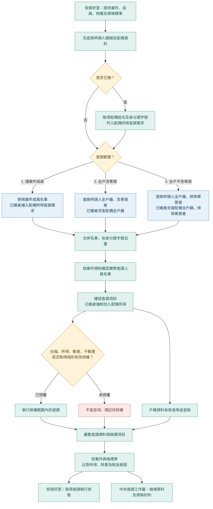

# 全國社會住宅統一申請登記平臺｜查調機制與 API 介接說明（會議討論版 v2.11）

**適用對象：國家住都中心、安居好室開發團隊、統一登記平臺團隊**

<!-- **文件定位：** 本文件說明介接分工、資料流與建議欄位，供會議確認；已確認可得知是否已婚，已婚時可取得配偶姓名及身分證字號；個人戶籍基本資料 API 不判斷配偶是否同戶。案件查調 API 的輸出格式維持待定。需決議事項集中於第六節。 -->

## 一、整體查調規則

權責機關透過 **API 發起查調**，提供案件資料、申請成員資料、查調對象與項目，並一併提供**資格判斷標準**。系統依指定範圍確認查調人員；**申請人如已婚，無論配偶是否同戶籍，均自動納入配偶所得查調**。

查調**社福資格、所得、動產及不動產**前，須確認受查人員已同意授權；**未授權不得查調**。系統取得資料後，依案件提供的標準進行**資格初判**。

查調完成後，API 提供**查調執行狀態**；權責機關授權人員登入**中央查調工作臺**檢視查調資料及初判結果，系統並**留存資料閱覽紀錄**。

### 1.1 目的、分工與共同原則

本規劃採三支對外 API，依序處理「確認配偶是誰」、「取得各戶名單」、「執行案件查調」。**配偶即使不同戶，仍須能透過婚姻／配偶資料識別，不能只在申請人戶籍名單內尋找配偶。**

| 階段 | 安居好室／權責機關 | 中央查調平臺 |
|---|---|---|
| 確認關係 | 提供案件、申請人及查調基準日。 | 向戶政來源查詢婚姻及配偶資訊，回傳可確認的資料。 |
| 取得戶籍 | 以申請人、必要時以配偶分別呼叫全戶籍 API，指定是否包含寄居者。 | 回傳各戶完整姓名及身分證字號清單，保留各次查詢識別碼。 |
| 整理查調對象 | 保留原案件成員身分，確認實際受查人員及個別授權，提供查調項目與標準。 | 檢核名單、引用結果與授權，不將「取得全戶名單」視為「全員已授權」。 |
| 執行與檢視 | 授權承辦人登入中央工作臺檢視資料及初判。 | 執行核准的查調，留存各批次資料及閱覽紀錄；對外輸出格式另議。 |

共同原則：

- 以同一案件編號與查調基準日串接三支 API；不同基準日的資料不得混用。
- 已婚配偶必須納入所得查調需求，**但未取得配偶授權時不得執行**，應標記待授權，不得因待授權而視為無配偶。
- 戶籍查詢依核准用途辦理；社福、所得、動產及不動產查調須確認各人有效授權。
- 區分「案件成員」、「戶籍名單」與「實際查調對象」；三者不一定相同。
- 配偶全戶是需要取得的戶籍資料；其同戶其他成員是否納入財稅查調，須依案件規則確認，不能由 API 自動推定。
- 婚姻或配偶身分資訊缺漏時，標記待確認；不得以空值推定未婚或資格符合。

## 二、開始查調時，要提供什麼？

| 資料類別 | 輸入內容 |
|---|---|
| **案件資料** | 統一案件編號、權責機關<br>申請社宅、申請房型、申請時間<br>查調基準日 |
| **案件成員** | **第一筆固定為申請人** <br>姓名、身分證字號、懷孕胎兒數<br>是否同意授權查調|
| **名單準備方式（三選一，非 API 欄位）** | ① **僅案件成員**<br>② **全戶含寄居**<br>③ **全戶不含寄居** |
| **查調資料（可複選）** | ① **戶役政**（基本）<br>② **社福資格**（基本，須授權）<br>③ **所得**（基本，須授權）<br>④ **動產**（依需求，須授權）<br>⑤ **不動產**（依需求，須授權） |
| **資格標準** | ① **年所得標準**<br>② **每人每月平均所得標準**<br>③ **不動產價值標準**<br>④ **動產價值標準**<br>⑤ **所得級距**：<br>　• 級距名稱（可自訂，筆數不固定）<br>　• 條件二選一：**每人每月平均所得起訖範圍**，或**住宅法第 4 條弱勢身分（勾選 13 類中的適用項目）** |

**所得級距輸入範例**（每筆級距只需名稱與一種判斷條件）：

```json
{
  "rentTiers": [
    {
      "tierName": "第一級",
      "condition": {
        "type": "LAW",
        "categoryCodes": [
          "W01",
          "W07"
        ]
      }
    },
    {
      "tierName": "第二級",
      "condition": {
        "type": "INCOME",
        "rangeStart": 0,
        "rangeEnd": 26624
      }
    },
    {
      "tierName": "第三級",
      "condition": {
        "type": "INCOME",
        "rangeStart": 26625,
        "rangeEnd": 62125
      }
    }
  ]
}
```

- `LAW`：符合所勾選的弱勢類別任一項。
- `INCOME`：比對每人每月平均所得起訖範圍（含起訖值）。
- 級距依傳入順序判斷；必要資料不足時標記無法判定。

## 三、查調機制流程

查調依「確認案件 → 查詢婚姻及配偶 → 取得所需全戶名單 → 確認查調對象 → 檢核項目與授權 → 執行與彙整 → 資格初判 → 結果檢視」的順序進行。

### 3.1 處理順序

1. **確認案件資料與查調基準日**：確認申請人、原案件成員及本案資格標準。
2. **先查詢配偶資料**：確認申請人是否已婚；已婚者先取得配偶姓名及身分證字號，並列入配偶所得查調需求。配偶資料確認完成後，才進入全戶籍查詢；不以是否同戶為前提。
3. **再查詢全戶籍**：完成前一步的婚姻及配偶資料確認後，再確認是否需要全戶名單。僅案件成員者不展開全戶；需要全戶者，先決定是否包含稱謂為「寄居」的人，再取得申請人全戶；已婚者另取得配偶全戶。
4. **整理名單並確認實際查調對象**：合併案件成員及需要的戶籍名單，依身分證字號去重，保留原案件成員身分。配偶全戶中的其他人是否納入查調，依案件規則確認，不自動全員納入。
5. **確認查調項目與個別授權**：確認每人的查調項目及有效授權。已婚配偶須列入所得查調需求，但未授權仍不得執行。
6. **執行查調並彙整資料**：執行已授權的社福、所得及財產查調；未授權者標記待授權，來源失敗或回傳不足者標記資料缺漏。戶籍查詢依核准用途辦理。
7. **依標準進行資格初判**：彙整家庭所得、人口及財產資料，再比對本案標準與所得級距；必要資料不齊時不得視為符合。
8. **提供檢視並留存紀錄**：授權承辦人檢視查調資料與初判結果，系統保存批次及查閱紀錄。

### 3.2 流程圖



### 3.3 全戶名單範圍與人員整理

確認婚姻及配偶資料後，再依案件選擇名單範圍：

| 範圍 | 名單取得方式 |
|---|---|
| 僅案件成員 | 不展開全戶；已婚者仍須確認並納入配偶所得查調需求。 |
| 全戶含寄居 | 取得申請人全戶，包含稱謂為「寄居」的人；已婚者另取得配偶全戶，採相同設定。 |
| 全戶不含寄居 | 取得申請人全戶，排除稱謂為「寄居」的人；已婚者另取得配偶全戶，採相同設定。 |

取得名單後，依身分證字號合併去重，保留原案件成員身分，再依案件規則決定實際查調對象。取得配偶全戶資料，不代表其中所有人都自動納入所得或財產查調。

### 3.4 授權與判定原則

- **配偶所得：** 已婚配偶須列入所得查調需求，不因是否同戶或是否展開全戶而省略；未授權時仍不得執行。
- **個別授權：** 社福資格、所得、動產及不動產均須先確認各人的有效授權；未授權項目不查，標記待授權。戶籍查詢依核准用途辦理。
- **資料完整性：** 婚姻、配偶或必要資料缺漏時應補正或重查，不得把缺漏當作未婚、無成員或符合資格。
- **所得與人口：** 不得先刪除未授權者，再把剩餘名單當作完整家庭計算所得及人口；必要資料不齊時，標記無法完整判定。

### 3.5 常見情境

| 情境 | 處理原則 |
|---|---|
| 未婚、僅案件成員 | 使用案件成員名單，不展開全戶。 |
| 已婚、僅案件成員 | 不展開全戶，但配偶仍須列入所得查調需求；未列原案件成員時，不因此改變其案件成員身分。 |
| 未婚、需全戶 | 依是否含寄居取得申請人全戶，再確認實際查調對象。 |
| 已婚、需全戶 | 取得申請人及配偶全戶，不需先判斷同戶；重複人員只計一次。 |
| 配偶未授權 | 保留配偶所得查調需求，標記待授權，不執行該項查調。 |
| 婚姻、配偶或必要戶籍資料缺漏 | 待補正或重新確認，不將缺漏當作未婚、無成員或符合資格。 |

## 四、API 怎麼用？

既有「統一案件取號 API」照原方式使用。查調介接提供以下服務：

| API | 呼叫方式 | 使用時機／取得資訊 |
|---|---|---|
| **個人戶籍基本資料 API** | `POST /api/v1/person-household-inquiries` | 傳入申請人資料，取得是否已婚及已婚者的配偶姓名、身分證字號，詳見 4.1。 |
| **全戶籍 API** | `POST /api/v1/household-inquiries` | 以指定人員查詢其戶籍成員；申請人、配偶共用。是否包含寄居由 `includeLodgers` 決定，詳見 4.2。 |
| **案件查調 API** | `POST /api/v1/inquiries` | 提交案件、成員、授權、查調項目及資格標準，可引用多筆已取得的戶籍結果，詳見 4.3。 |

本文件依上述三支對外 API 分工，個人戶籍基本資料的輸出依 4.1 定義。不另列狀態查詢或中央工作臺內部介面；輪詢或完成通知方式，待案件查調輸出規格確認後再定義。

**資料提供方式**：全戶籍 API 向安居好室回傳戶籍成員姓名與身分證字號清單。案件查調的狀態及必要待辦資訊為預計提供內容，輸出欄位與格式尚未定案。所得、財產、社福資料及資格初判明細，由授權承辦人登入**中央查調工作臺**檢視。

### 4.1 個人戶籍基本資料 API

用途：確認查詢對象是否已婚；已婚時回傳配偶姓名與身分證字號，供後續查詢配偶全戶籍。呼叫 `POST /api/v1/person-household-inquiries`。

#### 輸入欄位說明

| 欄位 | 說明 |
|---|---|
| `caseNumber` | 統一案件編號。 |
| `referenceDate` | 查調基準日，格式為 `YYYY-MM-DD`。 |
| `subject.name` | 查詢對象姓名。 |
| `subject.nationalId` | 查詢對象身分證字號。 |

#### 輸入格式 JSON 範例

```json
{
  "caseNumber": "CH-115-00000001",
  "referenceDate": "2026-10-08",
  "subject": {
    "name": "張忠政",
    "nationalId": "B134567890"
  }
}
```

#### 輸出欄位說明

| 欄位 | 說明 |
|---|---|
| `isMarried` | 是否已婚，布林值：`true` 為已婚，`false` 為未婚。 |
| `spouse` | 已婚時回傳配偶資料；未婚時為 `null`。 |
| `spouse.name` | 配偶姓名，已婚時必須提供。 |
| `spouse.nationalId` | 配偶身分證字號，已婚時必須提供，供後續查詢配偶全戶籍。 |

#### 輸出格式 JSON 範例

已婚：

```json
{
  "isMarried": true,
  "spouse": {
    "name": "劉欣慧",
    "nationalId": "A287654329"
  }
}
```

未婚：

```json
{
  "isMarried": false,
  "spouse": null
}
```

本 API 不回傳配偶是否同戶。查詢失敗或資料缺漏不得回傳 `isMarried: false` 冒充未婚。

**串接順序：** 先確認申請人基本資料，再依需要查詢申請人全戶；需要全戶且已婚時，以配偶的姓名與身分證字號再次呼叫 4.2，不需預先判斷是否同戶。兩次查詢使用相同案件編號與基準日。確認實際查調人員及個別授權後，再呼叫 4.3。

所得、動產、不動產及社福對外仍由案件查調 API 統一指定項目；來源機關介接、歷次查調及檢視紀錄屬內部介面，另行規劃。

### 4.2 全戶籍 API

#### 輸入欄位說明

| 欄位 | 說明 |
|---|---|
| `caseNumber` | 統一案件編號。 |
| `referenceDate` | 查調基準日，格式為 `YYYY-MM-DD`。 |
| `subject.name` | 查詢對象姓名，可為申請人或配偶。 |
| `subject.nationalId` | 查詢對象身分證字號，用以查詢其所屬戶籍。 |
| `includeLodgers` | 必填布林值。是否包含戶籍稱謂為「寄居」的人：`true` 包含；`false` 排除。依戶籍資料的稱謂欄位判斷。 |

#### 輸入格式 JSON 範例

呼叫 `POST /api/v1/household-inquiries`：

```json
{
  "caseNumber": "CH-115-00000001",
  "referenceDate": "2026-10-08",
  "subject": {
    "name": "張忠政",
    "nationalId": "B134567890"
  },
  "includeLodgers": false
}
```

#### 輸出欄位說明

呼叫全戶籍 API 後，由同一支 API 回傳該戶符合查詢範圍的全部成員姓名、身分證字號及本次查詢識別碼，不需另呼叫狀態查詢 API。以下定義成功取得完整名單的回傳；錯誤與逾時格式待補。

| 欄位 | 說明 |
|---|---|
| `householdInquiryId` | 本次全戶籍查詢識別碼，供後續案件查調引用該次名單。 |
| `caseNumber` | 對應的統一案件編號。 |
| `referenceDate` | 本次查調基準日。 |
| `subject` | 本次查詢對象，包含 `name` 與 `nationalId`；對應輸入，供辨識申請人戶或配偶戶的查詢來源。 |
| `includeLodgers` | 本次是否包含稱謂為「寄居」的人，與輸入相同。 |
| `status` | `COMPLETED`：已成功取得完整名單。 |
| `householdMembers` | 該戶依 `includeLodgers` 篩選後的完整成員陣列，每筆包含姓名與身分證字號；依身分證字號去重，不只限於原案件成員。 |
| `householdMembers[].name` | 戶籍成員姓名。 |
| `householdMembers[].nationalId` | 該名戶籍成員的身分證字號，與同筆姓名對應。 |
| `completedAt` | 資料完成時間，採含時區的 ISO 8601 格式。 |
| `issues` | 異常或待辦事項；無事項時為空陣列。 |

#### 輸出格式 JSON 範例

以下為申請人戶查詢完成後的回傳範例（沿用現有示意案件，不含寄居者）：

```json
{
  "householdInquiryId": "HH-20261008-00001",
  "caseNumber": "CH-115-00000001",
  "referenceDate": "2026-10-08",
  "includeLodgers": false,
  "status": "COMPLETED",
  "completedAt": "2026-10-08T21:35:55+08:00",
  "issues": [],
  "householdMembers": [
    {
      "name": "張忠政",
      "nationalId": "B134567890"
    },
    {
      "name": "張大富",
      "nationalId": "E123456789"
    },
    {
      "name": "張曉雯",
      "nationalId": "B234567890"
    }
  ],
  "subject": {
    "name": "張忠政",
    "nationalId": "B134567890"
  }
}
```

#### 配偶不同戶：同一支 API 的第二次呼叫範例

本例使用現有頁面的申請人張忠政與配偶劉欣慧資料，以兩人不同戶的情境示範；由 4.1 取得配偶身分後，即可以配偶為對象查全戶，不需先判斷是否同戶。以配偶為查詢對象，不新增配偶專用端點；本次與申請人戶採相同基準日及不含寄居設定。

**輸入：**

```json
{
  "caseNumber": "CH-115-00000001",
  "referenceDate": "2026-10-08",
  "subject": {
    "name": "劉欣慧",
    "nationalId": "A287654329"
  },
  "includeLodgers": false
}
```

**輸出：**

```json
{
  "householdInquiryId": "HH-20261008-00002",
  "caseNumber": "CH-115-00000001",
  "referenceDate": "2026-10-08",
  "subject": {
    "name": "劉欣慧",
    "nationalId": "A287654329"
  },
  "includeLodgers": false,
  "status": "COMPLETED",
  "completedAt": "2026-10-08T21:36:20+08:00",
  "issues": [],
  "householdMembers": [
    {
      "name": "劉欣慧",
      "nationalId": "A287654329"
    },
    {
      "name": "張曉晨",
      "nationalId": "B123456789"
    }
  ]
}
```

申請人戶結果為 `HH-20261008-00001`，配偶戶結果為 `HH-20261008-00002`。配偶戶包含張曉晨，但他不在本例四位案件成員中；是否列為實際受查人員須另依案件規則確認，不能因名單已回傳就自動查其所得。

### 4.3 案件查調 API

#### 輸入欄位說明

| 欄位 | 說明 |
|---|---|
| `case.caseNumber` | 統一案件編號。 |
| `case.agencyCode` | 權責機關編碼：`CH` 國家住都中心、`LF` 新北市、`LA` 臺北市、`LH` 桃園市、`LB` 臺中市、`LD` 臺南市、`LE` 高雄市。 |
| `case.housingCode` | 申請社宅代碼。 |
| `case.roomTypeName` | 申請房型名稱，直接傳入文字，例如「套房」、「一房型」、「二房型」、「三房型」。 |
| `case.submittedAt` | 申請時間，採含時區的 ISO 8601 格式。 |
| `case.referenceDate` | 查調基準日，格式為 `YYYY-MM-DD`。 |
| `members` | 原案件成員陣列，第一筆固定為申請人。 |
| `members[].name` | 成員姓名。 |
| `members[].nationalId` | 成員身分證字號。 |
| `members[].isConsentGranted` | 是否同意授權查調社福、所得、動產及不動產；`true` 為同意，`false` 為未同意。 |
| `members[].fetusCount` | 懷孕胎兒數；無則填 `0`。 |
| `query.householdInquiryIds` | 全戶查詢識別碼陣列，可引用申請人戶及配偶戶等多筆結果；重複識別碼只列一次，不引用則省略。各筆案件編號與基準日須一致，不重新查詢全戶。引用名單不等於其中每人均納入財稅查調，實際納入規則待確認。 |
| `query.subjectNationalIds`（新增提案） | 明列本次實際查調對象的身分證字號，與戶籍結果引用分開。由案件規則決定納入名單，不以是否授權代替是否納入；中央須檢核來源及已婚配偶所得需求。此欄位與責任分工列為會議決議事項。 |
| `query.items` | 查調項目陣列：`HOUSEHOLD` 戶役政、`WELFARE` 社福資格、`INCOME` 所得、`REAL_ESTATE` 不動產、`MOVABLE_ASSET` 動產。 |
| `subjectConsents` | 全戶展開或補入配偶後，非原案件成員的個別授權資訊；原案件成員仍使用 `members` 的授權欄位。 |
| `subjectConsents[].nationalId` | 受查人員身分證字號。 |
| `subjectConsents[].isConsentGranted` | 是否同意授權；未提供或為 `false` 時，不執行該人的社福、所得、動產及不動產查調。同一人不得傳入矛盾的授權值。 |
| `standards.totalAnnualIncome` | 家庭年所得標準，包含比較運算子 `op` 及金額 `value`（元）。 |
| `standards.perCapitaMonthlyIncome` | 每人每月平均所得標準，包含 `op` 及 `value`（元）。 |
| `standards.realEstateValue` | 不動產價值標準，包含 `op` 及 `value`（元）。 |
| `standards.movableAssetValue` | 動產價值標準，包含 `op` 及 `value`（元）。 |
| 上述標準的 `op` | `LT`：低於、不含上限；`LTE`：不超過、含上限。 |
| `standards.includeFetusInPopulation` | 計算平均所得的人口數是否包含胎兒。 |
| `standards.rentTiers` | 所得級距陣列，名稱與筆數不固定，依傳入順序判斷。 |
| `standards.rentTiers[].tierName` | 級距名稱。 |
| `standards.rentTiers[].condition.type` | `LAW`：弱勢身分條件；`INCOME`：每人每月平均所得區間，二選一。 |
| `standards.rentTiers[].condition.categoryCodes` | `LAW` 使用的弱勢類別代碼清單，符合任一項即可。 |
| `standards.rentTiers[].condition.rangeStart` | `INCOME` 使用的所得區間下限（元，含下限）。 |
| `standards.rentTiers[].condition.rangeEnd` | `INCOME` 使用的所得區間上限（元，含上限）。 |

案件查調 API 不提供 `query.scope`。是否包含稱謂為「寄居」的人，由全戶籍 API 的 `includeLodgers` 決定。帶入 `householdInquiryIds` 時，引用各次已取得的 `householdMembers` 並依身分證字號去重，不重新展開戶籍；案件成員身分仍以 `members` 為準。配偶同戶成員是否納入所得、財產查調的規則尚待確認，不能僅因出現在引用名單中或已授權就自動納入。

例如兩人不同戶時，`query.householdInquiryIds` 可傳入 `["HH-20261008-00001", "HH-20261008-00002"]`，分別引用申請人戶與配偶戶；兩份結果中的人員依身分證字號去重。此陣列引用既有結果，不會自行發起另一戶的查詢。

**實際受查名單建議明列：** 以 `query.subjectNationalIds` 區分「引用哪些戶籍資料」與「這次查哪些人」。名單內未授權者仍保留待授權狀態，不執行其社福、所得及財產查調；不得先刪去未授權者，再把剩餘人員當成完整家庭計算平均所得。所需人口或所得資料不完整時，標記無法完整判定。

`query.items` 為本次指定項目；已婚配偶的所得是另外必須檢核的需求，不能只因未傳 `INCOME` 而跳過。其餘項目的執行依實際受查名單及有效授權判斷。如何在請求中明列「不同人查不同項目」，列為會議決議事項，不在此先指定尚未確認的結構。

#### 輸入格式 JSON 範例

呼叫 `POST /api/v1/inquiries`。以下為會議討論範例：引用申請人戶及配偶戶，原案件成員仍為張忠政、張大富、張曉雯、劉欣慧四人。`subjectNationalIds` 示範只查這四人的提案，**不代表配偶戶其他成員一律排除的正式政策**。四人皆已在 `members` 提供授權，故本例不需重複提供 `subjectConsents`。

```json
{
  "case": {
    "caseNumber": "CH-115-00000001",
    "agencyCode": "CH",
    "housingCode": "H001",
    "roomTypeName": "三房型",
    "submittedAt": "2026-10-08T21:34:55+08:00",
    "referenceDate": "2026-10-08"
  },
  "members": [
    {
      "name": "張忠政",
      "nationalId": "B134567890",
      "isConsentGranted": true,
      "fetusCount": 0
    },
    {
      "name": "張大富",
      "nationalId": "E123456789",
      "isConsentGranted": true,
      "fetusCount": 0
    },
    {
      "name": "張曉雯",
      "nationalId": "B234567890",
      "isConsentGranted": true,
      "fetusCount": 0
    },
    {
      "name": "劉欣慧",
      "nationalId": "A287654329",
      "isConsentGranted": true,
      "fetusCount": 1
    }
  ],
  "query": {
    "items": [
      "HOUSEHOLD",
      "WELFARE",
      "INCOME",
      "REAL_ESTATE",
      "MOVABLE_ASSET"
    ],
    "householdInquiryIds": [
      "HH-20261008-00001",
      "HH-20261008-00002"
    ],
    "subjectNationalIds": [
      "B134567890",
      "E123456789",
      "B234567890",
      "A287654329"
    ]
  },
  "standards": {
    "totalAnnualIncome": {
      "op": "LT",
      "value": 1450000
    },
    "perCapitaMonthlyIncome": {
      "op": "LTE",
      "value": 62125
    },
    "realEstateValue": {
      "op": "LT",
      "value": 7080000
    },
    "movableAssetValue": {
      "op": "LT",
      "value": 4710000
    },
    "includeFetusInPopulation": true,
    "rentTiers": [
      {
        "tierName": "第一級",
        "condition": {
          "type": "LAW",
          "categoryCodes": [
            "W01",
            "W07"
          ]
        }
      },
      {
        "tierName": "第二級",
        "condition": {
          "type": "INCOME",
          "rangeStart": 0,
          "rangeEnd": 26624
        }
      },
      {
        "tierName": "第三級",
        "condition": {
          "type": "INCOME",
          "rangeStart": 26625,
          "rangeEnd": 62125
        }
      }
    ]
  }
}
```

輸出欄位及輸出格式尚未定案，本節暫不提供。

#### 串接檢核原則

- `householdInquiryIds` 須屬於同一案件、相同基準日，且為可用的完整結果；不得引用其他案件、失效或已刪除資料。
- 查詢識別碼只標識一次查詢，不等同戶號；兩筆識別碼不同不代表一定是不同戶。
- 跨戶及案件成員以身分證字號去重；同一人姓名或授權資訊衝突時須確認，不得任意覆寫。
- `subjectNationalIds` 不得含無法對應案件成員、引用戶籍或已確認配偶的人員；已婚配偶未列入時不得靜默略過所得需求。
- 胎兒數須為非負整數；同一孕婦跨名單出現不得重複計算。平均所得人口的法定認定與其他納入條件由業務規則確認。
- 標準金額與比較方式須分開：年所得、不動產、動產範例為 `LT`；每人每月所得為 `LTE`。不動產排除原住民保留地與道路用地所需的來源分類欄位及計算方式，須另行對照確認。
- `LAW` 與 `INCOME` 條件擇一；級距依順序判斷，必要資料不足不跳過前項直接判定較後級距。`W01`、`W07` 暫為代碼示意，正式類別對照表須在會議確認，不據此推定具體資格。
- 重送同一請求與主動重新查調須能區分，避免意外產生重複批次；冪等識別、逾時及錯誤格式列為後續技術契約，不在本版捏造輸出。

## 五、中央結果檢視

本節僅說明中央工作臺的檢視功能，不定義對外 API 或內部介面路徑。案件查調 API 的輸出尚未定案，暫不提供格式範例。

中央工作臺顯示：**家庭總所得、每人每月平均所得、動產、不動產的實際值／標準／初判結果，以及適用租金級距與判斷理由、戶籍成員明細**。

同一案件可有多次查調，每次保存獨立版本。檢視歷史批次時，整頁顯示該版資料，並標示批次、送查調時間、資料完成時間、保存期限及是否為目前採用版本；版本到期後不得再檢視原始內容。查調內容最多保存六個月，正式起算點與刪除範圍列於第六節確認。

檢視次數以案件統計，每筆閱覽紀錄包含檢視人員、所屬機關、時間及查閱批次；切換至另一版檢視亦須留下對應紀錄。閱覽軌跡與查調內容分開管理，軌跡的保存期限另訂。

[查調案件列表](https://jillyz.github.io/housing/backend/enquiry-hub.html)
[查調結果明細](https://jillyz.github.io/housing/backend/enquiry-detail.html?case=CH-115-00000001)

[查調案件列表(配偶未列未授權)](https://jillyz.github.io/housing/backend/enquiry-hub-spouse-demo.html)
[查調結果明細(配偶未列未授權)](https://jillyz.github.io/housing/backend/enquiry-detail-spouse-demo.html)


## 六、會議需確認的事項

下列為尚未定案的設計決策，不應視為已完成的介接規格。

| 項目 | 本版建議／需要確認的問題 | 建議確認對象 |
|---|---|---|
| 基本資料介接對照 | 是否已婚及已婚者配偶姓名、身分證字號已確認可取得；待確認來源欄位與狀態碼對照、查調基準日支援及錯誤情境，不再將資訊是否可取得列為待決事項。 | 戶政介接窗口、平臺團隊 |
| 全戶回傳可行性 | 目前以同次呼叫回傳完整名單規劃；確認來源時效、最大等待時間及歷史基準日支援。若不支援，再討論非同步，不能先承諾。 | 兩方開發團隊、戶政介接窗口 |
| 實際受查名單 | 建議由權責機關依業務規則提供 `query.subjectNationalIds`，中央檢核；配偶戶其他成員納入條件、不同人的查調項目須明訂。 | 國家住都中心／權責機關、兩方開發團隊 |
| 人口與資格計算 | 哪些人計入所得與分母、胎兒認列、不動產排除項目、弱勢類別代碼對照與缺漏資料的處理。 | 業務單位、資料來源窗口 |
| 授權及補件 | 布林值如何連結授權憑證、有效期間及項目；配偶待授權如何補入，補件是否新開批次。 | 業務單位、兩方開發團隊 |
| 案件查調輸出 | 受理回傳、完成／部分完成、錯誤、待辦，以及輪詢或完成通知；尚未定案，本版不提供輸出 JSON。 | 兩方開發團隊、業務單位 |
| 請求與資料一致性 | 防止重複送件的識別方式、跨案件引用檢核、引用結果失效／刪除後如何重查、基本資料結果如何與後續案件綁定。 | 兩方開發團隊 |
| 六個月保存及閱覽軌跡 | 查調版本最多保存六個月；建議以送查調時間起算，須確認正式起算點、到期刪除執行與涵蓋資料。閱覽軌跡保存政策另定，不與原始查調內容混為一談。 | 業務單位、系統維運／資安窗口 |

**本次會議建議產出：** 確認三支 API 的分工及資料來源可行性、決定實際受查名單與配偶戶納入規則、指定輸出契約與例外處理的確認窗口；再據此形成可供開發的正式版。
