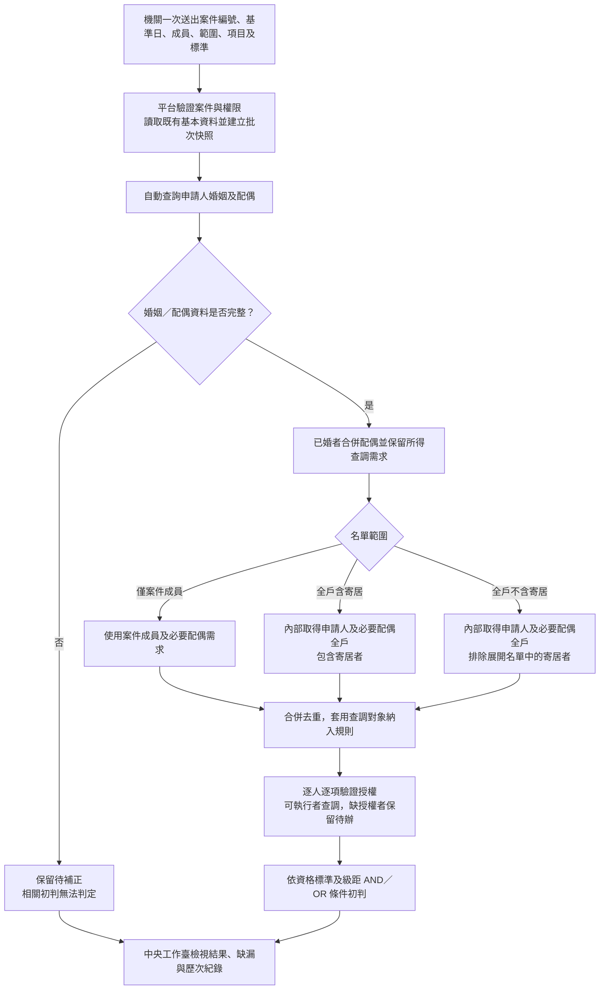

# 全國社會住宅統一申請登記平臺｜查調機制與 API 介接說明（會議討論版 v3.0）

**適用對象：國家住都中心、安居好室開發團隊、統一登記平臺團隊**

**更新日期：2026-11-16**

## 一、整體查調規則

查調對外僅保留一支 **案件查調 API：`POST /api/v1/inquiries`**。權責機關提供統一案件編號、查調基準日、案件成員、名單範圍、查調項目及資格標準；平台依案件編號讀取既有案件基本資料，並自動查詢申請人婚姻及配偶資料、依範圍取得戶籍名單、檢核授權、執行查調及資格初判。

統一案件取號及案件進度 API 沿用 [申請案件查詢功能規格](申請案件查詢功能規格.md)，不計入本文件的一支查調 API。查調請求不重複傳入機關、案件年度、縣市、社宅、房型或申請日期，亦不更新案件基本資料、案件進度或案件成員主檔。

原先由機關分別呼叫的「個人戶籍基本資料」與「全戶籍」服務，改為平台內部來源介接步驟，不再提供獨立對外查調端點。機關無須先取得配偶或全戶查詢識別碼，也不需傳入戶籍結果引用清單。

共同原則：

- `members[0]` 固定為申請人本人，至少一人，保留傳入順序。本次成員及授權屬查調批次快照，不因主檔已有成員就省略。
- 平台每次查調均自動確認申請人是否有配偶，不依「配偶是否已列案件成員」或「是否展開全戶」決定要不要查婚姻。
- 已婚配偶無論是否同戶、是否列原案件成員，均須保留配偶所得查調需求；未取得配偶授權時不執行，標記待授權。
- 戶役政查詢依核准用途執行。社福資格、所得、動產及不動產均須有受查人本人的有效授權；申請人的授權不能套用至配偶或全戶其他人。
- 自動取得的人員與原案件成員依身分證字號去重，保留案件成員、配偶及各戶來源標記。戶籍名單不直接等於財稅查調名單或家庭計算人口。
- 各來源資料對齊同一查調基準日；來源無法提供該日資料時須保存實際資料期間與差異，不以當日現況冒充基準日結果。
- 婚姻、配偶、授權或必要資料缺漏時，保留待辦或無法判定，不推定未婚、零所得或資格符合。
- 同一案件可有多次查調，每次保存獨立批次、標準快照及初判結果；查調批次狀態與「已受理／已入住／已退租」案件狀態分開保存。

## 二、開始查調時，要提供什麼？

| 資料類別 | 輸入內容 |
|---|---|
| **案件識別** | 統一案件編號；案件基本資料由平台依編號讀取，不重複傳入 |
| **查調基準日** | 西元日期 `YYYY-MM-DD` |
| **案件成員** | 第一筆固定為申請人；每人提供姓名、身分證字號、是否同意授權查調、懷孕胎兒數 |
| **名單範圍（三選一）** | ① 僅案件成員　② 全戶含寄居　③ 全戶不含寄居 |
| **查調資料** | ① 戶役政（基本）　② 社福資格（基本，須授權）　③ 所得（基本，須授權）　④ 動產（依需求，須授權）　⑤ 不動產（依需求，須授權） |
| **資格標準** | 年所得標準、每人每月平均所得標準、不動產價值標準、動產價值標準、所得級距 |
| **所得級距** | 級距名稱與判斷條件；可單獨使用「住宅法第 4 條弱勢身分」或「每人每月平均所得起訖範圍」，同一級亦可將兩者以 AND／OR 組合 |

戶役政、社福資格及所得為本次基本查調項目，`query.items` 必須包含三者；動產、不動產依需求加入。基本項目不代表免授權，未授權的社福及所得仍不得執行。

## 三、平台自動查調流程

### 3.1 處理順序

1. **驗證與讀取案件**：驗證機關憑證及統一案件編號，確認案件已由取號 API 建立且屬授權機關；讀取 `application_case` 及必要主檔，建立本次基本資料快照。未取號時拒絕，不由查調 API 自行建立申請案件。
2. **建立查調批次與成員快照**：保存基準日、名單範圍、項目、資格標準及完整 members。第一筆為申請人；若案件成員主檔已有申請人，須比對其身分證字號，不一致時拒絕並要求先更正，不能藉查調變更申請人。若尚未回傳進度而沒有成員主檔，採本次第一筆作查調申請人，不回寫主檔。
3. **自動查婚姻及配偶**：以第一筆申請人及基準日向戶政來源查詢。已婚時取得配偶姓名與身分證字號，合併批次人員並建立配偶所得需求；來源失敗、婚姻不明或配偶身分不足時保留待補正，不當作未婚。
4. **依名單範圍取得戶籍**：僅案件成員時不展開全戶；其餘範圍取得申請人全戶，已婚者另取得配偶全戶。由平台依來源協定完成一次或多次內部查詢，機關無須分次呼叫。已明確同戶時可共用來源結果；不能因配偶戶未回傳就自行推定同戶。
5. **合併名單並決定實際查調對象**：依身分證字號去重、保留原案件成員及配偶標記，再套用業務納入規則。未授權不影響名單納入判斷；配偶戶其他成員的財稅納入規則未定時，標記待確認，不自動查調。
6. **取得基本戶役政並檢核個別授權**：依核准用途取得案件成員及必要受查人的基本戶役政資料；CASE_MEMBERS 只是不展開全戶，仍執行基本戶役政及申請人婚姻確認。members 的授權布林值展開至該人本次要求的社福、所得及財產項目。自動發現且未列 members 的人員，不繼承他人授權；僅有明確適用於本次範圍的本人有效授權紀錄時才可執行，否則待授權。
7. **執行查調與資格初判**：執行可查項目，保存來源資料與缺漏；依標準計算所得、人口、財產及級距。未授權或必要資料不齊時，相關初判為無法判定，不將未取得資料當作 0。
8. **結果檢視與稽核**：授權承辦人登入中央查調工作臺檢視當次資料、配偶及全戶自動查詢結果、初判、待辦及歷次批次；留存資料閱覽紀錄。

### 3.2 流程圖



本節為新版流程依據；舊版 `跨機關查調機制流程圖.png` 未同步，不再作為本版流程規格。

### 3.3 名單範圍

| query.scope | 名稱 | 處理方式 |
|---|---|---|
| CASE_MEMBERS | 僅案件成員 | 不展開全戶，仍自動查婚姻並保留已婚配偶所得需求 |
| WHOLE_HOUSEHOLD_INCLUDE_LODGERS | 全戶含寄居 | 取得申請人全戶，已婚者取得必要配偶全戶，包含來源確認的寄居者 |
| WHOLE_HOUSEHOLD_EXCLUDE_LODGERS | 全戶不含寄居 | 與前項相同，但展開戶籍名單排除來源確認的寄居者 |

「不含寄居」只篩選自動展開的戶籍名單，不刪除機關已送入的案件成員，也不省略必要配偶所得需求。來源無法提供寄居者或辨識其身分時，標記範圍資料不完整，不能將部分親屬名單冒充完整全戶結果。

### 3.4 授權、人口與胎兒數

- `isConsentGranted` 為每人必填布林值；true 表示機關確認此人已同意本次要求的社福、所得、動產及不動產查調，false 表示未同意。不另傳逐項授權陣列，後端仍逐人逐項保存授權及執行結果。
- 案件成員明確傳入 false 時，不以舊授權紀錄覆蓋本次未同意。自動取得的非案件成員缺授權時，標記 `PENDING`／`BLOCKED_CONSENT`，不得預設 true。
- 授權只允許執行已納入範圍的項目；有授權不代表自動成為家庭計算人口或財稅受查人。
- 自動查到的配偶若原已列 members，使用同一人的授權及胎兒數，不重複建立人員；未列 members 時，不變更原案件成員身分，胎兒數未知保留 NULL，不代填 0。
- members 的 `fetusCount` 必填非負整數，無胎兒填 0；同一人跨名單重複出現只計一次。平均所得是否納入胎兒由 `includeFetusInPopulation` 決定，家庭人口及其他法定納入規則另依業務設定。
- 不得先刪除未授權者，再將剩餘人員視為完整家庭計算平均所得。
- 自動取得的非案件成員之授權來源、補授權與胎兒數補正作業另行確認；未補齊前保留待辦，不為傳入授權而將非案件成員偽列原案件成員。補正後仍透過同一案件查調 API 發起新批次，不新增配偶／戶籍對外 API，亦不覆寫既有批次。

## 四、案件查調 API

### 4.1 用途與介接原則

```http
POST /api/v1/inquiries
Authorization: Bearer {agency_access_token}
Content-Type: application/json
Idempotency-Key: {request_key}
```

- HTTPS、JSON、UTF-8，機關服務憑證須綁定可查案件的 agencyCode；不使用民眾登入憑證。
- `Idempotency-Key` 為必填非空字串標頭，最長 100 字元。同機關同鍵同內容為重送，沿用原批次與基本資料快照，不新增批次；同鍵不同內容回應 409。主動重查、改基準日、改標準、補授權或補正須使用新鍵建立新批次。
- 查調請求以頂層 `caseNumber` 識別案件；不再使用含基本資料的 `case` 物件。
- 本版不接收 `subject`、`includeLodgers`、`householdInquiryIds`、`subjectNationalIds`、`subjectConsents` 或預查配偶結果；範圍由 `query.scope` 決定，其餘由平台內部處理。
- 全筆輸入驗證成功後才建立批次並啟動內部查調；任何輸入錯誤均不得留下部分批次或啟動來源查調。
- 呼叫成功代表送出查調，查調完成與資格符合須分開判斷。既有主檔狀態為 NULL 亦可送查調，不將「已受理／已入住／已退租」當作查調批次狀態。

### 4.2 請求欄位

| 欄位 | 型別／必填 | 說明 |
|---|---|---|
| caseNumber | string(14)／是 | 已取號的統一案件編號，格式沿用申請案件規格，如 CH115A00000842；須歸屬憑證授權機關 |
| referenceDate | string(date)／是 | 查調基準日，西元 YYYY-MM-DD |
| members | array／是 | 完整案件成員快照，至少一人，第一筆為申請人；同一身分證字號不可重複 |
| members[].name | string(1–100)／是 | 姓名，不可為空白 |
| members[].nationalId | string(10)／是 | 身分證字號，須通過格式及檢查碼驗證 |
| members[].isConsentGranted | boolean／是 | 本人是否同意授權查調，不接受字串或 NULL |
| members[].fetusCount | integer／是 | 懷孕胎兒數，須 ≥ 0，無則填 0 |
| query.scope | enum／是 | CASE_MEMBERS、WHOLE_HOUSEHOLD_INCLUDE_LODGERS、WHOLE_HOUSEHOLD_EXCLUDE_LODGERS，三選一 |
| query.items | array<enum>／是 | 必含 HOUSEHOLD、WELFARE、INCOME，可加 MOVABLE_ASSET、REAL_ESTATE；值不可重複 |
| standards.totalAnnualIncome | object／是 | 年所得標準，op 與 value 皆必填 |
| standards.perCapitaMonthlyIncome | object／是 | 每人每月平均所得標準，op 與 value 皆必填 |
| standards.realEstateValue | object／條件必填 | 選 REAL_ESTATE 時必填；未選時省略，不進行該項初判 |
| standards.movableAssetValue | object／條件必填 | 選 MOVABLE_ASSET 時必填；未選時省略，不進行該項初判 |
| 上述標準的 op | enum／是 | LT：低於、不含上限；LTE：不超過、含上限 |
| 上述標準的 value | number／是 | 金額（元），非負且最多二位小數，後端採十進位計算 |
| standards.includeFetusInPopulation | boolean／是 | 平均所得的人口數是否包含胎兒 |
| standards.rentTiers | array／是 | 至少一個所得級距，名稱與筆數可自訂，依傳入順序判斷 |
| standards.rentTiers[].tierName | string(1–100)／是 | 級距名稱，不可空白 |
| standards.rentTiers[].condition.type | enum／是 | LAW、INCOME、COMBINED，規則見 4.3 |
| standards.rentTiers[].condition.operator | enum／條件必填 | COMBINED 時必填 AND 或 OR；單一條件時不傳 |
| standards.rentTiers[].condition.categoryCodes | array<string>／條件必填 | LAW 或 COMBINED 必填，至少一個有效住宅法第 4 條弱勢類別代碼；類別間採符合任一項 |
| standards.rentTiers[].condition.rangeStart | number／條件必填 | INCOME 或 COMBINED 必填，每人每月平均所得下限（元，含下限） |
| standards.rentTiers[].condition.rangeEnd | number／條件必填 | INCOME 或 COMBINED 必填，每人每月平均所得上限（元，含上限），須 ≥ 下限 |

案件編號以外的機關、年度、縣市、社宅、房型及申請日期從 `application_case` 及主檔讀取，再保存本批次快照，不能因不重送而省略歷史快照。主檔缺少必要資料時拒絕並要求補正；機關不得在查調請求中覆寫。

### 4.3 所得級距與 AND／OR 判定

| condition.type | 必填內容 | 判定方式 |
|---|---|---|
| LAW | categoryCodes | 符合選定住宅法第 4 條弱勢類別任一項 |
| INCOME | rangeStart、rangeEnd | 每人每月平均所得落在含起訖值的區間 |
| COMBINED | categoryCodes、rangeStart、rangeEnd、operator | 同一級結合弱勢身分與所得範圍；AND 須兩者成立，OR 任一成立即可 |

- LAW 不傳所得區間及 operator；INCOME 不傳弱勢類別及 operator；COMBINED 必須同時提供兩組條件與 AND／OR。缺漏、空類別清單、重複／無效類別、反向區間或不適用欄位均拒絕。
- 金額區間非負、最多二位小數。級距可因 OR 或不同條件產生重疊，依傳入順序採第一個可確定符合的級距；無任何符合時標記未匹配，不自動套用最後一級。
- 每個條件有「成立／不成立／無法判定」三種結果。AND 有一項確定不成立即可判不成立，兩項均成立才成立；OR 有一項確定成立即可成立，兩項均不成立才不成立；其他含未知的組合為無法判定，不將缺資料當作 false。
- 前級仍無法判定時，不跳過並直接採後級。OR 已因其中一項確定成立而成立時，可判定該級，但不得據此將其他缺授權或未完成項目標示完成，亦不代表整案資格符合。
- 弱勢身分與所得範圍的判定對象沿用業務規則；弱勢身分是否以申請人或家庭成員認定，須在正式規則確認並保存規則版本，不自行推定。正式弱勢類別對照表另行確認；下例 W01、W07 僅為代碼示意。

### 4.4 完整請求範例

本例同時示範 AND、OR 及單一條件級距；金額及級距僅為介接示意，不代表正式政策。身分證字號為刻意不可驗證的占位值，正式測試須替換為可驗證的測試資料。

```json
{
  "caseNumber": "CH115A00000842",
  "referenceDate": "2026-11-16",
  "members": [
    {
      "name": "測試申請人",
      "nationalId": "A000000000",
      "isConsentGranted": true,
      "fetusCount": 0
    },
    {
      "name": "測試案件成員",
      "nationalId": "B000000000",
      "isConsentGranted": false,
      "fetusCount": 1
    }
  ],
  "query": {
    "scope": "WHOLE_HOUSEHOLD_EXCLUDE_LODGERS",
    "items": ["HOUSEHOLD", "WELFARE", "INCOME", "MOVABLE_ASSET", "REAL_ESTATE"]
  },
  "standards": {
    "totalAnnualIncome": { "op": "LT", "value": 1450000 },
    "perCapitaMonthlyIncome": { "op": "LTE", "value": 62125 },
    "realEstateValue": { "op": "LT", "value": 7080000 },
    "movableAssetValue": { "op": "LT", "value": 4710000 },
    "includeFetusInPopulation": true,
    "rentTiers": [
      {
        "tierName": "第一級：弱勢且所得較低",
        "condition": {
          "type": "COMBINED",
          "operator": "AND",
          "categoryCodes": ["W01", "W07"],
          "rangeStart": 0,
          "rangeEnd": 26624
        }
      },
      {
        "tierName": "第二級：弱勢或所得在指定範圍",
        "condition": {
          "type": "COMBINED",
          "operator": "OR",
          "categoryCodes": ["W01", "W07"],
          "rangeStart": 0,
          "rangeEnd": 40000
        }
      },
      {
        "tierName": "第三級：僅所得條件",
        "condition": {
          "type": "INCOME",
          "rangeStart": 0,
          "rangeEnd": 62125
        }
      },
      {
        "tierName": "第四級：僅弱勢身分條件",
        "condition": {
          "type": "LAW",
          "categoryCodes": ["W01"]
        }
      }
    ]
  }
}
```

### 4.5 輸出與異常規劃

對外輸出以查調執行狀態及必要待辦為原則；輸出欄位、同步等待時間或完成通知方式另行確認，本版不新增狀態查詢或配偶／全戶查詢對外 API。重送相同查調不得當作輪詢，也不能因此產生新批次。

查調結果明細、婚姻與配偶、全戶名單、所得、財產及社福資料由授權人員於中央工作臺檢視；不預設完整名單會經 API 回傳機關。API 請求、錯誤及一般紀錄不得回顯完整成員個資或憑證。

| 情境 | 處理原則 |
|---|---|
| 無效或失效憑證 | 401，不啟動查調 |
| 案件不屬授權機關 | 403，不讀取或建立該案查調內容 |
| 案件編號未配發／主檔不存在 | 404，不建立申請案件 |
| 無效 JSON | 400 |
| 必填缺漏、成員重複、型別／日期／代碼／級距不合法，或夾帶基本資料及舊版欄位 | 422，不建立部分批次 |
| 既有申請人不一致或同冪等鍵不同內容 | 409，要求更正或另送新請求 |
| 來源逾時、婚姻不明、戶籍範圍不足 | 保存批次待辦與失敗／缺漏狀態，不偽裝完成或未婚 |
| 未授權 | 保存待授權狀態，不執行該人的授權項目，不將金額當作 0 |

## 五、查調工作臺與歷史資料

中央工作臺顯示家庭總所得、每人每月平均所得、動產、不動產的實際值／標準／初判結果、適用所得級距及判斷理由，以及自動取得的婚姻、配偶與戶籍成員明細。級距須能呈現條件類型、AND／OR、弱勢類別及所得範圍，並保存各子條件判定與缺漏理由。

同一案件可有多次查調，每次保存獨立版本，包含送查調時從案件主檔讀取的基本資料、輸入成員及授權、基準日、名單範圍、查調項目、資格標準與級距組合條件。主檔或標準日後變動，不回寫已完成歷史批次。

檢視歷史批次時，整頁顯示該版資料，並標示批次、送查調時間、資料完成時間、保存期限及是否為目前採用版本。查調內容最多保存六個月，正式起算點、備份及刪除範圍待確認；到期不得由舊連結取回原始內容。

每筆閱覽紀錄包含檢視人員、所屬機關、時間及查閱批次；切換版本亦留紀錄。閱覽軌跡與查調內容分開管理，軌跡保存期限另訂。既有工作臺靜態畫面尚未同步新增的 AND／OR 顯示，本次調整介接與資料規劃。

- [查調案件列表](../backend/enquiry-hub.html)
- [查調結果明細](../backend/enquiry-detail.html)
- [配偶未列原案件成員／未授權情境](../backend/enquiry-detail-spouse-demo.html)

## 六、驗收與待確認事項

### 6.1 驗收項目

| 編號 | 情境 | 預期結果 |
|---|---|---|
| INQ-01 | 僅提供案件編號及本版查調欄位 | 平台讀取基本資料快照，不要求重送機關、社宅、房型、申請日期 |
| INQ-02 | 未取號或呼叫非授權機關案件 | 拒絕且不建立申請案件或查調批次 |
| INQ-03 | members 為空、重複證號、授權非布林、胎兒數為負／小數 | 拒絕整筆輸入；第一筆申請人順序不被改排 |
| INQ-04 | 三種名單範圍 | CASE_MEMBERS 不展開全戶；其餘正確處理兩戶及寄居者，保留原案件成員 |
| INQ-05 | 配偶未列 members 或不同戶 | 平台自動確認配偶並保留所得需求；去重且不偽列原案件成員 |
| INQ-06 | 配偶或自動展開人員無授權 | 不查其社福／所得／財產，保留待授權與相關無法判定 |
| INQ-07 | 同一人同時是案件成員、配偶或跨戶成員 | 只建一個批次人員，保存多重來源，不重複計入所得、人口或胎兒 |
| INQ-08 | 婚姻來源失敗或寄居範圍資料不足 | 保留 NULL／缺漏狀態，不推定未婚或全戶已完整 |
| INQ-09 | 基本查調缺項、選財產未附標準、未選財產卻附其標準 | 回應 422，不靜默補查或忽略標準 |
| INQ-10 | 同一級為 COMBINED AND／OR | 依兩個子條件及三值判定規則執行，保存組合與各自判斷理由 |
| INQ-11 | COMBINED 缺 operator、類別或範圍，或單一條件夾帶另一組欄位 | 回應 422 |
| INQ-12 | 前級無法判定但後級符合 | 不跳級；OR 已有一項確定成立時可判該級，整批缺漏仍保留 |
| INQ-13 | 相同冪等鍵同內容重送／不同內容 | 同內容不新增批次；不同內容回應 409 |
| INQ-14 | 主檔或資格標準日後變動、補授權重查 | 新請求使用新鍵與新批次，歷史快照與結果不被覆寫 |
| INQ-15 | 請求帶舊版 case、戶籍引用或預查配偶欄位 | 回應 422；對外契約只有本版案件查調 API |

### 6.2 待確認事項

- 自動展開的非案件成員之有效授權來源、補授權及胎兒數補正流程；不得以本次改為單一 API 視為已解決。
- 配偶戶其他成員及寄居者的財稅查調、家庭人口與資格納入規則；基本項目不取代納入規則或個人授權。
- 住宅法第 4 條弱勢類別正式代碼、判斷對象、所得及財產計算規則版本；不動產排除分類及動產欄位語意。
- 戶政來源能否完整提供婚姻、不同戶配偶、全戶及寄居者資料；無法符合範圍時的補正來源。
- 查調狀態及待辦輸出格式、同步等待時間或完成通知方式、逾時處理與正式冪等鍵有效期間。
- 查調資料最多六個月的正式起算點、刪除範圍、備份、文件與閱覽軌跡保存期限。

相關資料模型同步見 [跨機關查調資料表規劃](跨機關查調資料表規劃.md)、[工程師版](跨機關查調資料表規劃-工程師版.md) 及 [戶役政查調資料表規劃](戶役政查調資料表規劃.md)。

## 附錄一、財政部所得類別代號表


| 代碼 | 內容 |
|---|---|
| 1 | 營利所得 |
| 2 | 執行業務所得 |
| 3 | 薪資所得 |
| 4 | 利息所得 |
| 5 | 租賃所得及權利金所得 |
| 6 | 自力耕作、漁、牧、林、礦之所得 |
| 7 | 財產交易所得 |
| 8 | 競技、競賽及機會中獎之獎金或給與 |
| 9 | 退職所得 |
| A | 其他所得 |
| 空白 | 全部不分類 |
