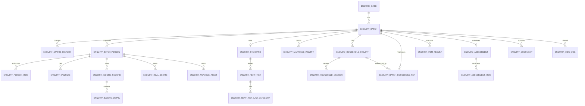

# 跨機關查調資料表規格｜工程師版

- 版本：v1.0
- 日期：2026-11-08
- 目標資料庫：PostgreSQL
- 範圍：三支查調 API、查調批次、婚姻／戶籍查詢、個別授權、來源結果、資格初判、中央工作臺閱覽稽核
- 原始規格：`跨機關查調機制.md`

本文件只列實作所需的資料模型、欄位、關聯、狀態、索引、API 對應及驗證規則。

---

## 1. 實作前提

1. 查調資料新增獨立的 `enquiry_` table group。
2. 一個 `enquiry_case` 可有多個不可覆寫的 `enquiry_batch`。
3. 批次內的人員以 `national_id_hash` 去重，不以姓名去重。
4. 「案件成員」、「戶籍回傳成員」及「實際查調對象」分開表示。
5. 授權以「批次人員 × 查調項目」保存；不可只存案件層級的授權布林值。
6. 配偶確認為已婚後，強制建立配偶的 `INCOME` 必要查調項目；未授權時不得執行，不得視為未婚。
7. 全戶籍查詢結果不代表其中所有人均為所得、動產或不動產查調對象。
8. 原始請求／回應及文件只保存加密物件位置與雜湊；不可將明文身分證字號或完整敏感 payload 長期放在 JSONB。
9. `submitted_at` 是本次送查調時間；`applied_at` 是案件原申請時間，兩者不可混用。
10. 查調內容的保存期限預設為送查調後六個月，正式起算點依業務確認。

### 1.1 既有表的使用

| 既有表 | 用途 |
|---|---|
| `housing_class` | 沿用 `AGENCY`、`ROOM_TYPE` 等代碼；批次仍須保存名稱快照 |
| `housing` | `housing_id` 可 nullable 對應；不可取代批次的社宅代碼／名稱快照 |
| `api_session` | 機關 API session 驗證 |
| `api_auth_log` | API 認證稽核 |
| `member_profile` | 前臺民眾帳號，不作為工作臺承辦人帳號 |
| `member_consent` | 會員條款同意，不作為查調授權 |
| `api_push_log` | 現有社宅／招租／公告推送，不直接承載查調結果 |

目前 `db.txt` 沒有共用案件主檔與機關承辦人帳號表；本版先以 `enquiry_case` 作為查調案件主檔，`viewer_account_id` 暫不加外鍵。

---

## 2. 關聯



---

## 3. 核心資料表

### 3.1 `enquiry_case`

一個統一案件編號一列。

| 欄位 | 型別 | Null | 說明 |
|---|---|---:|---|
| `id` | `uuid` | NO | PK，`gen_random_uuid()` |
| `case_number` | `varchar(20)` | NO | 統一案件編號；格式待定案 |
| `agency_code` | `varchar(20)` | NO | 權責機關代碼 |
| `applicant_name_snapshot` | `varchar(100)` | NO | 目前批次申請人姓名快照 |
| `applicant_id_hash` | `char(64)` | NO | 申請人身分證字號 HMAC-SHA256 |
| `current_status` | `varchar(30)` | NO | 目前採用批次狀態快照 |
| `current_batch_id` | `uuid` | YES | 目前採用批次；可由 `is_current` 查得 |
| `first_received_at` | `timestamptz` | NO | 首次收到時間 |
| `last_submitted_at` | `timestamptz` | YES | 最近送查調時間 |
| `created_at` | `timestamptz` | NO | 建立時間 |
| `updated_at` | `timestamptz` | NO | 更新時間 |

索引／限制：

```text
UNIQUE (case_number)
INDEX (agency_code, current_status, last_submitted_at DESC)
INDEX (applicant_id_hash)
```

### 3.2 `enquiry_batch`

同一案件每次送查調、補查或主動重查新增一筆。查調內容不可覆寫；生命週期欄位可更新。

| 欄位 | 型別 | Null | 說明 |
|---|---|---:|---|
| `id` | `uuid` | NO | PK |
| `case_id` | `uuid` | NO | FK → `enquiry_case.id` |
| `case_number_snapshot` | `varchar(20)` | NO | 請求案件編號快照 |
| `batch_code` | `varchar(40)` | NO | 工作臺批次編號 |
| `batch_sequence` | `integer` | NO | 案件內遞增序號 |
| `request_idempotency_key` | `varchar(100)` | YES | 冪等鍵 |
| `source_revision` | `integer` | YES | 權責機關來源版本 |
| `submitted_at` | `timestamptz` | NO | 本次送查調時間 |
| `received_at` | `timestamptz` | NO | 平臺收到時間 |
| `reference_date` | `date` | NO | 查調基準日 |
| `agency_code_snapshot` | `varchar(20)` | NO | 權責機關代碼快照 |
| `housing_id` | `uuid` | YES | 可對應既有 `housing.id` |
| `housing_code` | `varchar(50)` | NO | 申請社宅代碼 |
| `housing_name_snapshot` | `varchar(200)` | NO | 社宅名稱快照 |
| `room_type_code` | `varchar(50)` | YES | 房型代碼 |
| `room_type_name_snapshot` | `varchar(100)` | NO | 房型名稱快照 |
| `applied_at` | `timestamptz` | NO | 原案件申請時間 |
| `status` | `varchar(30)` | NO | 批次狀態，見第 11 節 |
| `is_current` | `boolean` | NO | 案件目前採用版本 |
| `list_scope` | `varchar(40)` | NO | 名單範圍 |
| `completed_at` | `timestamptz` | YES | 查調完成時間 |
| `retention_until` | `timestamptz` | NO | 內容到期時間 |
| `purged_at` | `timestamptz` | YES | 內容清除時間 |
| `issue_summary` | `text` | YES | 待辦／錯誤摘要 |
| `request_payload_ref` | `varchar(500)` | YES | 加密原始請求位置 |
| `request_payload_hash` | `char(64)` | YES | 原始請求雜湊 |
| `created_at` | `timestamptz` | NO | 建立時間 |

`list_scope` 值：`CASE_MEMBERS`、`WHOLE_HOUSEHOLD_INCLUDE_LODGERS`、`WHOLE_HOUSEHOLD_EXCLUDE_LODGERS`。

索引／限制：

```text
UNIQUE (batch_code)
UNIQUE (case_id, batch_sequence)
PARTIAL UNIQUE (case_id) WHERE is_current = true
INDEX (case_id, submitted_at DESC)
INDEX (status, submitted_at DESC)
INDEX (retention_until)
```

`housing_id` 若建立 FK，須確認社宅主檔同步不會阻擋歷史批次；否則只保存代碼與快照。

### 3.3 `enquiry_status_history`

只增不改的批次狀態歷程。

| 欄位 | 型別 | Null | 說明 |
|---|---|---:|---|
| `id` | `bigint identity` | NO | PK |
| `case_id` | `uuid` | NO | FK → `enquiry_case.id` |
| `batch_id` | `uuid` | NO | FK → `enquiry_batch.id` |
| `from_status` | `varchar(30)` | YES | 前一狀態 |
| `to_status` | `varchar(30)` | NO | 新狀態 |
| `reason_code` | `varchar(50)` | YES | 狀態變更原因 |
| `message` | `text` | YES | 不含敏感資料的說明 |
| `changed_at` | `timestamptz` | NO | 變更時間 |
| `changed_by_type` | `varchar(20)` | NO | `SYSTEM`、`AGENCY_API`、`STAFF` |
| `api_call_id` | `uuid` | YES | FK → `enquiry_api_call_log.id`；可延後建立 |

### 3.4 `enquiry_batch_person`

批次內所有已知人員：申請人、原案件成員、配偶、申請人戶成員、配偶戶成員。

| 欄位 | 型別 | Null | 說明 |
|---|---|---:|---|
| `id` | `uuid` | NO | PK |
| `batch_id` | `uuid` | NO | FK → `enquiry_batch.id` |
| `national_id_hash` | `char(64)` | NO | HMAC-SHA256，批次內唯一 |
| `national_id_encrypted` | `bytea` | NO | 應用程式加密密文 |
| `id_key_version` | `smallint` | NO | 金鑰版本 |
| `national_id_masked` | `varchar(20)` | NO | 顯示用遮罩值 |
| `name` | `varchar(100)` | NO | 人員姓名快照 |
| `birth_date` | `date` | YES | 生日 |
| `father_name` | `varchar(100)` | YES | 父／養父 |
| `mother_name` | `varchar(100)` | YES | 母／養母 |
| `household_title` | `varchar(50)` | YES | 戶籍稱謂 |
| `relation_to_applicant` | `varchar(50)` | YES | 與申請人關係 |
| `person_role` | `varchar(30)` | NO | `APPLICANT`、`ORIGINAL_MEMBER`、`SPOUSE`、`HOUSEHOLD_MEMBER` |
| `source_type` | `varchar(30)` | NO | `CASE_REQUEST`、`MARRIAGE_LOOKUP`、`APPLICANT_HOUSEHOLD`、`SPOUSE_HOUSEHOLD` |
| `source_household_inquiry_id` | `uuid` | YES | 發現來源的戶籍查詢 |
| `is_case_member` | `boolean` | NO | 是否為原案件成員 |
| `member_order` | `smallint` | YES | 原案件成員順序；申請人為 1 |
| `selection_status` | `varchar(30)` | NO | `SELECTED`、`HOUSEHOLD_REFERENCE_ONLY`、`EXCLUDED`、`NEEDS_CONFIRMATION` |
| `selection_reason` | `varchar(50)` | YES | `CASE_MEMBER`、`SPOUSE_INCOME_RULE`、`HOUSEHOLD_LIST_ONLY` |
| `fetus_count` | `integer` | YES | NULL 表示未知，0 表示無胎兒 |
| `source_consent_granted` | `boolean` | YES | API 原始整體授權快照 |
| `notes` | `text` | YES | 個人詳細記事 |
| `created_at` | `timestamptz` | NO | 建立時間 |

限制：

```text
UNIQUE (batch_id, national_id_hash)
CHECK (fetus_count IS NULL OR fetus_count >= 0)
```

### 3.5 `enquiry_person_item`

每位人員各查調項目的授權與執行狀態。`HOUSEHOLD` 為批次／戶籍查詢層級，不在此表建立人員授權列。

| 欄位 | 型別 | Null | 說明 |
|---|---|---:|---|
| `person_id` | `uuid` | NO | FK → `enquiry_batch_person.id` |
| `item_code` | `varchar(30)` | NO | `WELFARE`、`INCOME`、`MOVABLE_ASSET`、`REAL_ESTATE` |
| `is_required` | `boolean` | NO | 是否必要查調 |
| `required_reason` | `varchar(50)` | YES | `API_REQUEST`、`SPOUSE_INCOME_RULE`、`CASE_RULE` |
| `consent_status` | `varchar(30)` | NO | `GRANTED`、`NOT_GRANTED`、`PENDING`、`NOT_REQUIRED`、`UNKNOWN` |
| `consent_source` | `varchar(30)` | YES | `API_MEMBER_FIELD`、`API_SUBJECT_CONSENT`、`STAFF_CORRECTION` |
| `consented_at` | `timestamptz` | YES | 授權時間 |
| `consent_payload_hash` | `char(64)` | YES | 授權輸入雜湊 |
| `execution_status` | `varchar(30)` | NO | `NOT_STARTED`、`QUEUED`、`COMPLETED`、`PARTIAL`、`FAILED`、`BLOCKED_CONSENT`、`NO_DATA` |
| `completed_at` | `timestamptz` | YES | 項目完成時間 |
| `issue_code` | `varchar(50)` | YES | 缺漏／錯誤代碼 |
| `issue_message` | `text` | YES | 待辦摘要 |

主鍵：`PRIMARY KEY (person_id, item_code)`。

---

## 4. 婚姻及戶籍查詢表

### 4.1 `enquiry_marriage_inquiry`

對應 `POST /api/v1/person-household-inquiries`。

| 欄位 | 型別 | Null | 說明 |
|---|---|---:|---|
| `id` | `uuid` | NO | PK |
| `batch_id` | `uuid` | NO | FK → `enquiry_batch.id` |
| `subject_person_id` | `uuid` | NO | FK → `enquiry_batch_person.id` |
| `case_number_snapshot` | `varchar(20)` | NO | 請求案件編號 |
| `reference_date` | `date` | NO | 必須等於批次基準日 |
| `status` | `varchar(30)` | NO | `PENDING`、`COMPLETED`、`FAILED`、`DATA_INCOMPLETE` |
| `is_married` | `boolean` | YES | 失敗／缺漏時 NULL |
| `spouse_name` | `varchar(100)` | YES | 已婚配偶姓名 |
| `spouse_id_hash` | `char(64)` | YES | 配偶身分證 HMAC |
| `spouse_id_encrypted` | `bytea` | YES | 配偶身分證密文 |
| `spouse_id_key_version` | `smallint` | YES | 金鑰版本 |
| `completed_at` | `timestamptz` | YES | 完成時間 |
| `issue_code` | `varchar(50)` | YES | 錯誤／缺漏代碼 |
| `issue_message` | `text` | YES | 待辦摘要 |
| `response_payload_ref` | `varchar(500)` | YES | 加密回應位置 |
| `created_at` | `timestamptz` | NO | 建立時間 |

### 4.2 `enquiry_household_inquiry`

對應 `POST /api/v1/household-inquiries`；申請人戶及配偶戶共用此表。

| 欄位 | 型別 | Null | 說明 |
|---|---|---:|---|
| `id` | `uuid` | NO | 內部 PK |
| `household_inquiry_id` | `varchar(50)` | NO | API 回傳查詢識別碼，唯一 |
| `origin_batch_id` | `uuid` | NO | 首次取得批次 |
| `queried_person_id` | `uuid` | NO | 查詢對象 |
| `purpose_code` | `varchar(30)` | NO | `APPLICANT_HOUSEHOLD`、`SPOUSE_HOUSEHOLD` |
| `case_number_snapshot` | `varchar(20)` | NO | 請求案件編號 |
| `reference_date` | `date` | NO | 查調基準日 |
| `include_lodgers` | `boolean` | NO | 是否含寄居者 |
| `status` | `varchar(30)` | NO | `PENDING`、`COMPLETED`、`FAILED`、`DATA_INCOMPLETE` |
| `household_number` | `varchar(50)` | YES | 戶號；來源無此欄位則 NULL |
| `address` | `varchar(300)` | YES | 戶籍地址 |
| `completed_at` | `timestamptz` | YES | 完成時間 |
| `issue_code` | `varchar(50)` | YES | 錯誤／缺漏代碼 |
| `issue_message` | `text` | YES | 待辦摘要 |
| `response_payload_ref` | `varchar(500)` | YES | 加密回應位置 |
| `created_at` | `timestamptz` | NO | 建立時間 |

索引：

```text
UNIQUE (household_inquiry_id)
INDEX (origin_batch_id, reference_date)
INDEX (queried_person_id, reference_date)
```

### 4.3 `enquiry_household_member`

| 欄位 | 型別 | Null | 說明 |
|---|---|---:|---|
| `id` | `uuid` | NO | PK |
| `household_inquiry_id` | `uuid` | NO | FK → `enquiry_household_inquiry.id` |
| `person_id` | `uuid` | YES | FK → `enquiry_batch_person.id`；合併完成後填入 |
| `member_order` | `smallint` | NO | 來源順序 |
| `national_id_hash` | `char(64)` | NO | 回傳身分證 HMAC |
| `name_snapshot` | `varchar(100)` | NO | 回傳姓名 |
| `birth_date` | `date` | YES | 生日 |
| `title` | `varchar(50)` | YES | 戶籍稱謂 |
| `father_name` | `varchar(100)` | YES | 父／養父 |
| `mother_name` | `varchar(100)` | YES | 母／養母 |
| `notes` | `text` | YES | 個人記事 |
| `is_lodger` | `boolean` | YES | 是否寄居 |
| `moved_in_date` | `date` | YES | 遷入日期 |
| `created_at` | `timestamptz` | NO | 建立時間 |

限制：`UNIQUE (household_inquiry_id, national_id_hash)`。

### 4.4 `enquiry_batch_household_ref`

保存案件查調批次引用的申請人戶／配偶戶查詢結果。

| 欄位 | 型別 | Null | 說明 |
|---|---|---:|---|
| `batch_id` | `uuid` | NO | FK → `enquiry_batch.id` |
| `household_inquiry_id` | `uuid` | NO | FK → `enquiry_household_inquiry.id` |
| `reference_order` | `smallint` | NO | API 陣列順序 |
| `reference_type` | `varchar(30)` | NO | `APPLICANT_HOUSEHOLD`、`SPOUSE_HOUSEHOLD` |
| `referenced_at` | `timestamptz` | NO | 引用時間 |

主鍵：`PRIMARY KEY (batch_id, household_inquiry_id)`。

---

## 5. 標準與所得級距

### 5.1 `enquiry_standard`

| 欄位 | 型別 | Null | 說明 |
|---|---|---:|---|
| `id` | `uuid` | NO | PK |
| `batch_id` | `uuid` | NO | FK → `enquiry_batch.id`；一批次一筆 |
| `total_annual_income_op` | `varchar(5)` | YES | `LT`／`LTE` |
| `total_annual_income_value` | `numeric(18,2)` | YES | 年所得標準 |
| `per_capita_monthly_income_op` | `varchar(5)` | YES | `LT`／`LTE` |
| `per_capita_monthly_income_value` | `numeric(18,2)` | YES | 每人每月平均所得標準 |
| `real_estate_value_op` | `varchar(5)` | YES | `LT`／`LTE` |
| `real_estate_value_value` | `numeric(18,2)` | YES | 不動產價值標準 |
| `movable_asset_value_op` | `varchar(5)` | YES | `LT`／`LTE` |
| `movable_asset_value_value` | `numeric(18,2)` | YES | 動產價值標準 |
| `include_fetus_in_population` | `boolean` | NO | 胎兒是否納入人口 |
| `created_at` | `timestamptz` | NO | 建立時間 |

限制：運算子只允許 `LT`、`LTE`；金額不得為負；`UNIQUE (batch_id)`。

### 5.2 `enquiry_rent_tier`

| 欄位 | 型別 | Null | 說明 |
|---|---|---:|---|
| `id` | `uuid` | NO | PK |
| `standard_id` | `uuid` | NO | FK → `enquiry_standard.id` |
| `sequence_no` | `smallint` | NO | 輸入順序，從 1 起算 |
| `tier_name` | `varchar(100)` | NO | 級距名稱 |
| `condition_type` | `varchar(10)` | NO | `LAW`／`INCOME` |
| `range_start` | `numeric(18,2)` | YES | `INCOME` 下限，含下限 |
| `range_end` | `numeric(18,2)` | YES | `INCOME` 上限，含上限 |
| `created_at` | `timestamptz` | NO | 建立時間 |

限制：`UNIQUE (standard_id, sequence_no)`；`LAW` 不得填區間；`INCOME` 不得有法律類別。

### 5.3 `enquiry_rent_tier_law_category`

| 欄位 | 型別 | Null | 說明 |
|---|---|---:|---|
| `rent_tier_id` | `uuid` | NO | FK → `enquiry_rent_tier.id` |
| `category_code` | `varchar(30)` | NO | 弱勢類別代碼 |
| `category_name_snapshot` | `varchar(100)` | NO | 類別名稱快照 |

主鍵：`PRIMARY KEY (rent_tier_id, category_code)`。

---

## 6. 項目執行與 API 稽核

### 6.1 `enquiry_item_result`

每個批次、每個查調項目一列。

| 欄位 | 型別 | Null | 說明 |
|---|---|---:|---|
| `id` | `uuid` | NO | PK |
| `batch_id` | `uuid` | NO | FK → `enquiry_batch.id` |
| `item_code` | `varchar(30)` | NO | `HOUSEHOLD`、`WELFARE`、`INCOME`、`REAL_ESTATE`、`MOVABLE_ASSET` |
| `is_requested` | `boolean` | NO | 是否要求查調 |
| `status` | `varchar(30)` | NO | `NOT_REQUESTED`、`PENDING`、`COMPLETED`、`PARTIAL`、`FAILED`、`BLOCKED_CONSENT`、`NO_DATA` |
| `source_code` | `varchar(30)` | YES | 戶政／衛福／財政／地政等 |
| `requested_at` | `timestamptz` | YES | 發出時間 |
| `completed_at` | `timestamptz` | YES | 完成時間 |
| `received_record_count` | `integer` | YES | 回傳明細筆數 |
| `issue_code` | `varchar(50)` | YES | 錯誤／缺漏代碼 |
| `issue_message` | `text` | YES | 待辦摘要 |
| `response_payload_ref` | `varchar(500)` | YES | 加密回應位置 |
| `response_payload_hash` | `char(64)` | YES | 回應雜湊 |

限制：`UNIQUE (batch_id, item_code)`。

### 6.2 `enquiry_api_call_log`

保存三支對外 API 及來源機關介接紀錄。

| 欄位 | 型別 | Null | 說明 |
|---|---|---:|---|
| `id` | `uuid` | NO | PK |
| `batch_id` | `uuid` | YES | 對應批次 |
| `direction` | `varchar(10)` | NO | `INBOUND`／`OUTBOUND` |
| `endpoint_code` | `varchar(40)` | NO | `PERSON_HOUSEHOLD`、`HOUSEHOLD`、`INQUIRY` 或來源服務代碼 |
| `agency_code` | `varchar(20)` | YES | 呼叫或被呼叫機關 |
| `correlation_id` | `varchar(100)` | YES | 追蹤識別碼 |
| `idempotency_key` | `varchar(100)` | YES | 冪等鍵 |
| `occurred_at` | `timestamptz` | NO | 呼叫／收到時間 |
| `completed_at` | `timestamptz` | YES | 完成時間 |
| `http_status` | `smallint` | YES | HTTP 狀態碼 |
| `result` | `varchar(30)` | NO | `ACCEPTED`、`REJECTED`、`SUCCESS`、`FAILED`、`TIMEOUT` |
| `request_hash` | `char(64)` | YES | 請求雜湊 |
| `response_hash` | `char(64)` | YES | 回應雜湊 |
| `request_payload_ref` | `varchar(500)` | YES | 加密請求位置 |
| `response_payload_ref` | `varchar(500)` | YES | 加密回應位置 |
| `error_detail` | `text` | YES | 錯誤摘要，不存金鑰原文 |

索引：`INDEX (batch_id, occurred_at)`、`INDEX (correlation_id)`、時間 BRIN／一般索引。

---

## 7. 來源結果明細

### 7.1 `enquiry_welfare`

| 欄位 | 型別 | Null | 說明 |
|---|---|---:|---|
| `id` | `uuid` | NO | PK |
| `batch_id` | `uuid` | NO | FK → `enquiry_batch.id` |
| `person_id` | `uuid` | NO | FK → `enquiry_batch_person.id` |
| `category_code` | `varchar(30)` | NO | 弱勢類別代碼 |
| `category_name_snapshot` | `varchar(100)` | NO | 類別名稱 |
| `is_eligible` | `boolean` | NO | 是否符合 |
| `source_as_of_date` | `date` | YES | 來源基準日 |
| `source_record_ref` | `varchar(100)` | YES | 來源識別碼 |
| `created_at` | `timestamptz` | NO | 建立時間 |

限制：`UNIQUE (batch_id, person_id, category_code)`。

### 7.2 `enquiry_income_record`

| 欄位 | 型別 | Null | 說明 |
|---|---|---:|---|
| `id` | `uuid` | NO | PK |
| `batch_id` | `uuid` | NO | FK → `enquiry_batch.id` |
| `person_id` | `uuid` | NO | FK → `enquiry_batch_person.id` |
| `status` | `varchar(30)` | NO | `RECEIVED`、`NO_DATA`、`PARTIAL`、`FAILED`、`BLOCKED_CONSENT` |
| `income_period_start` | `date` | YES | 所得期間起日 |
| `income_period_end` | `date` | YES | 所得期間迄日 |
| `annual_total` | `numeric(18,2)` | YES | 近一年所得合計；不足時 NULL |
| `source_as_of_date` | `date` | YES | 來源基準日 |
| `source_record_ref` | `varchar(100)` | YES | 來源識別碼 |
| `created_at` | `timestamptz` | NO | 建立時間 |

限制：`UNIQUE (batch_id, person_id)`；未授權不得寫入 0，應寫 NULL 並保存狀態。

### 7.3 `enquiry_income_detail`

| 欄位 | 型別 | Null | 說明 |
|---|---|---:|---|
| `id` | `uuid` | NO | PK |
| `income_record_id` | `uuid` | NO | FK → `enquiry_income_record.id` |
| `income_type_code` | `varchar(10)` | NO | 財政部所得類別代碼 |
| `income_type_name_snapshot` | `varchar(100)` | NO | 類別名稱 |
| `amount` | `numeric(18,2)` | NO | 金額 |
| `source_detail_ref` | `varchar(100)` | YES | 來源明細識別碼 |

### 7.4 `enquiry_real_estate`

| 欄位 | 型別 | Null | 說明 |
|---|---|---:|---|
| `id` | `uuid` | NO | PK |
| `batch_id` | `uuid` | NO | FK → `enquiry_batch.id` |
| `owner_person_id` | `uuid` | YES | FK → `enquiry_batch_person.id`；無法對應時 NULL 並產生 issue |
| `category_code` | `varchar(30)` | NO | 房屋／土地等 |
| `category_name_snapshot` | `varchar(100)` | NO | 類別名稱 |
| `land_use_code` | `varchar(30)` | YES | 土地使用分類 |
| `location_text` | `varchar(300)` | YES | 地段地號／建號／座落 |
| `is_household_address` | `boolean` | YES | 是否戶籍地 |
| `share_numerator` | `numeric(18,8)` | YES | 持分分子 |
| `share_denominator` | `numeric(18,8)` | YES | 持分分母 |
| `share_text_snapshot` | `varchar(100)` | YES | 原始持分文字 |
| `area_value` | `numeric(18,4)` | YES | 面積 |
| `area_unit` | `varchar(20)` | YES | 面積單位 |
| `assessed_value` | `numeric(18,2)` | YES | 現值金額 |
| `is_common_ownership` | `boolean` | YES | 是否公同共有 |
| `excluded_from_calculation` | `boolean` | NO | 是否排除合計 |
| `exclusion_reason` | `varchar(50)` | YES | 原住民保留地／道路用地等 |
| `source_record_ref` | `varchar(100)` | YES | 來源識別碼 |

### 7.5 `enquiry_movable_asset`

| 欄位 | 型別 | Null | 說明 |
|---|---|---:|---|
| `id` | `uuid` | NO | PK |
| `batch_id` | `uuid` | NO | FK → `enquiry_batch.id` |
| `owner_person_id` | `uuid` | NO | FK → `enquiry_batch_person.id` |
| `interest_or_deposit_amount` | `numeric(18,2)` | YES | 正式語意待來源確認 |
| `prize_amount` | `numeric(18,2)` | YES | 中獎所得 |
| `other_amount` | `numeric(18,2)` | YES | 其他所得 |
| `subtotal` | `numeric(18,2)` | YES | 小計 |
| `source_as_of_date` | `date` | YES | 來源基準日 |
| `source_record_ref` | `varchar(100)` | YES | 來源識別碼 |

限制：`UNIQUE (batch_id, owner_person_id)`。

### 7.6 `enquiry_document`

| 欄位 | 型別 | Null | 說明 |
|---|---|---:|---|
| `id` | `uuid` | NO | PK |
| `batch_id` | `uuid` | NO | FK → `enquiry_batch.id` |
| `document_type_code` | `varchar(40)` | NO | 文件類型 |
| `document_name` | `varchar(200)` | NO | 顯示名稱 |
| `file_name_snapshot` | `varchar(255)` | YES | 來源檔名 |
| `storage_key` | `varchar(500)` | NO | 加密物件儲存 key |
| `content_sha256` | `char(64)` | NO | 檔案雜湊 |
| `content_type` | `varchar(100)` | YES | MIME type |
| `file_size` | `bigint` | YES | 檔案大小 |
| `source_code` | `varchar(30)` | YES | 來源機關 |
| `received_at` | `timestamptz` | NO | 收到時間 |
| `retention_until` | `timestamptz` | NO | 文件到期時間 |
| `deleted_at` | `timestamptz` | YES | 文件清除時間 |

---

## 8. 資格初判

### 8.1 `enquiry_assessment`

| 欄位 | 型別 | Null | 說明 |
|---|---|---:|---|
| `id` | `uuid` | NO | PK |
| `batch_id` | `uuid` | NO | FK → `enquiry_batch.id` |
| `assessment_version` | `integer` | NO | 批次內判定版本 |
| `algorithm_version` | `varchar(50)` | NO | 規則／程式版本 |
| `calculation_status` | `varchar(30)` | NO | `READY`、`INCOMPLETE`、`ERROR` |
| `overall_result` | `varchar(20)` | NO | `QUALIFIED`、`NOT_QUALIFIED`、`UNDETERMINED` |
| `total_annual_income` | `numeric(18,2)` | YES | 完整家庭總所得 |
| `population_count` | `numeric(18,2)` | YES | 計算人口數 |
| `fetus_count` | `integer` | YES | 納入計算的胎兒數 |
| `per_capita_monthly_income` | `numeric(18,2)` | YES | 年所得 ÷ 12 ÷ 人口數 |
| `real_estate_value` | `numeric(18,2)` | YES | 排除規則後合計 |
| `movable_asset_value` | `numeric(18,2)` | YES | 合計 |
| `selected_rent_tier_sequence` | `smallint` | YES | 適用級距順序 |
| `selected_rent_tier_name` | `varchar(100)` | YES | 級距名稱快照 |
| `reason_summary` | `text` | YES | 判定理由／缺漏 |
| `evaluated_at` | `timestamptz` | NO | 評估時間 |
| `is_current` | `boolean` | NO | 批次目前判定版本 |

限制：`UNIQUE (batch_id, assessment_version)`；同批次最多一筆 `is_current = true`。

### 8.2 `enquiry_assessment_item`

| 欄位 | 型別 | Null | 說明 |
|---|---|---:|---|
| `assessment_id` | `uuid` | NO | FK → `enquiry_assessment.id` |
| `item_code` | `varchar(30)` | NO | 五項判斷項目 |
| `actual_value` | `numeric(18,2)` | YES | 實際值 |
| `operator` | `varchar(5)` | YES | `LT`／`LTE` |
| `standard_value` | `numeric(18,2)` | YES | 標準值 |
| `result` | `varchar(20)` | NO | `PASS`、`FAIL`、`UNDETERMINED`、`NOT_REQUESTED` |
| `reason_code` | `varchar(50)` | YES | 缺授權／資料不足／超標等 |
| `reason_detail` | `text` | YES | 顯示理由 |
| `evaluated_at` | `timestamptz` | NO | 評估時間 |

主鍵：`PRIMARY KEY (assessment_id, item_code)`。

---

## 9. 閱覽稽核

### 9.1 `enquiry_view_log`

每次開啟案件或切換歷史批次新增一筆；檢視次數由 COUNT 計算。

| 欄位 | 型別 | Null | 說明 |
|---|---|---:|---|
| `id` | `bigint identity` | NO | PK |
| `case_id` | `uuid` | NO | FK → `enquiry_case.id` |
| `batch_id` | `uuid` | NO | FK → `enquiry_batch.id` |
| `viewer_account_id` | `uuid` | YES | 帳號表確認後再加 FK |
| `viewer_name_snapshot` | `varchar(100)` | NO | 閱覽時姓名快照 |
| `viewer_agency_code` | `varchar(20)` | NO | 閱覽時機關快照 |
| `viewed_at` | `timestamptz` | NO | 閱覽時間 |
| `view_type` | `varchar(30)` | NO | `CURRENT_BATCH`／`HISTORICAL_BATCH` |
| `source_ip` | `inet` | YES | 來源 IP |
| `user_agent` | `varchar(500)` | YES | 使用者代理 |
| `reason_code` | `varchar(50)` | YES | 閱覽用途 |

索引：`INDEX (case_id, viewed_at DESC)`、`INDEX (batch_id, viewed_at DESC)`、`INDEX (viewer_account_id, viewed_at DESC)`。

### 9.2 `enquiry_purge_log`（建議）

| 欄位 | 型別 | 說明 |
|---|---|---|
| `id` | `bigint identity` | PK |
| `batch_id` | `uuid` | FK → `enquiry_batch.id` |
| `started_at` | `timestamptz` | 清除開始 |
| `completed_at` | `timestamptz` | 清除完成 |
| `result` | `varchar(20)` | `SUCCESS`／`FAILED` |
| `deleted_table_count` | `integer` | 清除筆數統計 |
| `error_detail` | `text` | 錯誤摘要 |

---

## 10. API 欄位對應

### 10.1 `POST /api/v1/inquiries`

| API 欄位 | 資料表欄位 |
|---|---|
| `case.caseNumber` | `enquiry_case.case_number`、`enquiry_batch.case_number_snapshot` |
| `case.agencyCode` | `enquiry_case.agency_code`、`enquiry_batch.agency_code_snapshot` |
| `case.housingCode` | `enquiry_batch.housing_code`、`housing_id` |
| `case.roomTypeName` | `enquiry_batch.room_type_name_snapshot` |
| `case.submittedAt` | `enquiry_batch.applied_at` |
| `case.referenceDate` | `enquiry_batch.reference_date` |
| `members[]` | `enquiry_batch_person`，`is_case_member = true` |
| `members[].isConsentGranted` | `source_consent_granted`，再展開至 `enquiry_person_item` |
| `members[].fetusCount` | `enquiry_batch_person.fetus_count` |
| `query.items[]` | `enquiry_item_result.item_code/is_requested` |
| `query.householdInquiryIds[]` | `enquiry_batch_household_ref` |
| `query.subjectNationalIds[]` | 批次人員 `selection_status` + `enquiry_person_item` |
| `subjectConsents[]` | `enquiry_person_item.consent_status/consent_source/consented_at` |
| `standards.*` | `enquiry_standard` |
| `standards.rentTiers[]` | `enquiry_rent_tier` + `enquiry_rent_tier_law_category` |

`query.scope` 不建立欄位；寄居者設定只來自全戶籍 API 的 `includeLodgers`。

### 10.2 `POST /api/v1/person-household-inquiries`

| API 欄位 | 資料表欄位 |
|---|---|
| `caseNumber`、`referenceDate` | `enquiry_marriage_inquiry.case_number_snapshot/reference_date` |
| `subject` | `subject_person_id` |
| `isMarried` | `enquiry_marriage_inquiry.is_married`；失敗／缺漏為 NULL |
| `spouse` | `spouse_*` 欄位 + 建立 `person_role = SPOUSE` 的批次人員 |
| `issues` | `status`、`issue_code`、`issue_message` |

### 10.3 `POST /api/v1/household-inquiries`

| API 欄位 | 資料表欄位 |
|---|---|
| `householdInquiryId` | `enquiry_household_inquiry.household_inquiry_id` |
| `caseNumber`、`referenceDate` | 戶籍查詢案件／基準日快照 |
| `subject` | `queried_person_id`、`purpose_code` |
| `includeLodgers` | `enquiry_household_inquiry.include_lodgers` |
| `status`、`completedAt`、`issues` | 戶籍查詢 `status/completed_at/issue_*` |
| `householdMembers[]` | `enquiry_household_member`，再合併到 `enquiry_batch_person` |

---

## 11. 狀態與結果代碼

### 11.1 批次狀態 `enquiry_batch.status`

| 代碼 | 說明 |
|---|---|
| `RECEIVED` | 已收到請求 |
| `PROCESSING` | 執行中 |
| `WAITING_CONSENT` | 等待必要授權 |
| `PARTIAL_COMPLETED` | 部分項目完成，仍有缺漏／待辦 |
| `COMPLETED` | 查調流程完成 |
| `NEEDS_CORRECTION` | 婚姻、配偶或必要資料待補正 |
| `FAILED` | 系統或來源失敗 |
| `PURGED` | 查調內容已清除 |

### 11.2 項目狀態

`enquiry_item_result.status`：`NOT_REQUESTED`、`PENDING`、`COMPLETED`、`PARTIAL`、`FAILED`、`BLOCKED_CONSENT`、`NO_DATA`。

`enquiry_person_item.consent_status`：`GRANTED`、`NOT_GRANTED`、`PENDING`、`NOT_REQUIRED`、`UNKNOWN`。

### 11.3 判定結果

| 代碼 | 顯示／用途 |
|---|---|
| `PASS` | 符合 |
| `FAIL` | 不符合 |
| `UNDETERMINED` | 無法判定；資料缺漏、未授權或來源失敗 |
| `NOT_REQUESTED` | 未要求該項 |

`enquiry_batch.status` 與 `enquiry_assessment.overall_result` 必須分開；查調完成不等於資格符合。

---

## 12. 必須實作的驗證規則

1. 同一批次的婚姻查詢、戶籍查詢及案件查調引用，`case_number` 與 `reference_date` 必須一致。
2. 批次內以 `national_id_hash` 去重；同一身分證出現不同姓名時拒絕靜默覆寫並產生 issue。
3. 原案件成員第一筆固定為申請人；申請人不得重複。
4. 已婚配偶必須建立 `SPOUSE` 人員及 `INCOME`、`is_required = true` 的 `enquiry_person_item`。
5. `consent_status <> GRANTED` 時不得執行該人該項目；不得將未授權或未回傳轉成 0。
6. 全戶籍成員不得自動成為財稅查調對象；是否查調由 `selection_status` 與 `enquiry_person_item` 決定。
7. 未授權人員不能從家庭人口完整性計算中被刪除；資料不足時相關 assessment 必須為 `UNDETERMINED`。
8. `fetus_count` 為非負整數；NULL 與 0 語意不同；同一人不得重複計算胎兒數。
9. `LAW` 與 `INCOME` 級距條件二選一；依 `sequence_no` 順序判斷，必要資料不足不得跳過前級。
10. 不動產合計須依 `land_use_code` 保存排除原因；不可只保存排除後總額。
11. 相同冪等鍵且 payload 相同為安全重送；相同冪等鍵但 payload 不同回 409 並記錄 API log。
12. 重新查調、補授權或重新計算不得覆寫歷史批次；需新增批次或 assessment version。
13. 來源失敗或婚姻資料缺漏不得寫成 `is_married = false`。
14. 批次及所有敏感子表到期後不可由舊 batch id 取回原始內容。
15. 每次檢視目前或歷史批次都必須新增 `enquiry_view_log`。
16. 金額欄位使用 `numeric(18,2)`；身分證欄位使用 HMAC + 加密密文，不存明文。

---

## 13. 保存期限

1. `retention_until` 預設為 `submitted_at + 6 months`，正式起算點待確認。
2. 到期清除／不可逆遮罩：批次人員、地址、婚姻／戶籍結果、所得、社福、財產、文件及加密 payload。
3. `enquiry_batch` 可保留批次編號、狀態、送查調時間、完成時間、清除時間及錯誤代碼等非內容 metadata。
4. `enquiry_view_log` 與查調內容分開保存；閱覽稽核期限另訂。
5. 物件儲存、備份及 API log 也必須遵守同一敏感資料清除政策。

---

## 14. 建表順序

### Migration 1：核心

```text
enquiry_case
enquiry_batch
enquiry_status_history
enquiry_batch_person
enquiry_person_item
enquiry_marriage_inquiry
enquiry_household_inquiry
enquiry_household_member
enquiry_batch_household_ref
enquiry_standard
enquiry_rent_tier
enquiry_rent_tier_law_category
enquiry_item_result
enquiry_assessment
enquiry_assessment_item
enquiry_view_log
```

### Migration 2：來源結果及稽核

```text
enquiry_welfare
enquiry_income_record
enquiry_income_detail
enquiry_real_estate
enquiry_movable_asset
enquiry_document
enquiry_api_call_log
enquiry_purge_log
```

### Migration 3：待既有帳號模組確認

- 對 `enquiry_view_log.viewer_account_id` 增加正式帳號外鍵。
- 增加機關／角色／案件範圍的資料庫或服務層權限驗證。

---

## 15. 定稿前必須確認

| 編號 | 項目 | 影響 |
|---|---|---|
| Q1 | 統一案件編號正式格式：13 碼無分隔或 `CH-115-00000001` | `case_number` 長度、CHECK、索引 |
| Q2 | 共用案件主檔是否會建立，以及正式表名／主鍵 | `enquiry_case` 是否改為讀取模型 |
| Q3 | 機關承辦人帳號表名、主鍵及角色權限 | `viewer_account_id`、權限 |
| Q4 | 授權是整體授權還是社福／所得／動產／不動產分項授權 | `enquiry_person_item`、API schema |
| Q5 | `query.subjectNationalIds` 及不同人不同項目的正式 API 格式 | 人員選擇及授權寫入 |
| Q6 | 各來源正式回傳 schema，尤其戶號、地址、動產欄位及不動產排除分類 | 結果明細欄位 |
| Q7 | 六個月保存期限的起算點、刪除範圍、備份及文件政策 | purge job、所有敏感表 |
| Q8 | 配偶戶其他成員是否可能納入所得／財產查調，以及納入規則 | `selection_status`、逐項授權 |
