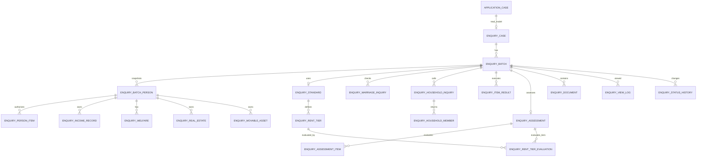

# 全國社會住宅統一申請登記平臺
# 跨機關查調資料表規劃

- 文件版本：v2.0
- 規劃日期：2026-11-16
- 規劃範圍：跨機關查調 API、中央查調工作臺、歷次查調、資格初判、資料閱覽稽核
- 依據文件：`跨機關查調機制.md`（含新版流程圖）、`db.txt`、查調工作臺四個畫面及其 JavaScript 示意資料
- 本文件定位：資料模型規劃，不提供特定資料庫方言的完整 DDL

---

## 1. 規劃結論

目前 `db.txt` 已有 PostgreSQL 的 `application_case` 案件基本資料、成員及案件狀態歷程模型。查調對外僅保留 `POST /api/v1/inquiries`，依 caseNumber 讀取既有案件，不重送基本資料；另規劃獨立的 `enquiry_` 資料表保存查調批次及結果。婚姻、配偶與全戶查詢均為平台內部步驟，無獨立對外查調端點。

核心設計採「案件主檔 → 查調批次 → 批次快照 → 回傳資料 → 資格初判 → 閱覽紀錄」的結構：

```text
一個案件 enquiry_case
    └── 多次查調批次 enquiry_batch
            ├── 該批次的受查人快照 enquiry_batch_person
            ├── 每位受查人的個別授權與項目狀態 enquiry_person_item
            ├── 婚姻／配偶查詢 enquiry_marriage_inquiry
            ├── 一或多次全戶籍查詢 enquiry_household_inquiry
            ├── 查調標準與所得級距 enquiry_standard / enquiry_rent_tier
            ├── 各查調項目執行狀態 enquiry_item_result
            ├── 所得、社福、不動產、動產明細
            ├── 資格初判 enquiry_assessment
            └── 承辦人閱覽紀錄 enquiry_view_log
```

最重要的資料邊界如下：

| 概念 | 建議資料表 | 必須維持的差異 |
|---|---|---|
| 統一案件 | `enquiry_case` | 一個統一案件編號只有一筆穩定主檔 |
| 歷次查調 | `enquiry_batch` | 同一案件可以有多個批次，每個批次不可覆蓋歷史資料 |
| 原案件成員、配偶、戶籍成員 | `enquiry_batch_person` | 同一人可能因不同來源被發現，但批次內以身分證字號去重 |
| 實際查調對象 | `enquiry_batch_person` + `enquiry_person_item` | 出現在戶籍名單不代表一定是所得或財產查調對象 |
| 授權 | `enquiry_person_item` | 授權必須以「人 × 查調項目」保存，不能只有案件層級一個布林值 |
| 戶籍名單 | `enquiry_household_inquiry` + `enquiry_household_member` | 全戶查詢結果與實際財稅查調對象分開 |
| 查調結果 | 各項結果明細表 | 不以姓名判斷資產歸屬，使用批次內的 `person_id` |
| 資格判定 | `enquiry_assessment` + `enquiry_assessment_item` | 判定保存當時實際值、標準、結果與理由，避免日後規則變動造成歷史結果改變 |
| 閱覽紀錄 | `enquiry_view_log` | 與查調內容分開管理，記錄實際檢視人員及批次 |

### 1.1 建議的實作優先順序

第一階段先建立案件、批次、受查人、授權、婚姻／戶籍查詢、標準、項目狀態、初判及閱覽紀錄，讓 API 與工作臺可以運作。第二階段再補齊所得明細、社福類別、財產明細、文件索引及完整 API 交換稽核。原始回傳內容與文件應採加密物件儲存或應用程式加密後保存，不建議直接以明文 JSONB 長期保存。

---

## 2. 現有資料庫盤點與整合原則

`db.txt` 已有下列可沿用的資料：

| 現有表 | 查調模組使用方式 | 建議 |
|---|---|---|
| `housing_class` | 可沿用 `AGENCY`、`ROOM_TYPE` 等代碼群組 | 查調批次仍須保存代碼及名稱快照，不要只依賴日後可能變更的類別表 |
| `application_case` | 依 caseNumber 讀取基本資料及權責機關，供查調授權與建批次快照 | 不由查調 API 新增或修改申請案件 |
| `housing` | 依案件的 housing_id 讀取社宅名稱與地區 | 查調批次保存當時名稱，避免歷史結果隨主檔改變 |
| `api_session` | 機關 API 驗證 session | 不直接當成查調批次或結果紀錄 |
| `api_auth_log` | API 登入、登出及撤銷紀錄 | 維持現有用途 |
| `api_push_log` | 現有社宅、招租、公告推送紀錄 | 不建議直接拿來保存查調回傳，查調有不同的方向、敏感資料及保存期限；另建 `enquiry_api_call_log` |
| `member_profile` | 前臺民眾帳號 | 不應用來代表中央工作臺的承辦人帳號，也不應以此表授予機關查調權限 |
| `member_consent` | 會員登記條款同意 | 不等同查調授權，不應共用 |

目前 `db.txt` 沒有：

- 機關承辦人／中央工作臺帳號與角色權限表。
- 查調批次、婚姻查詢、全戶籍查詢、個別授權及各來源結果表。

`enquiry_case` 為查調讀取模型，以唯一的 application_case_id 外鍵對應 `application_case.id`。查調批次保存從主檔讀取的機關、社宅、房型及申請時間快照；案件狀態歷程與查調批次狀態歷程分開管理。

---

## 3. 關聯圖

以下只畫出核心關聯；來源明細與索引表在後續章節列出。



---

## 4. 核心表設計

### 4.1 `enquiry_case`：查調案件主檔

一個統一案件編號一列。這張表只放案件識別及列表需要的最小資訊；每次送查調的完整輸入與結果放在 `enquiry_batch` 及其子表。

| 欄位 | PostgreSQL 建議型別 | 必填 | 說明 |
|---|---|---:|---|
| `id` | `uuid` | 是 | 主鍵，`gen_random_uuid()` |
| `application_case_id` | `uuid` | 是 | UNIQUE、FK → application_case.id；案件須先取號建立 |
| `case_number` | `varchar(14)` | 是 | 統一案件編號，沿用 2＋3＋1＋8 的 14 字元格式，須與對應主檔一致 |
| `agency_code` | `varchar(20)` | 是 | 權責機關代碼，如 `CH`、`LF`；從案件主檔讀取並比對機關憑證，不由請求重送 |
| `applicant_name_snapshot` | `varchar(100)` | 是 | 目前採用批次的申請人姓名快照，供列表顯示；敏感資料清除政策需另定 |
| `applicant_id_hash` | `char(64)` | 是 | 申請人身分證字號 HMAC-SHA256，供查找；不存明文 |
| `current_status` | `varchar(30)` | 是 | 目前採用批次的查調狀態快照，如 `PROCESSING`、`PARTIAL_COMPLETED`、`COMPLETED` |
| `current_batch_id` | `uuid` | 否 | 目前採用批次；若採 `is_current` 部分唯一索引，也可不存此欄位 |
| `first_received_at` | `timestamptz` | 是 | 首次收到案件查調資料時間 |
| `last_submitted_at` | `timestamptz` | 否 | 最近一次送查調時間 |
| `created_at` | `timestamptz` | 是 | 建立時間 |
| `updated_at` | `timestamptz` | 是 | 更新時間 |

建議限制與索引：

- `UNIQUE (case_number)`。
- `INDEX (agency_code, current_status, last_submitted_at DESC)`，支援工作臺列表及機關篩選。
- `INDEX (applicant_name_snapshot)`，正式上線前依查詢需求決定是否需要模糊查詢索引。
- `INDEX (applicant_id_hash)`，不可用明文身分證字號查詢。
- `current_status` 由目前批次狀態同步，不讓前端任意寫入。

### 4.2 `enquiry_batch`：查調批次與不可變版本

同一案件每次重新送查調、新增授權後補查或主動重查，都新增一筆批次。批次完成後不直接修改內容；若需要重新計算或補查，新增批次或新增 assessment 版本。

| 欄位 | PostgreSQL 建議型別 | 必填 | 說明 |
|---|---|---:|---|
| `id` | `uuid` | 是 | 主鍵 |
| `case_id` | `uuid` | 是 | FK → `enquiry_case.id` |
| `case_number_snapshot` | `varchar(14)` | 是 | 本次 API 請求的統一案件編號快照 |
| `batch_code` | `varchar(40)` | 是 | 對外或工作臺顯示的批次編號，如 `INQ-20261008-00001` |
| `batch_sequence` | `integer` | 是 | 案件內遞增序號 |
| `request_idempotency_key` | `varchar(100)` | 是 | 必填 Idempotency-Key 標頭，同機關同鍵同內容不新增批次 |
| `source_revision` | `integer` | 否 | 權責機關來源案件版本；若 API 契約採用 revision 則保存 |
| `submitted_at` | `timestamptz` | 是 | 送查調時間；保存期限以此欄位計算 |
| `received_at` | `timestamptz` | 是 | 平臺收到請求時間 |
| `reference_date` | `date` | 是 | 查調基準日；所有婚姻、戶籍及各項資料須對齊此日 |
| `agency_code_snapshot` | `varchar(20)` | 是 | 本次從 application_case 讀取的權責機關代碼快照 |
| `housing_id` | `uuid` | 是 | 由 application_case.housing_id 讀取並保存批次快照 |
| `housing_code` | `varchar(50)` | 是 | 申請社宅代碼，從 application_case.housing_code 讀取 |
| `housing_name_snapshot` | `varchar(200)` | 是 | 送查調當時的社宅名稱快照 |
| `room_type_code` | `varchar(30)` | 是 | 從 application_case.room_type_code 讀取，名稱由 ROOM_TYPE 主檔取得 |
| `room_type_name_snapshot` | `varchar(100)` | 是 | 送查調當時的房型名稱快照 |
| `applied_at` | `timestamptz` | 是 | 原申請時間；與本批次送查調時間 `submitted_at` 分開保存 |
| `status` | `varchar(30)` | 是 | 建議值：`RECEIVED`、`PROCESSING`、`WAITING_CONSENT`、`PARTIAL_COMPLETED`、`COMPLETED`、`NEEDS_CORRECTION`、`FAILED`、`PURGED` |
| `is_current` | `boolean` | 是 | 是否為案件目前採用版本；同一案件最多一筆 true |
| `list_scope` | `varchar(40)` | 是 | query.scope， `CASE_MEMBERS`、`WHOLE_HOUSEHOLD_INCLUDE_LODGERS`、`WHOLE_HOUSEHOLD_EXCLUDE_LODGERS` |
| `completed_at` | `timestamptz` | 否 | 本批次全部可判定或已完成的時間；待授權不應冒充完整完成 |
| `retention_until` | `timestamptz` | 是 | 建議 `submitted_at + 6 months`；正式起算點待業務確認 |
| `purged_at` | `timestamptz` | 否 | 查調內容清除時間；稽核 metadata 可保留 |
| `issue_summary` | `text` | 否 | 待補正、資料缺漏、來源失敗等摘要 |
| `request_payload_ref` | `varchar(500)` | 否 | 加密原始請求的物件儲存位置或密文索引，不存明文敏感 JSON |
| `request_payload_hash` | `char(64)` | 否 | 原始請求完整性雜湊 |
| `created_at` | `timestamptz` | 是 | 建立時間 |

建議限制與索引：

- `UNIQUE (batch_code)`。
- `UNIQUE (case_id, batch_sequence)`。
- `UNIQUE (agency_code_snapshot, request_idempotency_key)`，同機關重送沿用原批次與快照，併發相同鍵不重複建批次。
- 部分唯一索引：同一 `case_id` 只能有一筆 `is_current = true`。
- `INDEX (case_id, submitted_at DESC)`，支援「歷次查調紀錄」。
- `INDEX (status, submitted_at DESC)`，支援工作臺狀態篩選。
- `INDEX (retention_until)`，支援保存期限清理工作。
- 案件編號、基準日、內部婚姻及戶籍來源結果須對齊同一批次，由服務驗證；不接收外部戶籍結果引用。

### 4.3 `enquiry_status_history`：批次狀態歷程

列表只需要目前狀態，但 API 回傳、錯誤追蹤及工作臺稽核需要知道狀態如何變化。這張表只增不改。

| 欄位 | 型別 | 說明 |
|---|---|---|
| `id` | `bigint identity` | 主鍵 |
| `case_id` | `uuid` | FK → `enquiry_case.id` |
| `batch_id` | `uuid` | FK → `enquiry_batch.id` |
| `from_status` | `varchar(30)` | 前一狀態，首次可為 NULL |
| `to_status` | `varchar(30)` | 新狀態 |
| `reason_code` | `varchar(50)` | 例如 `CONSENT_MISSING`、`SOURCE_TIMEOUT`、`RESULT_COMPLETED` |
| `message` | `text` | 面向工作臺的說明，可遮罩敏感資料 |
| `changed_at` | `timestamptz` | 狀態變更時間 |
| `changed_by_type` | `varchar(20)` | `SYSTEM`、`AGENCY_API`、`STAFF` |
| `api_call_id` | `uuid` | 對應 API 呼叫，可為 NULL |

---

## 5. 受查人員、名單與授權

### 5.1 `enquiry_batch_person`：批次人員快照

這張表同時容納原案件成員、戶政查出的配偶、申請人戶成員及配偶戶成員。與其另建四張人員表，不如用來源及角色欄位區分，並在同一批次以身分證字號 HMAC 去重。

| 欄位 | PostgreSQL 建議型別 | 說明 |
|---|---|---|
| `id` | `uuid` | 主鍵 |
| `batch_id` | `uuid` | FK → `enquiry_batch.id` |
| `national_id_hash` | `char(64)` | 帶金鑰 HMAC-SHA256；批次內唯一 |
| `national_id_encrypted` | `bytea` | 應用程式加密密文；金鑰不放資料庫 |
| `id_key_version` | `smallint` | 加密／HMAC 金鑰版本 |
| `national_id_masked` | `varchar(20)` | 僅供工作臺顯示的遮罩值，如 `B1******90` |
| `name` | `varchar(100)` | 該批次來源回傳的姓名快照 |
| `birth_date` | `date` | 生日；沒有回傳時為 NULL |
| `father_name` | `varchar(100)` | 父／養父快照 |
| `mother_name` | `varchar(100)` | 母／養母快照 |
| `household_title` | `varchar(50)` | 戶籍稱謂，如戶長、長子、寄居 |
| `relation_to_applicant` | `varchar(50)` | 本人、配偶、子女等 |
| `person_role` | `varchar(30)` | `APPLICANT`、`ORIGINAL_MEMBER`、`SPOUSE`、`HOUSEHOLD_MEMBER` |
| `source_type` | `varchar(30)` | `CASE_REQUEST`、`MARRIAGE_LOOKUP`、`APPLICANT_HOUSEHOLD`、`SPOUSE_HOUSEHOLD` |
| `source_household_inquiry_id` | `uuid` | 對應發現此人的全戶籍查詢，可為 NULL |
| `is_case_member` | `boolean` | 是否為原案件成員；配偶後補入時仍可為 false |
| `member_order` | `smallint` | 原案件成員順序；第一筆必須是申請人 |
| `selection_status` | `varchar(30)` | `SELECTED`、`HOUSEHOLD_REFERENCE_ONLY`、`EXCLUDED`、`NEEDS_CONFIRMATION` |
| `selection_reason` | `varchar(50)` | 如 `CASE_MEMBER`、`SPOUSE_INCOME_RULE`、`HOUSEHOLD_LIST_ONLY` |
| `fetus_count` | `integer` | 非負整數；未知時為 NULL，不用 0 代替未知 |
| `source_consent_granted` | `boolean` | 原案件成員必填授權布林快照；非成員未知為 NULL，執行時展開至逐項授權 |
| `notes` | `text` | 個人詳細記事；應限制顯示權限 |
| `created_at` | `timestamptz` | 建立時間 |

建議限制：

- `UNIQUE (batch_id, national_id_hash)`。
- `CHECK (fetus_count IS NULL OR fetus_count >= 0)`。
- `member_order = 1` 的人只能有一人，且 `person_role = APPLICANT`；第一筆固定為申請人由服務驗證。
- 不以姓名作為去重鍵或資產歸屬鍵。
- `HOUSEHOLD_REFERENCE_ONLY` 的人員可以出現在戶籍明細，但不能因為出現或已授權就自動產生財稅查調結果。

### 5.2 `enquiry_person_item`：個別人員 × 查調項目授權與執行狀態

規格要求社福、所得、動產、不動產須確認各人有效授權。此表是整個機制的關鍵，不能只在 `enquiry_batch_person` 放 `is_consent_granted`。

| 欄位 | 型別 | 說明 |
|---|---|---|
| `person_id` | `uuid` | FK → `enquiry_batch_person.id` |
| `item_code` | `varchar(30)` | `WELFARE`、`INCOME`、`MOVABLE_ASSET`、`REAL_ESTATE`；`HOUSEHOLD` 通常由批次／戶籍查詢狀態管理 |
| `is_required` | `boolean` | 依案件請求或規則是否必須查調 |
| `required_reason` | `varchar(50)` | `API_REQUEST`、`SPOUSE_INCOME_RULE`、`CASE_RULE` 等 |
| `consent_status` | `varchar(30)` | `GRANTED`、`NOT_GRANTED`、`PENDING`、`NOT_REQUIRED`、`UNKNOWN` |
| `consent_source` | `varchar(30)` | `API_MEMBER_FIELD`、`VALID_CONSENT_RECORD`、`STAFF_CORRECTION` |
| `consented_at` | `timestamptz` | 授權取得時間 |
| `consent_payload_hash` | `char(64)` | 授權輸入快照的完整性雜湊 |
| `execution_status` | `varchar(30)` | `NOT_STARTED`、`QUEUED`、`COMPLETED`、`PARTIAL`、`FAILED`、`BLOCKED_CONSENT`、`NO_DATA` |
| `completed_at` | `timestamptz` | 該人員該項目完成時間 |
| `issue_code` | `varchar(50)` | `CONSENT_MISSING`、`SOURCE_TIMEOUT`、`DATA_INCOMPLETE` 等 |
| `issue_message` | `text` | 工作臺顯示的待辦摘要 |

主鍵：`PRIMARY KEY (person_id, item_code)`。

必要規則：

- 請求每人僅傳一個 isConsentGranted，展開到本次要求項目；明確 false 不以舊紀錄覆蓋。自動發現的非成員需本人有效授權來源，缺漏時 PENDING／BLOCKED_CONSENT，不繼承申請人授權。
- `consent_status <> GRANTED` 時，該人員該項目不得進入 `COMPLETED`。
- 申請人已婚且婚姻查詢確認配偶時，配偶必須存在一筆 `item_code = INCOME`、`is_required = true` 的資料；未授權時狀態為 `BLOCKED_CONSENT`，不能當成未婚或無配偶。
- 配偶所得未授權時，已授權且納入查調的其他結果可保存，但所得及平均所得必要資料不足時為 `UNDETERMINED`。所得級距依 LAW／INCOME／COMBINED 的三值規則判斷；OR 已有一項確定成立可判該級，仍保留其餘缺漏，不視為整案完成。
- 原案件成員的授權與補入配偶的授權都以此表統一保存，避免兩套判斷邏輯。

---

## 6. 婚姻及戶籍查詢表

### 6.1 `enquiry_marriage_inquiry`：個人戶籍基本資料／配偶查詢

單一案件查調 API 受理後，平台以 members[0] 自動執行的內部婚姻／配偶查詢，不對外提供此子查詢端點。查詢失敗或資料缺漏時，is_married 必須為 NULL，不得寫成 false。

| 欄位 | 型別 | 說明 |
|---|---|---|
| `id` | `uuid` | 主鍵 |
| `batch_id` | `uuid` | FK → `enquiry_batch.id` |
| `subject_person_id` | `uuid` | FK → `enquiry_batch_person.id`；通常是申請人 |
| `case_number_snapshot` | `varchar(14)` | 請求時案件編號快照 |
| `reference_date` | `date` | 必須等於批次基準日 |
| `status` | `varchar(30)` | `PENDING`、`COMPLETED`、`FAILED`、`DATA_INCOMPLETE` |
| `is_married` | `boolean` | 成功且明確為未婚才填 false；失敗或缺漏為 NULL |
| `spouse_name` | `varchar(100)` | 已婚時的配偶姓名快照 |
| `spouse_id_hash` | `char(64)` | 配偶身分證字號 HMAC |
| `spouse_id_encrypted` | `bytea` | 配偶身分證字號密文 |
| `spouse_id_key_version` | `smallint` | 金鑰版本 |
| `completed_at` | `timestamptz` | 完成時間 |
| `issue_code` | `varchar(50)` | 缺漏或失敗原因 |
| `issue_message` | `text` | 工作臺待辦摘要 |
| `response_payload_ref` | `varchar(500)` | 加密回傳內容位置 |
| `created_at` | `timestamptz` | 建立時間 |

建議 `INDEX (batch_id, reference_date)` 及 `INDEX (subject_person_id, created_at DESC)`。成功取得配偶後，服務應在同一交易內建立／合併 `enquiry_batch_person` 的配偶資料並建立 `INCOME` 必要項目。

### 6.2 戶役政結果與成員：沿用兩張結果表

內部查詢結果使用 enquiry_household_inquiry 與 enquiry_household_member，完整欄位、兩戶摘要、婚姻與配偶、監護／輔助及來源代碼規則，以 [戶役政查調資料表規劃](戶役政查調資料表規劃.md) 為準，不再維持舊版分戶查詢模型。

- 主表以 batch_id 直接關聯 enquiry_batch，query.scope 同時保存於批次；全戶範圍衍生 include_lodgers，僅案件成員時不建立全戶展開結果。
- 平台內部以申請人及必要配偶取得所需名單，來源依協定可一次回傳兩戶或分次取得；每次來源結果保存各自識別及狀態，均限同案同基準日。
- 成員以 household_scope 保留申請人戶／配偶戶來源，同一人對應同一 enquiry_batch_person，不重複計入所得、人口或胎兒。
- 不提供機關先查戶籍再引用的模式，不建立 enquiry_batch_household_ref；來源回應、戶籍名單及授權仍分開保存。
- 寄居者依來源欄位篩選，資料不足時標記 DATA_INCOMPLETE，不以親屬名單冒充全戶；原案件成員及必要配偶需求不因篩選寄居者而刪除。

---

## 7. 查調標準與所得級距

### 7.1 `enquiry_standard`：案件資格判斷標準

一個批次保存一份標準快照。金額與比較運算子分欄保存，不能只存顯示文字「低於 150 萬」。

| 欄位 | 型別 | 說明 |
|---|---|---|
| `id` | `uuid` | 主鍵 |
| `batch_id` | `uuid` | FK → `enquiry_batch.id`，一批次一筆 |
| `total_annual_income_op` | `varchar(5)` | `LT` 或 `LTE` |
| `total_annual_income_value` | `numeric(18,2)` | 年所得標準，元 |
| `per_capita_monthly_income_op` | `varchar(5)` | `LT` 或 `LTE` |
| `per_capita_monthly_income_value` | `numeric(18,2)` | 每人每月平均所得標準 |
| `real_estate_value_op` | `varchar(5)` | 不動產比較方式 |
| `real_estate_value_value` | `numeric(18,2)` | 不動產價值標準 |
| `movable_asset_value_op` | `varchar(5)` | 動產比較方式 |
| `movable_asset_value_value` | `numeric(18,2)` | 動產價值標準 |
| `include_fetus_in_population` | `boolean` | 是否納入胎兒人口 |
| `created_at` | `timestamptz` | 建立時間 |

運算子限 LT／LTE，金額非負且最多二位小數；年所得、每人每月平均所得及 include_fetus_in_population 必填。選 REAL_ESTATE／MOVABLE_ASSET 時對應標準必填，未選時對應標準為 NULL，不進行該項初判；資料缺漏與未要求須區分。

### 7.2 `enquiry_rent_tier`：所得級距定義

級距筆數不固定，且依傳入順序判斷，不能把級距固定成四個欄位。

| 欄位 | 型別 | 說明 |
|---|---|---|
| `id` | `uuid` | 主鍵 |
| `standard_id` | `uuid` | FK → `enquiry_standard.id` |
| `sequence_no` | `smallint` | 傳入順序，從 1 起算 |
| `tier_name` | `varchar(100)` | 級距名稱，如第一級 |
| `condition_type` | `varchar(10)` | LAW、INCOME、COMBINED |
| `combination_operator` | `varchar(3)` | COMBINED 必填 AND／OR，單一條件為 NULL |
| `range_start` | `numeric(18,2)` | INCOME／COMBINED 下限，含下限 |
| `range_end` | `numeric(18,2)` | INCOME／COMBINED 上限，含上限 |
| `created_at` | `timestamptz` | 建立時間 |

UNIQUE (standard_id, sequence_no)。LAW：至少一筆弱勢類別、無所得區間、組合運算子為 NULL；INCOME：必填完整區間、無弱勢類別、組合運算子為 NULL；COMBINED：弱勢類別與完整區間皆必填，組合運算子限 AND／OR。區間非負、下限不大於上限；類別清單非空且有效，由同一交易驗證。依 sequence_no 及三值邏輯評估，前級無法判定不得跳級。

### 7.3 `enquiry_rent_tier_law_category`：級距弱勢類別

| 欄位 | 型別 | 說明 |
|---|---|---|
| `rent_tier_id` | `uuid` | FK → `enquiry_rent_tier.id` |
| `category_code` | `varchar(30)` | 住宅法第 4 條弱勢類別代碼，如 `W01` |
| `category_name_snapshot` | `varchar(100)` | 當時顯示名稱快照 |

主鍵：PRIMARY KEY (rent_tier_id, category_code)。適用 LAW 與 COMBINED，類別間採任一符合。正式類別代碼及判斷對象（申請人／家庭）確認前，不以示意代碼推定實際政策。

---

## 8. 查調項目與來源回傳

### 8.1 `enquiry_item_result`：批次 × 查調項目執行結果

這張表提供工作臺的「查調中、完成、部分完成、資料缺漏」狀態。每個項目一列。

| 欄位 | 型別 | 說明 |
|---|---|---|
| `id` | `uuid` | 主鍵 |
| `batch_id` | `uuid` | FK → `enquiry_batch.id` |
| `item_code` | `varchar(30)` | `HOUSEHOLD`、`WELFARE`、`INCOME`、`REAL_ESTATE`、`MOVABLE_ASSET` |
| `is_requested` | `boolean` | 是否列在本次查調項目 |
| `status` | `varchar(30)` | `NOT_REQUESTED`、`PENDING`、`COMPLETED`、`PARTIAL`、`FAILED`、`BLOCKED_CONSENT`、`NO_DATA` |
| `source_code` | `varchar(30)` | 戶政、衛福、財政、地政等來源代碼 |
| `requested_at` | `timestamptz` | 發出查調時間 |
| `completed_at` | `timestamptz` | 來源完成時間 |
| `received_record_count` | `integer` | 收到的明細筆數 |
| `issue_code` | `varchar(50)` | 缺漏或錯誤代碼 |
| `issue_message` | `text` | 工作臺顯示說明 |
| `response_payload_ref` | `varchar(500)` | 加密原始回傳位置 |
| `response_payload_hash` | `char(64)` | 回傳完整性雜湊 |

主鍵建議為 `UNIQUE (batch_id, item_code)`。項目是否完成不代表每一位受查人都已完成，個人層級仍以 `enquiry_person_item` 為準。

### 8.2 `enquiry_api_call_log`：單一對外 API 及內部來源介接紀錄

現有 `api_push_log` 的設計是機關推送社宅、招租及公告，查調 API 另外需要記錄婚姻查詢、全戶籍查詢、案件查調及來源機關回傳，因此另建此表。

| 欄位 | 型別 | 說明 |
|---|---|---|
| `id` | `uuid` | 主鍵 |
| `batch_id` | `uuid` | 對應查調批次，可為 NULL（例如尚未建立批次的拒絕請求） |
| `direction` | `varchar(10)` | `INBOUND` 或 `OUTBOUND` |
| `endpoint_code` | `varchar(40)` | INBOUND 僅 INQUIRY；OUTBOUND 為婚姻、戶籍及其他來源服務代碼 |
| `agency_code` | `varchar(20)` | 呼叫或被呼叫機關 |
| `correlation_id` | `varchar(100)` | 跨服務追蹤識別碼 |
| `idempotency_key` | `varchar(100)` | 冪等鍵 |
| `occurred_at` | `timestamptz` | 呼叫／收到時間 |
| `completed_at` | `timestamptz` | 完成時間 |
| `http_status` | `smallint` | HTTP 狀態碼 |
| `result` | `varchar(30)` | `ACCEPTED`、`REJECTED`、`SUCCESS`、`FAILED`、`TIMEOUT` |
| `request_hash` | `char(64)` | 請求雜湊 |
| `response_hash` | `char(64)` | 回應雜湊 |
| `request_payload_ref` | `varchar(500)` | 加密請求位置 |
| `response_payload_ref` | `varchar(500)` | 加密回應位置 |
| `error_detail` | `text` | 錯誤摘要，禁止存金鑰原文 |

建議按 `occurred_at` 建 BRIN 或時間索引，並依 `batch_id`、`correlation_id` 建一般索引。原始內容應有明確的敏感資料保存期限，不應因 API log 永久保留而繞過六個月查調內容政策。

---

## 9. 結果明細表

### 9.1 `enquiry_welfare`：社福資格明細

| 欄位 | 型別 | 說明 |
|---|---|---|
| `id` | `uuid` | 主鍵 |
| `batch_id` | `uuid` | FK → `enquiry_batch.id` |
| `person_id` | `uuid` | FK → `enquiry_batch_person.id` |
| `category_code` | `varchar(30)` | 正式弱勢類別代碼 |
| `category_name_snapshot` | `varchar(100)` | 類別名稱快照 |
| `is_eligible` | `boolean` | 是否符合該類別 |
| `source_as_of_date` | `date` | 資料基準日 |
| `source_record_ref` | `varchar(100)` | 來源紀錄識別碼 |
| `created_at` | `timestamptz` | 建立時間 |

主鍵可使用 `id`，並加 `UNIQUE (batch_id, person_id, category_code)`。不要把多個資格以換行文字當成唯一結構；顯示文字可以在服務層組合。

### 9.2 `enquiry_income_record`：人員所得彙總

| 欄位 | 型別 | 說明 |
|---|---|---|
| `id` | `uuid` | 主鍵 |
| `batch_id` | `uuid` | FK → `enquiry_batch.id` |
| `person_id` | `uuid` | FK → `enquiry_batch_person.id` |
| `status` | `varchar(30)` | `RECEIVED`、`NO_DATA`、`PARTIAL`、`FAILED`、`BLOCKED_CONSENT` |
| `income_period_start` | `date` | 所得期間起日 |
| `income_period_end` | `date` | 所得期間迄日 |
| `annual_total` | `numeric(18,2)` | 近一年所得合計；資料不足時為 NULL |
| `source_as_of_date` | `date` | 財稅資料基準日 |
| `source_record_ref` | `varchar(100)` | 來源紀錄識別碼 |
| `created_at` | `timestamptz` | 建立時間 |

建議 `UNIQUE (batch_id, person_id)`。不授權者不要建立看似為 0 的所得列；可以建立狀態為 `BLOCKED_CONSENT` 且 `annual_total IS NULL` 的列，讓工作臺清楚顯示缺漏。

### 9.3 `enquiry_income_detail`：所得類別明細

對應規格附錄的財政部所得類別代號，支援日後顯示或重新核算。

| 欄位 | 型別 | 說明 |
|---|---|---|
| `id` | `uuid` | 主鍵 |
| `income_record_id` | `uuid` | FK → `enquiry_income_record.id` |
| `income_type_code` | `varchar(10)` | 1～9、A 或空白等來源代碼 |
| `income_type_name_snapshot` | `varchar(100)` | 所得類別名稱快照 |
| `amount` | `numeric(18,2)` | 金額 |
| `source_detail_ref` | `varchar(100)` | 來源明細識別碼 |

### 9.4 `enquiry_real_estate`：不動產明細

| 欄位 | 型別 | 說明 |
|---|---|---|
| `id` | `uuid` | 主鍵 |
| `batch_id` | `uuid` | FK → `enquiry_batch.id` |
| `owner_person_id` | `uuid` | FK → `enquiry_batch_person.id`；若來源持有人不在名單可 NULL 並產生異常 |
| `category_code` | `varchar(30)` | 房屋、土地等 |
| `category_name_snapshot` | `varchar(100)` | 顯示名稱快照 |
| `land_use_code` | `varchar(30)` | 原住民保留地、道路用地等分類依來源保存 |
| `location_text` | `varchar(300)` | 地段地號／建號／座落 |
| `is_household_address` | `boolean` | 是否為戶籍地 |
| `share_numerator` | `numeric(18,8)` | 持分分子 |
| `share_denominator` | `numeric(18,8)` | 持分分母 |
| `share_text_snapshot` | `varchar(100)` | 原始顯示，如「5 分之 2」 |
| `area_value` | `numeric(18,4)` | 面積 |
| `area_unit` | `varchar(20)` | 平方公尺等 |
| `assessed_value` | `numeric(18,2)` | 房地現值金額 |
| `is_common_ownership` | `boolean` | 是否公同共有 |
| `excluded_from_calculation` | `boolean` | 是否排除在不動產合計 |
| `exclusion_reason` | `varchar(50)` | 如 `INDIGENOUS_RESERVED_LAND`、`ROAD_LAND` |
| `source_record_ref` | `varchar(100)` | 來源識別碼 |

不能只保存畫面用的 `share_text`；若要計算，分子、分母及來源原始值都要保存。排除原住民保留地及道路用地所需的來源分類應在此表保留，不能在服務中靠地址文字猜測。

### 9.5 `enquiry_movable_asset`：動產明細

現有畫面顯示利息／存款本金、中獎所得、其他所得及小計，因此先以一人一列彙總；若來源未來提供逐筆資產，再增加明細子表。

| 欄位 | 型別 | 說明 |
|---|---|---|
| `id` | `uuid` | 主鍵 |
| `batch_id` | `uuid` | FK → `enquiry_batch.id` |
| `owner_person_id` | `uuid` | FK → `enquiry_batch_person.id` |
| `interest_or_deposit_amount` | `numeric(18,2)` | 畫面「利息（存款本金）」對應值，正式欄名需與來源契約確認 |
| `prize_amount` | `numeric(18,2)` | 中獎所得 |
| `other_amount` | `numeric(18,2)` | 其他所得 |
| `subtotal` | `numeric(18,2)` | 小計 |
| `source_as_of_date` | `date` | 資料基準日 |
| `source_record_ref` | `varchar(100)` | 來源識別碼 |

建議 `UNIQUE (batch_id, owner_person_id)`。若來源將存款本金與利息拆開，應新增欄位或明細表，不要覆蓋現有欄位的語意。

### 9.6 `enquiry_document`：回傳文件索引

畫面示意包含戶籍資料證明、婚姻關係資料、所得資料清單、財產歸戶清單及職務列等資料。實際檔案不建議直接放在關聯式資料庫，資料庫只保存索引與完整性資訊。

| 欄位 | 型別 | 說明 |
|---|---|---|
| `id` | `uuid` | 主鍵 |
| `batch_id` | `uuid` | FK → `enquiry_batch.id` |
| `document_type_code` | `varchar(40)` | `HOUSEHOLD_PROOF`、`MARRIAGE_PROOF`、`INCOME_LIST` 等 |
| `document_name` | `varchar(200)` | 顯示名稱 |
| `file_name_snapshot` | `varchar(255)` | 來源檔名 |
| `storage_key` | `varchar(500)` | 加密物件儲存 key，不是公開網址 |
| `content_sha256` | `char(64)` | 檔案完整性雜湊 |
| `content_type` | `varchar(100)` | MIME type |
| `file_size` | `bigint` | 檔案大小 |
| `source_code` | `varchar(30)` | 來源機關 |
| `received_at` | `timestamptz` | 收到時間 |
| `retention_until` | `timestamptz` | 與批次內容相同或更短 |
| `deleted_at` | `timestamptz` | 檔案刪除時間 |

---

## 10. 資格初判與工作臺顯示

### 10.1 `enquiry_assessment`：批次資格初判總表

一個查調批次可以有多次重算，但每一次都要能追溯當時的輸入及規則版本。若業務確認一批次只會計算一次，可先限制一批一筆；模型仍保留 assessment version。

| 欄位 | 型別 | 說明 |
|---|---|---|
| `id` | `uuid` | 主鍵 |
| `batch_id` | `uuid` | FK → `enquiry_batch.id` |
| `assessment_version` | `integer` | 同批次內的判定版本 |
| `algorithm_version` | `varchar(50)` | 初判程式／規則版本 |
| `calculation_status` | `varchar(30)` | `READY`、`INCOMPLETE`、`ERROR` |
| `overall_result` | `varchar(20)` | `QUALIFIED`、`NOT_QUALIFIED`、`UNDETERMINED` |
| `total_annual_income` | `numeric(18,2)` | 完整時的家庭總所得；不完整為 NULL |
| `population_count` | `numeric(18,2)` | 計算人口數，可含胎兒 |
| `fetus_count` | `integer` | 納入計算的胎兒數 |
| `per_capita_monthly_income` | `numeric(18,2)` | 年所得 ÷ 12 ÷ 人口數 |
| `real_estate_value` | `numeric(18,2)` | 排除規則後合計 |
| `movable_asset_value` | `numeric(18,2)` | 合計 |
| `selected_rent_tier_sequence` | `smallint` | 適用級距順序；無法判定為 NULL |
| `selected_rent_tier_name` | `varchar(100)` | 級距名稱快照 |
| `reason_summary` | `text` | 整體判定理由及缺漏說明 |
| `evaluated_at` | `timestamptz` | 判定時間 |
| `is_current` | `boolean` | 該批次目前採用的判定版本 |

建議 `UNIQUE (batch_id, assessment_version)`，並對 `is_current = true` 建部分唯一索引。

### 10.2 `enquiry_assessment_item`：各項標準比較結果

| 欄位 | 型別 | 說明 |
|---|---|---|
| `assessment_id` | `uuid` | FK → `enquiry_assessment.id` |
| `item_code` | `varchar(30)` | `TOTAL_ANNUAL_INCOME`、`PER_CAPITA_MONTHLY_INCOME`、`REAL_ESTATE_VALUE`、`MOVABLE_ASSET_VALUE`、`RENT_TIER` |
| `actual_value` | `numeric(18,2)` | 實際值；資料不足為 NULL |
| `operator` | `varchar(5)` | `LT` 或 `LTE`；租金級距可為 NULL |
| `standard_value` | `numeric(18,2)` | 比較標準；租金級距以 assessment 的選定欄位保存 |
| `result` | `varchar(20)` | `PASS`、`FAIL`、`UNDETERMINED`、`NOT_REQUESTED` |
| `reason_code` | `varchar(50)` | `MISSING_CONSENT`、`MISSING_INCOME`、`OVER_STANDARD` 等 |
| `reason_detail` | `text` | 顯示於工作臺的判斷理由 |
| `evaluated_at` | `timestamptz` | 評估時間 |

主鍵：`PRIMARY KEY (assessment_id, item_code)`。

工作臺列表的五個欄位「總所得、每人每月平均所得、不動產價值、動產價值、租金級距」應由目前 assessment 的 item 結果產生，不直接讀取來源明細判斷。若任一必要資料未齊，相關 item 為 `UNDETERMINED`，不能把缺漏當成符合。

---

### 10.3 enquiry_rent_tier_evaluation：所得級距逐級判定

每個 assessment 保存實際評估到的級距及子條件結果；依順序遇到第一個確定符合或無法判定時停止，不為尚未評估的後級補造結果。

| 欄位 | 型別 | 說明 |
|---|---|---|
| assessment_id | uuid | FK → enquiry_assessment.id，複合主鍵之一 |
| rent_tier_id | uuid | FK → enquiry_rent_tier.id，複合主鍵之一；必須與 assessment 屬同批次 |
| law_result | varchar(20) | 弱勢子條件 PASS／FAIL／UNDETERMINED；INCOME 類型為 NOT_REQUESTED |
| income_result | varchar(20) | 所得區間子條件 PASS／FAIL／UNDETERMINED；LAW 類型為 NOT_REQUESTED |
| result | varchar(20) | 單一條件或 AND／OR 組合後的 PASS／FAIL／UNDETERMINED |
| reason_detail | text | 各子條件及組合判定理由，不含成員個資 |
| evaluated_at | timestamptz | 評估時間 |

PRIMARY KEY (assessment_id, rent_tier_id)。條件與組合運算子由同批次不可覆寫的級距標準取得；三值邏輯及前級未知的處理依跨機關查調機制 4.3，不將缺資料當 false。未選定級距時保留未匹配或無法判定理由。

---

## 11. 閱覽稽核與保存期限

### 11.1 `enquiry_view_log`：資料閱覽紀錄

每次承辦人開啟案件詳細資料，或切換至另一歷史批次，都新增一筆。檢視次數由這張表以 `COUNT(*)` 計算，不在案件主檔手動累加。

| 欄位 | 型別 | 說明 |
|---|---|---|
| `id` | `bigint identity` | 主鍵 |
| `case_id` | `uuid` | FK → `enquiry_case.id` |
| `batch_id` | `uuid` | FK → `enquiry_batch.id`；切換歷史版本時必填對應版本 |
| `viewer_account_id` | `uuid` | 對應未來機關／中央承辦人帳號；帳號模組未定前可不建 FK |
| `viewer_name_snapshot` | `varchar(100)` | 閱覽當時姓名快照 |
| `viewer_agency_code` | `varchar(20)` | 閱覽當時所屬機關快照 |
| `viewed_at` | `timestamptz` | 閱覽時間 |
| `view_type` | `varchar(30)` | `CURRENT_BATCH`、`HISTORICAL_BATCH` |
| `source_ip` | `inet` | 來源 IP |
| `user_agent` | `varchar(500)` | 使用者代理資訊，可選 |
| `reason_code` | `varchar(50)` | 若政策要求，可記錄閱覽用途 |

建議索引：`INDEX (case_id, viewed_at DESC)`、`INDEX (batch_id, viewed_at DESC)`、`INDEX (viewer_account_id, viewed_at DESC)`。閱覽軌跡的保存期限應與查調內容分開訂定；查調內容刪除後，閱覽紀錄仍可保留案件、批次、帳號及時間等稽核 metadata，但不應保留原始個資或結果內容。

### 11.2 保存與刪除規則

目前規格寫明查調內容最多保存六個月，但正式起算點與刪除範圍尚待確認。資料模型先預留以下處理：

1. `enquiry_batch.retention_until` 由送查調時間計算並明確保存，不在查詢時臨時計算。
2. 到期後清除或不可逆遮罩 `enquiry_batch_person`、戶籍地址、婚姻／戶籍回傳、所得、社福、財產、文件及加密原始 payload。
3. `enquiry_batch` 可保留不含敏感內容的批次編號、送查調時間、狀態、完成時間、清除時間及錯誤代碼，供案件歷史列表顯示「已逾保存期限」。
4. `enquiry_view_log` 為獨立的稽核資料，保存期限另訂；不可因查調明細刪除而刪掉閱覽軌跡。
5. 清除工作需要寫入一張只增不改的刪除工作紀錄；若不另建表，至少在批次留下 `purged_at`、清除工作 ID 及清除結果。
6. 不要因 `enquiry_api_call_log` 或備份而使已到期的查調明細繼續以可讀形式存在；備份與物件儲存也要納入刪除政策。

可選的 `enquiry_purge_log` 欄位：`id`、`batch_id`、`started_at`、`completed_at`、`deleted_table_count`、`result`、`error_detail`、`operator_type`。

---

## 12. 流程與資料表對照

| 流程步驟 | 寫入／讀取資料表 | 主要驗證 |
|---|---|---|
| 1. 確認案件 | 讀取 `application_case`；寫入 `enquiry_case`、`enquiry_batch`、`enquiry_batch_person`、`enquiry_standard` | 既有 14 字元案件、憑證機關、申請人、基準日；基本資料由主檔建快照 |
| 2. 查婚姻及配偶 | `enquiry_marriage_inquiry`、`enquiry_batch_person`、`enquiry_person_item` | 失敗不得寫 `is_married = false`；已婚配偶建立所得必要項目 |
| 3. 內部查申請人／配偶全戶 | `enquiry_household_inquiry`、`enquiry_household_member` | query.scope 衍生 include_lodgers，批次、案件編號及基準日一致 |
| 4. 整理實際受查人 | `enquiry_batch_person` | 依 `national_id_hash` 去重；戶籍出現者不自動成為財稅對象 |
| 5. 確認授權 | `enquiry_person_item` | 逐人逐項授權；未授權不得執行 |
| 6. 執行查調 | `enquiry_item_result`、`enquiry_api_call_log` 及各結果明細表 | 已授權、資料來源成功、批次及基準日一致 |
| 7. 資格初判 | `enquiry_assessment`、`enquiry_assessment_item`、`enquiry_rent_tier_evaluation` | 完整性、比較運算子、級距 AND／OR 與三值判定、排除土地分類 |
| 8. API 狀態回傳 | `enquiry_batch`、`enquiry_status_history`、`enquiry_api_call_log` | 對外只回傳契約允許的狀態與待辦，不回傳不必要敏感明細 |
| 9. 工作臺檢視 | 讀取目前或指定 `enquiry_batch` | 到期批次拒絕檢視；指定歷史批次要留下閱覽紀錄 |
| 10. 保存期限清除 | `enquiry_batch`、結果表、文件索引、`enquiry_view_log` | 查調內容與稽核紀錄分開處理 |

---

## 13. API 欄位與資料表對應

本節把規格中的 JSON 欄位對應到資料模型，避免 API 欄位最後只被收進一個無法查詢的 JSON 欄位。原始請求可以另存加密 payload，但下列欄位仍應寫入結構化表格。

### 13.1 唯一對外案件查調 API：POST /api/v1/inquiries

| API 欄位／資料來源 | 寫入資料表／欄位 | 備註 |
|---|---|---|
| caseNumber | enquiry_case.case_number、application_case_id、enquiry_batch.case_number_snapshot | 主檔須存在且屬憑證機關，固定 14 字元 |
| 案件機關、社宅、房型、申請日期 | enquiry_batch 的基本資料及名稱快照 | 從 application_case 及主檔讀取，不重複傳入 |
| referenceDate | enquiry_batch.reference_date | 所有內部查詢與來源結果須對齊 |
| members[] | enquiry_batch_person | 第一筆 member_order=1 為申請人；is_case_member=true，保留順序 |
| members[].name、nationalId | name、national_id_hash／national_id_encrypted | 身分證去重及加密 |
| members[].isConsentGranted | source_consent_granted → enquiry_person_item | 每人一個必填布林，展開至本次要求項目；false 不以舊授權覆蓋 |
| members[].fetusCount | enquiry_batch_person.fetus_count | 輸入必填非負整數，自動取得的非成員未知為 NULL |
| query.scope | enquiry_batch.list_scope | 三選一；全戶時衍生 include_lodgers |
| query.items[] | enquiry_item_result.item_code／is_requested | 必含 HOUSEHOLD、WELFARE、INCOME；財產依需求 |
| standards.totalAnnualIncome | enquiry_standard.total_annual_income_op／value | 必填 |
| standards.perCapitaMonthlyIncome | enquiry_standard.per_capita_monthly_income_op／value | 必填 |
| standards.realEstateValue、movableAssetValue | enquiry_standard 對應 op／value | 選財產項目時必填，未選時省略 |
| standards.includeFetusInPopulation | enquiry_standard.include_fetus_in_population | 必填布林 |
| standards.rentTiers[] | enquiry_rent_tier | 依 sequence_no 保存順序 |
| condition.type、operator | condition_type、combination_operator | COMBINED 時 operator 限 AND／OR |
| condition.categoryCodes[] | enquiry_rent_tier_law_category | LAW／COMBINED 使用，類別間採任一符合 |
| condition.rangeStart／rangeEnd | enquiry_rent_tier.range_start／range_end | INCOME／COMBINED 使用，含起訖值 |
| Idempotency-Key 標頭 | enquiry_batch.request_idempotency_key、enquiry_api_call_log | 同機關同鍵同內容不新增批次；不同內容拒絕 |

### 13.2 平台自動執行的內部步驟

- 以第一筆申請人查婚姻及配偶，保存 enquiry_marriage_inquiry；已婚配偶合併到批次人員，保留必要所得需求。
- 案件成員及必要受查人的基本戶役政資料依核准用途取得，存入批次人員來源欄位及來源結果紀錄；CASE_MEMBERS 仍執行基本戶役政，只省略全戶展開。
- query.scope 要求全戶時，平台自行取得申請人及必要配偶戶籍；保存 enquiry_household_inquiry 與 enquiry_household_member，不要求外部引用查詢識別碼。
- 非案件成員的有效授權來源仍須確認；無明確適用紀錄時為待授權，不能套用申請人授權，也不為補授權而改變原成員身分。
- 不接收舊版 case 物件、戶籍結果引用、實際查調證號清單或額外授權陣列；批次人員納入由 scope、已確認配偶及業務規則決定。
- 初判保存 enquiry_assessment、enquiry_assessment_item 及 enquiry_rent_tier_evaluation，歷次結果不可覆寫。

---

## 14. 工作臺畫面欄位對應

### 14.1 查調案件列表 `enquiry-hub.html`

| 畫面欄位 | 建議來源 |
|---|---|
| 統一案件編號 | `enquiry_case.case_number` |
| 申請人 | 目前批次的 `enquiry_batch_person.name`，或 `enquiry_case.applicant_name_snapshot` |
| 申請社宅 | `enquiry_batch.housing_name_snapshot`；若目前表尚未建，需補入批次快照欄位 |
| 申請房型 | `enquiry_batch.room_type_name_snapshot`；需補入批次快照欄位 |
| 申請時間 | `enquiry_batch.applied_at`；不可誤用本次送查調時間 `submitted_at` |
| 權責機關 | `enquiry_batch.agency_code_snapshot` 對應 `housing_class.AGENCY`，顯示名稱取批次／案件快照 |
| 查調狀態 | `enquiry_batch.status` 映射為畫面用「查調中／部分完成／查調完成」 |
| 總所得 | 目前 assessment 的 `TOTAL_ANNUAL_INCOME` |
| 每人每月平均所得 | 目前 assessment 的 `PER_CAPITA_MONTHLY_INCOME` |
| 不動產價值 | 目前 assessment 的 `REAL_ESTATE_VALUE` |
| 動產價值 | 目前 assessment 的 `MOVABLE_ASSET_VALUE` |
| 租金級距 | `enquiry_assessment.selected_rent_tier_*` 及 `RENT_TIER` 結果 |
| 關鍵字 | 案件編號、申請人姓名、申請人 HMAC；不得以明文身分證字號存索引 |

建議在 `enquiry_batch` 增加以下案件輸入快照欄位，避免列表依賴外部案件主檔的日後變更：

- `housing_code`
- `housing_name_snapshot`
- `room_type_code`
- `room_type_name_snapshot`
- `submitted_at` 已有
- `reference_date` 已有

### 14.2 查調案件詳細頁 `enquiry-detail.html`

| 畫面區塊 | 建議資料來源 |
|---|---|
| 案件資料 | `enquiry_case` + 指定 `enquiry_batch` |
| 案件查調對象與授權 | `enquiry_batch_person` + `enquiry_person_item` |
| 查出的配偶 | `enquiry_marriage_inquiry` + `person_role = SPOUSE` 的人員 |
| 戶籍／家庭成員 | `enquiry_household_inquiry` + `enquiry_household_member` |
| 社福資格 | `enquiry_welfare` |
| 所得 | `enquiry_income_record` + `enquiry_income_detail` |
| 不動產 | `enquiry_real_estate` |
| 動產 | `enquiry_movable_asset` |
| 五項比較 | `enquiry_assessment` + `enquiry_assessment_item` |
| 所得級距 AND／OR 與子條件理由 | `enquiry_rent_tier` + `enquiry_rent_tier_evaluation`，使用同批次標準及結果 |
| 文件 | `enquiry_document` |
| 檢視次數 | `COUNT(enquiry_view_log)`，不建議手動累加欄位 |
| 歷次查調紀錄 | `enquiry_batch`，依 `submitted_at DESC`；點選後指定 batch id |

---

## 15. 建議狀態與結果代碼

### 15.1 批次狀態

| 內部代碼 | 畫面對應 | 說明 |
|---|---|---|
| `RECEIVED` | 待查調 | 已收到案件資料，尚未開始執行 |
| `PROCESSING` | 查調中 | 正在呼叫或等待資料來源 |
| `WAITING_CONSENT` | 部分完成／待授權 | 有必要項目未取得個別授權 |
| `PARTIAL_COMPLETED` | 部分完成 | 部分項目已完成，仍有缺漏或待辦 |
| `COMPLETED` | 查調完成 | 查調流程完成；初判仍可能是無法判定 |
| `NEEDS_CORRECTION` | 待補正 | 婚姻、配偶或必要資料缺漏 |
| `FAILED` | 查調失敗 | 系統或來源服務失敗，需重試或人工處理 |
| `PURGED` | 已逾保存期限 | 原始查調內容已清除，不可檢視 |

### 15.2 初判結果

| 內部代碼 | 畫面對應 | 使用原則 |
|---|---|---|
| `PASS` | 符合 | 必要資料完整且該項通過標準 |
| `FAIL` | 不符合 | 必要資料完整但未通過標準 |
| `UNDETERMINED` | 無法判定 | 授權未取得、資料缺漏、來源失敗或規則無法套用 |
| `NOT_REQUESTED` | `--` | 本批次未要求該項 |

「查調完成」不等於「資格符合」；`enquiry_batch.status` 與 `enquiry_assessment.overall_result` 必須分開。

---

## 16. 重要資料完整性規則

以下規則建議由服務層驗證，必要時以 PostgreSQL constraint、trigger 或 deferred constraint 補強：

1. 同一批次所有內部婚姻、戶籍及其他來源查調的 `case_number` 與 `reference_date` 必須一致，不接收跨批次戶籍引用。
2. 同一批次內人員以 `national_id_hash` 去重；姓名不同時不得靜默覆寫，應建立資料衝突 issue。
3. 原案件成員第一筆固定為申請人；申請人不可在成員清單重複出現。
4. 配偶被戶政查出後，不能因配偶不在原案件成員或不同戶而忽略；至少建立 `SPOUSE` 人員與 `INCOME` 必要查調項目。
5. 全戶籍查詢結果只是名單來源；不得將所有 `enquiry_household_member` 自動建立為所得、動產或不動產查調對象。
6. `consent_status` 未為 `GRANTED` 時，該人該項目不可執行，也不可把無資料當成 0。
7. 未授權者仍要留在家庭人口與資料完整性判斷中；不能先刪除未授權者，再用剩餘人員計算平均所得。
8. 胎兒數只能是非負整數；未知與 0 必須區分。跨戶或重複名單合併時不得重複計算同一人的胎兒數。
9. 級距支援 LAW、INCOME 與 COMBINED（AND／OR）；級距依 `sequence_no` 順序判斷，前一級必要資料不足時不得直接跳到後一級。
10. 不動產合計必須保存排除原因；不可只在畫面顯示排除後總額而遺失原始明細。
11. 相同冪等鍵且內容相同視為安全重送；相同冪等鍵但內容不同應拒絕並留存 API log。
12. 批次完成後不覆寫歷史結果；重新查調、補授權或規則重算都必須留下可辨識的新版本。
13. 批次到期後，詳細內容不可因知道 batch id 或舊連結而重新取回。
14. 工作臺每次檢視目前版本或歷史版本都要新增 `enquiry_view_log`，切換版本不能只在前端切換畫面。
15. 任何 API 原始請求、回傳、文件及身分證字號都應套用加密、金鑰版本、存取權限及保存期限；資料表欄位設計不能取代應用程式的權限控管。

---

## 17. 尚待業務／API 會議確認事項

下列事項不能由目前文件或畫面自行推定，應在 DDL 定稿前確認：

| 編號 | 待確認事項 | 影響資料表 |
|---|---|---|
| Q1 | 主檔更正、查調申請人不一致時的補正作業與權限 | application_case、enquiry_case |
| Q2 | 已確認採 14 字元案件編號；既有示意或舊資料的轉換方式 | case_number、批次快照 |
| Q3 | 查調批次的正式狀態與對外 API 狀態回傳欄位為何？ | `enquiry_batch`、`enquiry_status_history` |
| Q4 | 機關帳號、角色與所屬機關的正式表名及主鍵為何？ | `enquiry_view_log.viewer_account_id`、權限驗證 |
| Q5 | 已確認每位案件成員傳一個授權布林；自動展開非成員的授權來源及補正流程 | enquiry_person_item |
| Q6 | 三種 scope 的家庭納入規則及自動取得人員的胎兒數補正 | enquiry_batch_person、enquiry_batch.list_scope |
| Q7 | 已確認自動查配偶並保留所得需求；缺授權、缺配偶身分的補正作業 | enquiry_person_item、初判規則 |
| Q8 | 配偶全戶中的其他成員是否可能納入所得或財產查調？納入條件及授權流程為何？ | `selection_status`、個別項目授權 |
| Q9 | 戶籍 API 是否回傳戶號、地址、生日、稱謂、父母、記事、遷入日期等欄位？ | `enquiry_household_member` |
| Q10 | 社福、所得、動產、不動產各來源的回傳格式、資料期間及錯誤格式為何？ | 各結果明細表、`enquiry_item_result` |
| Q11 | 動產欄位「利息（存款本金）」的正式語意是利息、存款本金或兩者？ | `enquiry_movable_asset` |
| Q12 | 不動產價值排除規則及土地分類代碼由哪個來源提供？ | `enquiry_real_estate`、初判 |
| Q13 | 查調內容六個月的起算點、刪除範圍、備份及文件保存期限為何？ | 所有結果表、`enquiry_document`、`enquiry_purge_log` |
| Q14 | 同鍵同內容沿用批次、新鍵建立新批次已確認；冪等鍵有效期間及逾時處理細節 | enquiry_batch、冪等設計 |
| Q15 | 對外只回傳執行狀態，還是要提供彙總結果與待辦清單？ | `enquiry_assessment`、API response |
| Q16 | 初判演算法的正式版本管理、人工覆核及人工改判是否需要？ | `enquiry_assessment`、人工操作稽核 |

---

## 18. 第一版建表清單

### 必建

1. `enquiry_case`
2. `enquiry_batch`
3. `enquiry_status_history`
4. `enquiry_batch_person`
5. `enquiry_person_item`
6. `enquiry_marriage_inquiry`
7. `enquiry_household_inquiry`
8. `enquiry_household_member`
9. `enquiry_standard`
10. `enquiry_rent_tier`
11. `enquiry_rent_tier_law_category`
12. `enquiry_item_result`
13. `enquiry_assessment`
14. `enquiry_assessment_item`
15. `enquiry_rent_tier_evaluation`
16. `enquiry_view_log`

### 有正式來源格式後建議啟用

17. `enquiry_welfare`
18. `enquiry_income_record`
19. `enquiry_income_detail`
20. `enquiry_real_estate`
21. `enquiry_movable_asset`
22. `enquiry_document`
23. `enquiry_api_call_log`
24. `enquiry_purge_log`

### 不建議現在直接新增或共用

- 不把查調授權寫進既有 `member_consent`；會員條款同意與案件查調授權是不同法律及業務事件。
- 不把查調結果寫進 `housing_search_log`；該表是前臺找社宅查詢統計。
- 不把承辦人直接當成 `member_profile`；後臺帳號、角色與機關歸屬尚未在 `db.txt` 定義。
- 不以一個 `result jsonb` 取代標準化資料表。原始 payload 可以保留為加密備查，但工作臺查詢與權限判斷應依結構化欄位。

---

## 19. 建議的開發切分

第一個 migration 建立核心 16 張表、代碼檢核、批次目前版本的部分唯一索引、身分證 HMAC 唯一索引及保存期限欄位。第二個 migration 建立來源結果明細、文件索引及 API call log。第三個 migration 再依正式的機關帳號表補上 `viewer_account_id` 外鍵及細緻的角色權限。

API 實作時，僅由 POST /api/v1/inquiries 受理；先驗證既有 application_case 並讀取快照、建立查調批次，再自動處理婚姻及配偶、所需戶籍、實際人員及逐項授權。來源呼叫屬同批次的內部非同步步驟，不由外部依序呼叫多支 API。案件查調執行完成後才產生 assessment；任何授權缺漏或來源資料不足都要落在明確的 status／issue 欄位，不能只靠前端顯示文字判斷。

這份模型的核心取捨是：保留必要的歷史快照與個別授權，避免未來規則或主檔變更而改寫過去結果；同時不把「戶籍名單」、「案件成員」及「實際查調對象」混成一張不可解釋的名單。
